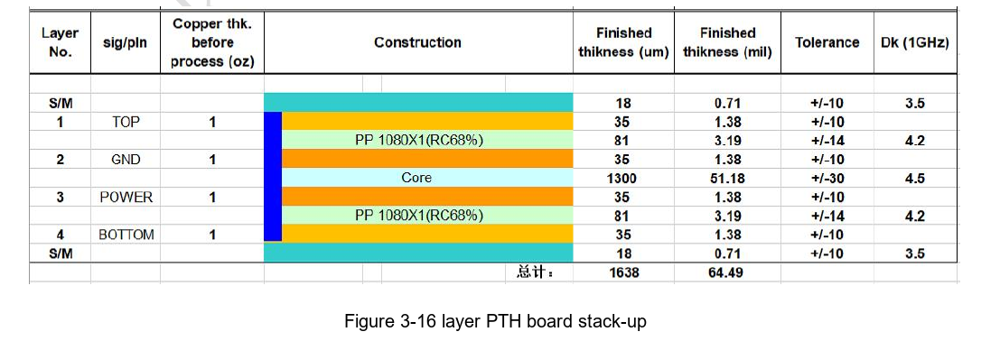
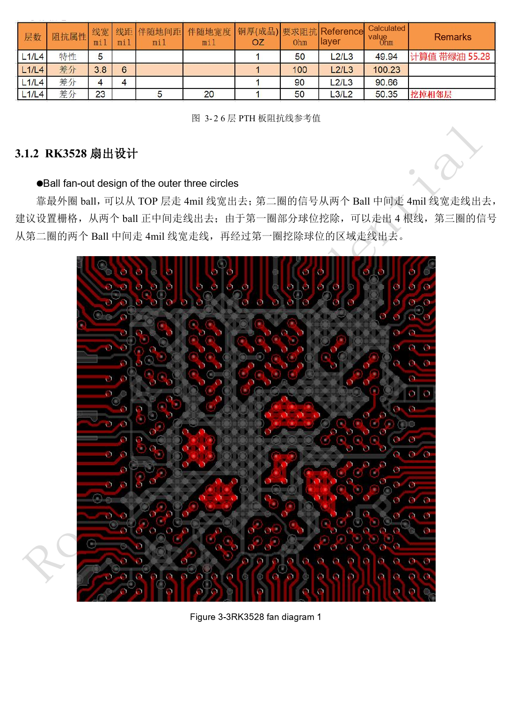
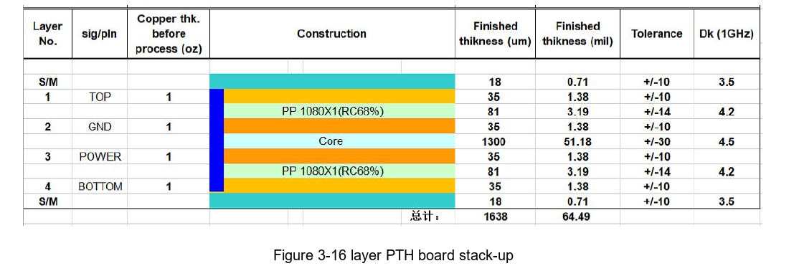
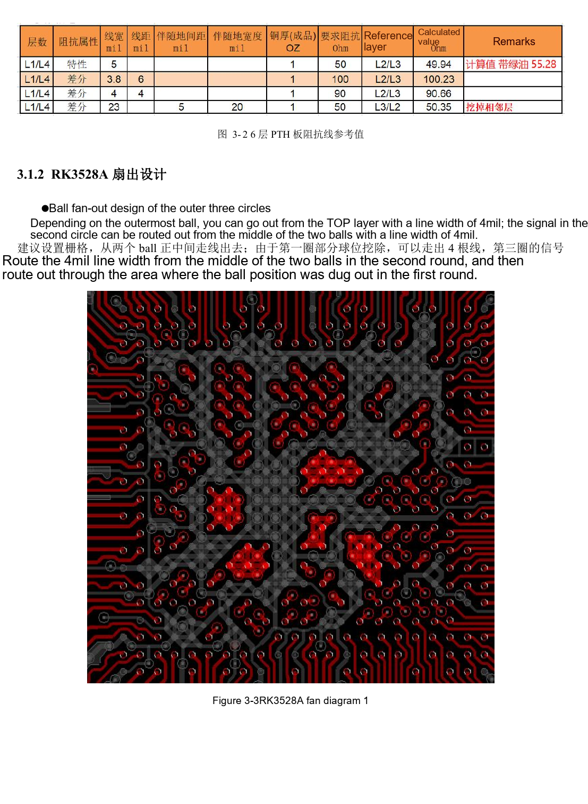

# RK3528 / RK3528A PCB review: stackup, fanout, return paths and protection

This engineering topic is based on the Chinese RK3528 V1.0 (2023-05-25) and RK3528A V1.0 (2023-07-12) hardware guides; it is not a verbatim translation of both PDFs. The discussed chapters are closely aligned, which does not establish drop-in chip compatibility. The official [Sige1 board documentation](https://docs.armsom.org/armsom-sige1) identifies RK3528 in ArmSoM [Sige1](https://www.armsom.org/sige1), providing a product for evaluating related applications. This does not identify Sige1 as an RK3528A board or establish interchangeability of the chips. SoC reference circuits are not the Sige1 schematic. Confirm pins, package, BSP/SDK, kernel and board revision for the actual product. Values are source references, not ArmSoM hardware measurements.

**§3.1–3.3.2; §5; PDF 88–126, 156–158**

## Agree the stackup with the fabricator first

The source text explicitly uses four-layer PTH, with TOP–GND–POWER–BOTTOM, 1.6mm thickness and 1oz copper as the reference. Figure 3-1 and 3-2 captions nevertheless say six layers. Preserve this source contradiction; the captions do not establish a six-layer design. If materials or layer count change, have the fabricator recalculate single-ended and differential impedance. Put ground adjacent to the SoC, signals next to ground where possible, power next to ground, and maintain structural and copper symmetry.

## Fanout must preserve the return path

The outer three BGA-ring example uses 4mil escape traces and gaps in the outer ball pattern. This is a package-, pad- and process-specific template, not a universal board trace width. Plane splits, layer changes and vias alter high-speed return currents. For power, review DC drop, current capacity and decoupling loops before local width. For differential pairs, secure continuous reference ground before tuning length and spacing. Connectors, filters and ESD pads are part of the impedance channel.

## ESD and EMI are not a final added component

Place protection close to connectors so the discharge meets the TVS before the SoC. Shorten ground loops and provide adequate vias. Keep reset, clock and interrupt nets at least 5mm from the board edge. Clock series resistors sit at the source; the guide limits SoC-to-resistor distance to <400mil. Power-plane pullback is suggested as 20H, where H is power-to-ground separation. Generic ESD text gives 2.2–10Ω board-to-board resistance, whereas interface chapters give 22–100Ω; do not apply one global value. Select through waveform, surge and error testing. Shields and heatsinks also need system-level emission checks.

## Reference parameters

| Item | Source value |
| --- | --- |
| Reference stackup text | 4-layer PTH; 1.6mm; 1oz |
| Outer-ring fanout example | 4mil |
| Sensitive-net edge distance | ≥5mm |
| Clock source-to-resistor distance | <400mil |

## Source illustrations and locations

No corresponding English original was supplied. All four languages use the Chinese PDF figures below, labeled separately by chip and physical page; RK3528 images are not presented as RK3528A images.

RK3528 · CN · PDF 88

RK3528 · CN · PDF 89

RK3528A · CN · PDF 88

RK3528A · CN · PDF 89

## Development and documentation

Choose ArmSoM products from their own documentation; this series does not claim that ArmSoM offers an RK3528/RK3528A board. Interface and software experience from existing ArmSoM boards may inform your workflow, but does not make these voltage, pin or PCB rules interchangeable.

- [ArmSoM](https://www.armsom.org/) · [ArmSoM Docs](https://docs.armsom.org/)
- [RK3528 / RK3528A hardware design: nine engineering topics](/articles/rk3528-rk3528a-hardware-design-series/)
- [RK3528 / RK3528A networking and control: RGMII, PHY, UART, I2C and PWM](/articles/rk3528-rk3528a-ethernet-control-interfaces/)
- [RK3528 / RK3528A thermal design and production: cooling, reflow and moisture control](/articles/rk3528-rk3528a-thermal-assembly-storage/)
