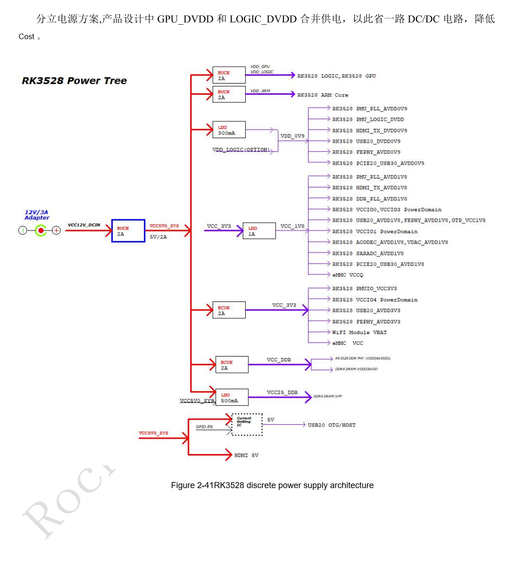
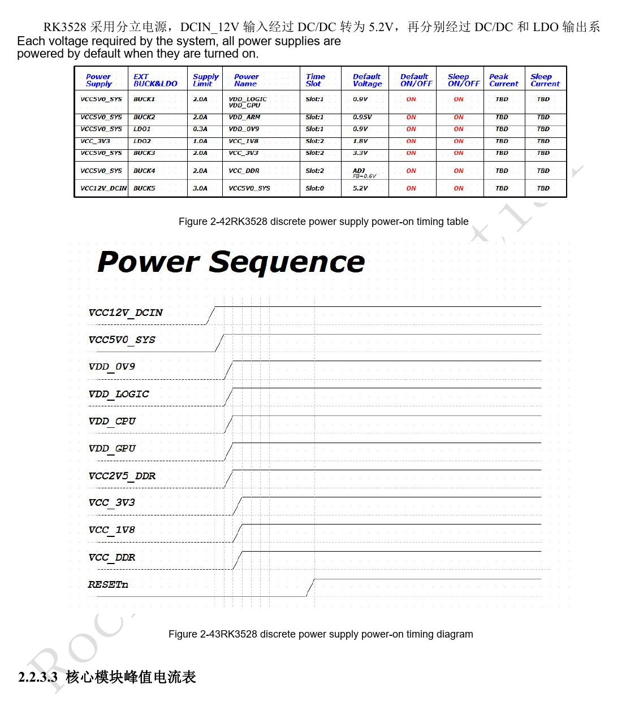
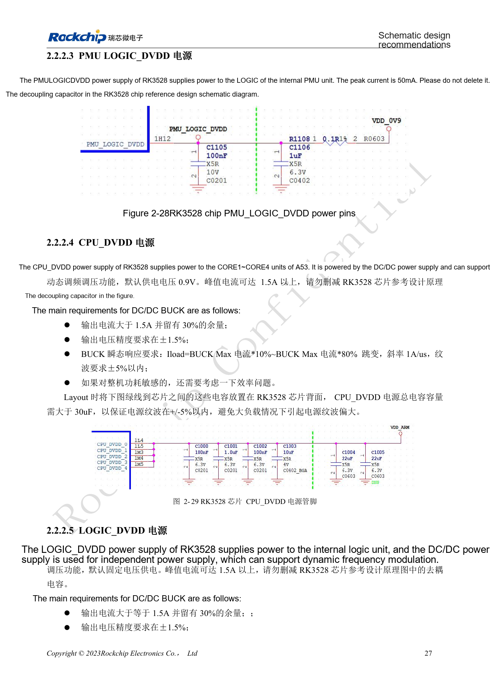
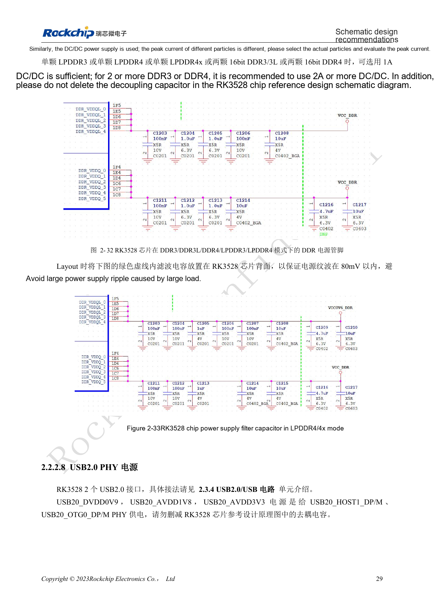
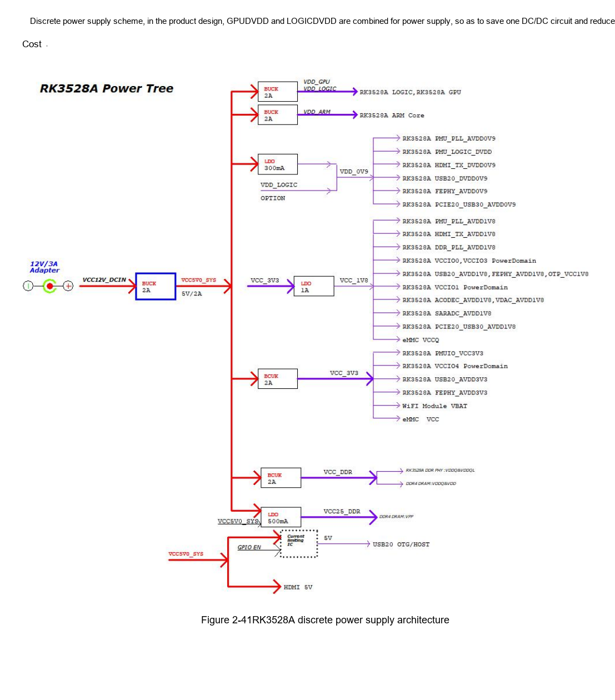
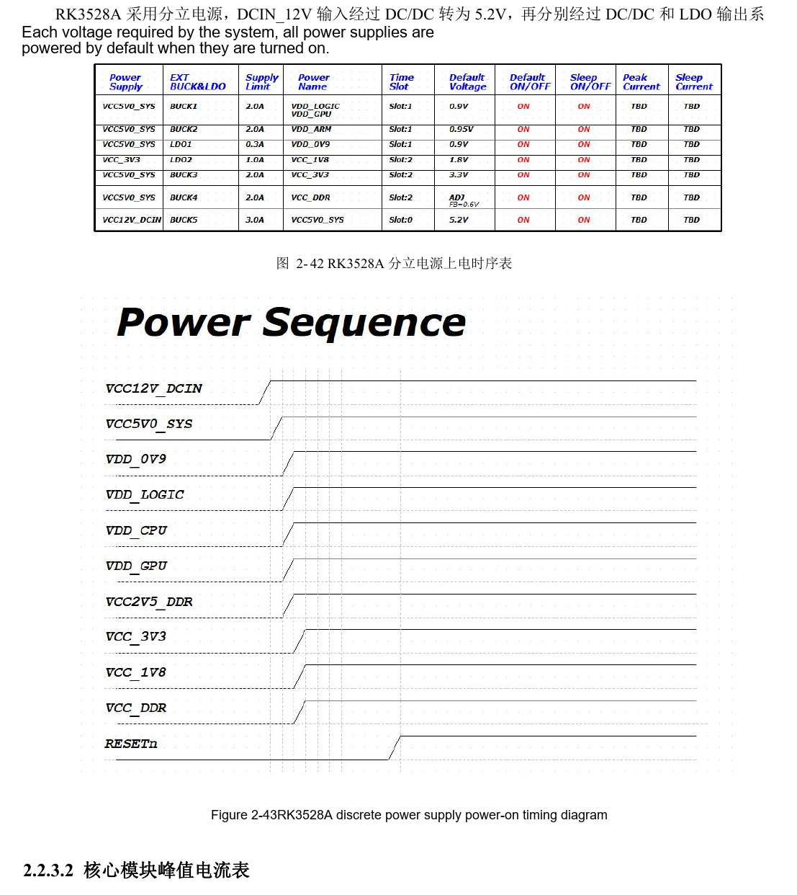
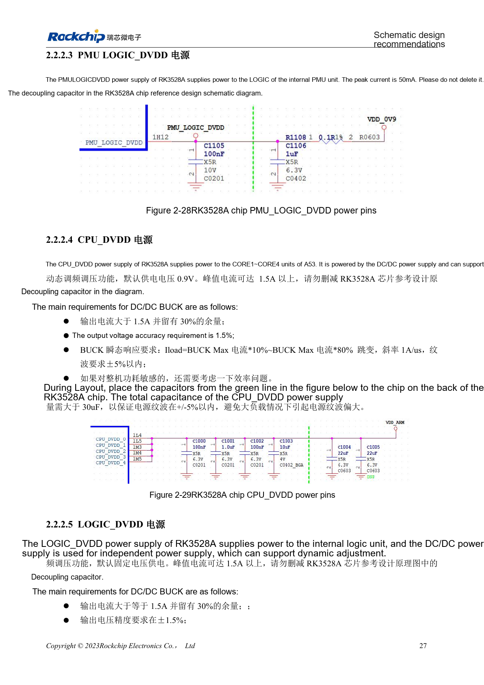
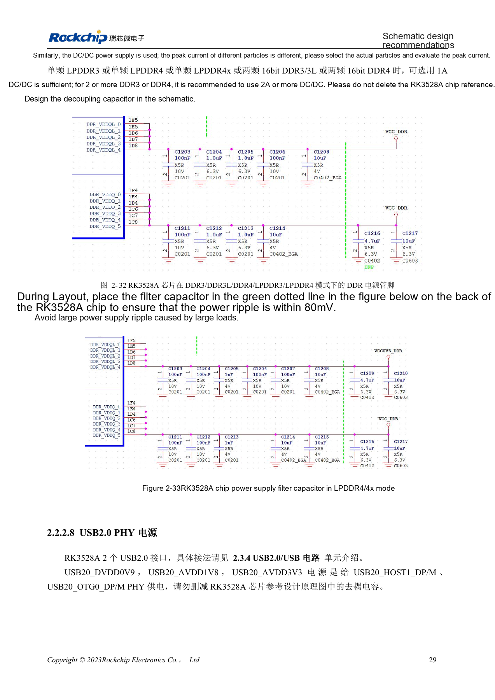

# RK3528 / RK3528A power design: discrete rails, sequencing and load checks

This engineering topic is based on the Chinese RK3528 V1.0 (2023-05-25) and RK3528A V1.0 (2023-07-12) hardware guides; it is not a verbatim translation of both PDFs. The discussed chapters are closely aligned, which does not establish drop-in chip compatibility. The official [Sige1 board documentation](https://docs.armsom.org/armsom-sige1) identifies RK3528 in ArmSoM [Sige1](https://www.armsom.org/sige1), providing a product for evaluating related applications. This does not identify Sige1 as an RK3528A board or establish interchangeability of the chips. SoC reference circuits are not the Sige1 schematic. Confirm pins, package, BSP/SDK, kernel and board revision for the actual product. Values are source references, not ArmSoM hardware measurements.

**§2.2; PDF 37–49; §3.3.2**

## Start with a power-domain inventory

The guides distinguish PLL, logic, CPU, GPU, DDR, IO and analog PHY supplies. VCCIO0–4 accept 1.8V or 3.3V with hardware voltage detection; PMUIO is a fixed-voltage domain. This does not permit mixed peripheral voltages within one domain. List each peripheral supply, pull-up, reset and power-off state to identify back-power paths when an external device starts first.

## Stabilize supplies before releasing reset

Within a module, bring lower voltage up before higher voltage and equal-voltage supplies together. Hold RESETn for at least 10ms after the final rail stabilizes. On shutdown assert RESETn first, then remove the rails. The source example groups 0.9V, 1.8V, 3.3V, DDR and reset; verify actual discrete-regulator dependencies against figures 2-41 through 2-43. A domain marked optional at initial power-up does not authorize arbitrary voltage on its external pins.

## A discrete regulator is more than a current rating

The reference merges GPU_DVDD with LOGIC_DVDD to save one converter; changes require review of dynamic load, voltage drop and software DVFS. The CPU reference default is 0.9V and peak current may exceed 1.5A. The guides require more than 30µF total decoupling for each CPU and LOGIC rail, placed close to the chip with the reference current paths preserved. The PCIe2.0/USB3 Combo PHY still needs power when unused because of internal PLL dependencies. Measure load steps and sequencing at the chip, not only the regulator output.

## Reference parameters

| Item | Source value |
| --- | --- |
| Reset hold | ≥10ms |
| CPU reference default | 0.9V |
| CPU / LOGIC total decoupling | >30µF each |
| DDR ripple reference | <80mV |

## First-power-up supply table

Source table 2-9, PDF page 39. Optional supply applies to the stated first-power-up condition, not to operation of that module. Review suspend and shutdown separately.

| Module | Supply pins | First-power-up requirement |
| --- | --- | --- |
| PLL | PMU_PLL_AVDD0V9, PMU_PLL_AVDD1V8 | Required |
| PMU_DVDD | PMU_LOGIC_DVDD | Required |
| DDR PLL | DDR_PLL_AVDD1V8 | Required |
| DDR VDDQ | DDR VDDQ | Required |
| DDR VDDQL | DDR VDDQL | Required |
| CPU | CPU_DVDD | May be unpowered at first power-up |
| GPU | GPU_DVDD | May be unpowered at first power-up |
| LOGIC | LOGIC_DVDD | Required |
| IO | VCCIO0_VCC, VCCIO2_VCC, VCCIO3_VCC, VCCIO4_VCC | May be unpowered at first power-up |
| PMUIO | PMUIO_VCC3V3 | Required |
| EMMCIO | VCCIO1_VCC | Required |
| USB2.0 PHY | USB20_DVDD0V9, USB20_AVDD1V8, USB20_AVDD3V3 | Required |
| PCIe2.0 / USB3 Combo PHY | PCIE20_USB30_AVDD0V9, PCIE20_USB30_AVDD1V8 | Required |
| SARADC | SARADC_AVDD1V8 | Required |
| OTP | OTP_VCC1V8 | Required |
| HDMI TX PHY | HDMI_TX_DVDD0V9, HDMI_TX0_AVDD1V8 | May be unpowered at first power-up |
| ACODEC PHY | ACODEC_AVDD1V8 | May be unpowered at first power-up |
| VDAC PHY | VDAC_AVDD1V8 | May be unpowered at first power-up |
| FEPHY | FEPHY_AVDD0V9, FEPHY_AVDD1V8, FEPHY_AVDD3V3 | May be unpowered at first power-up |

### PLL

| Rail | Reference peak current | AC reference requirement |
| --- | --- | --- |
| PMU_PLL_AVDD0V9 | 10mA | <20mV |
| PMU_PLL_AVDD1V8 | 10mA | <50mV |
| DDR_PLL_AVDD1V8 | 5mA | <50mV |

## Source illustrations and locations

No corresponding English original was supplied. All four languages use the Chinese PDF figures below, labeled separately by chip and physical page; RK3528 images are not presented as RK3528A images.

RK3528 · CN · PDF 48

RK3528 · CN · PDF 49

RK3528 · CN · PDF 41

RK3528 · CN · PDF 43

RK3528A · CN · PDF 48

RK3528A · CN · PDF 49

RK3528A · CN · PDF 41

RK3528A · CN · PDF 43

## Development and documentation

Choose ArmSoM products from their own documentation; this series does not claim that ArmSoM offers an RK3528/RK3528A board. Interface and software experience from existing ArmSoM boards may inform your workflow, but does not make these voltage, pin or PCB rules interchangeable.

- [ArmSoM](https://www.armsom.org/) · [ArmSoM Docs](https://docs.armsom.org/)
- [RK3528 / RK3528A hardware design: nine engineering topics](/articles/rk3528-rk3528a-hardware-design-series/)
- [RK3528 / RK3528A boot and debug: clocks, reset, Maskrom and UART](/articles/rk3528-rk3528a-boot-clock-debug/)
- [RK3528 / RK3528A DDR: topology, rails, swapping rules and PCB](/articles/rk3528-rk3528a-ddr-circuit-routing/)
