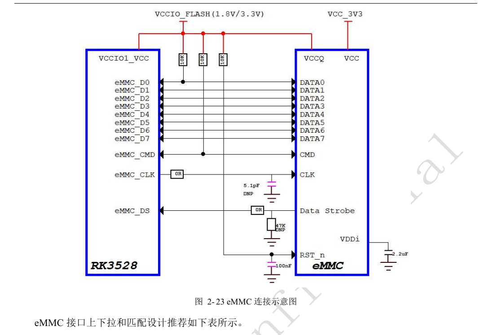
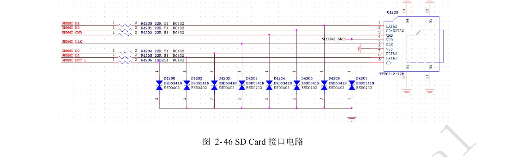
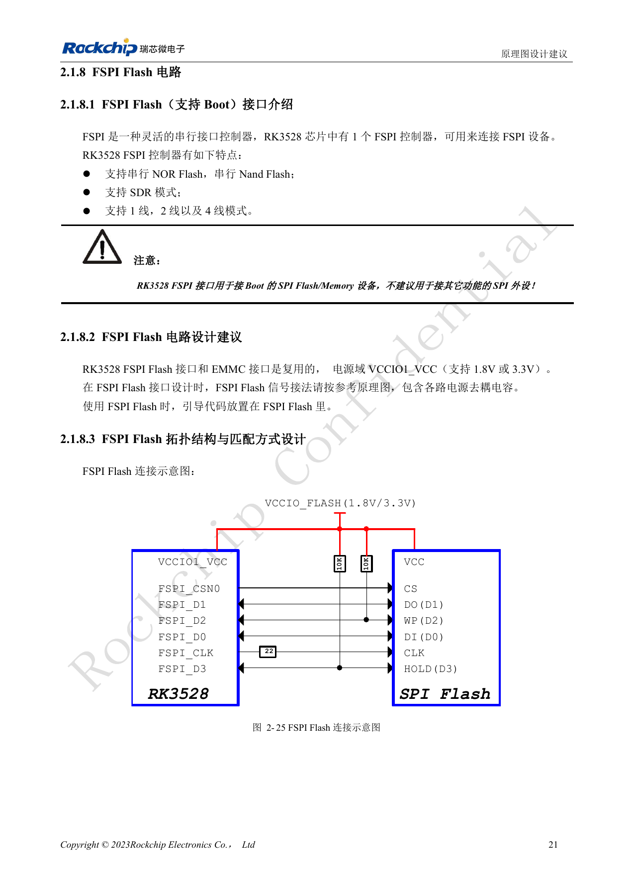
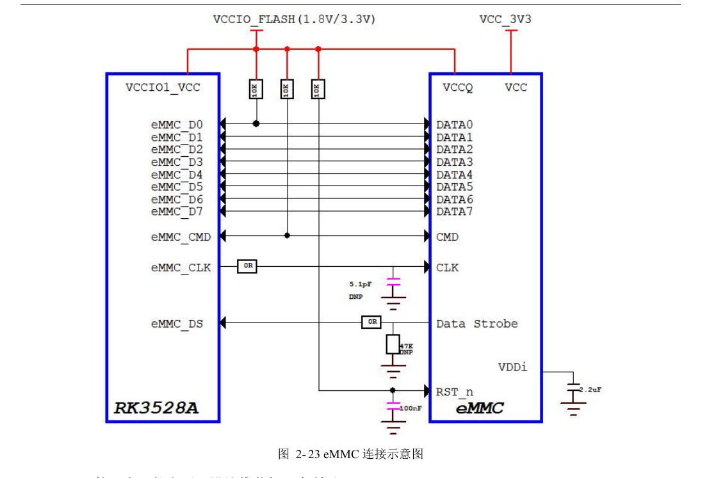
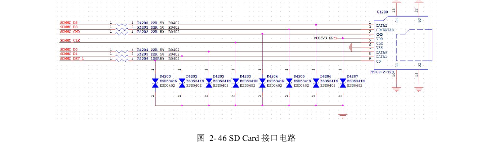
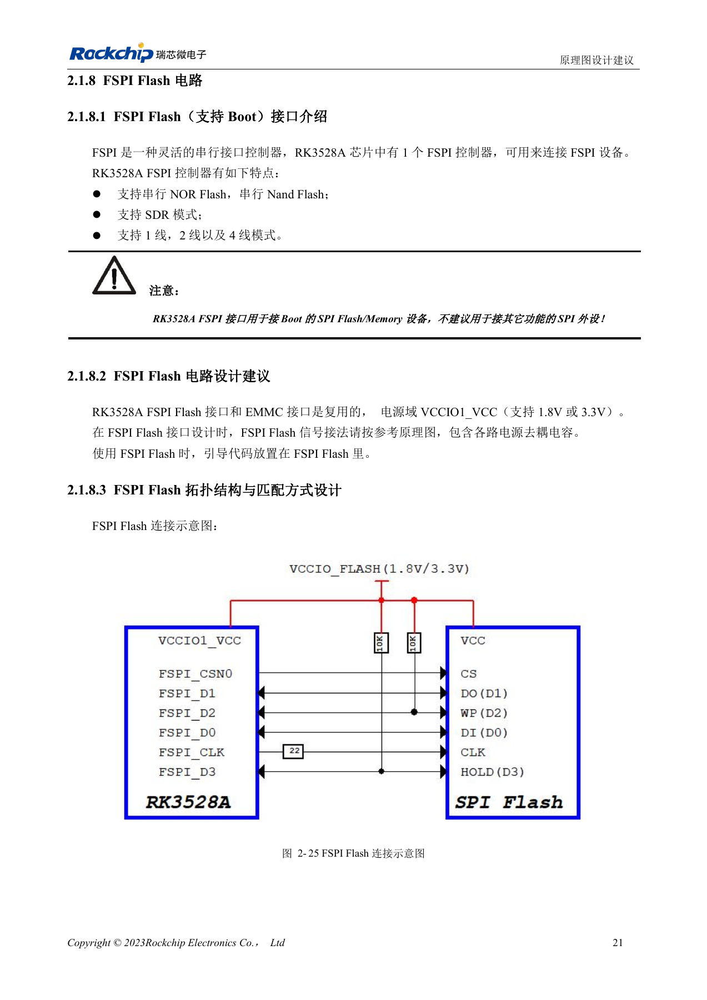

# RK3528 / RK3528A storage and wireless interfaces: eMMC, FSPI, SDMMC and SDIO

This engineering topic is based on the Chinese RK3528 V1.0 (2023-05-25) and RK3528A V1.0 (2023-07-12) hardware guides; it is not a verbatim translation of both PDFs. The discussed chapters are closely aligned, which does not establish drop-in chip compatibility. The official [Sige1 board documentation](https://docs.armsom.org/armsom-sige1) identifies RK3528 in ArmSoM [Sige1](https://www.armsom.org/sige1), providing a product for evaluating related applications. This does not identify Sige1 as an RK3528A board or establish interchangeability of the chips. SoC reference circuits are not the Sige1 schematic. Confirm pins, package, BSP/SDK, kernel and board revision for the actual product. Values are source references, not ArmSoM hardware measurements.

**§2.1.7–2.1.8; §2.3.1; PDF 32–36, 50–54, 145–147**

## Plan eMMC and FSPI as shared resources

eMMC and FSPI share pins in VCCIO1_VCC (1.8V/3.3V); do not treat them as two unconditionally concurrent interfaces. eMMC supports 5.1, 1/4/8bit and HS400. Preserve external 10kΩ pull-ups on CMD and D0, 22Ω on CLK at the SoC, and 0Ω on Strobe at the eMMC with provision for a 47kΩ pull-down. A single SoC IO supply does not remove the memory device’s VCC/VCCQ sequencing requirements. Device substitutions also require support-list and boot-firmware review.

## Use FSPI for boot storage

FSPI supports serial NOR/NAND, SDR and 1/2/4-wire modes; the guides discourage using it for ordinary SPI peripherals. Flash supply must match its IO domain. Reserve 10kΩ external pull-ups on D2/D3 and 22Ω on CLK at the SoC. eMMC routing references are 50Ω±10%, CLK/STRB-to-data mismatch <120mil, length <3in and preferably no more than two vias. FSPI uses 50Ω±10%, CLK-to-data mismatch <200mil and length <4in. Apply limits to the complete channel including connectors and daughterboards.

## Separate SDMMC boot from SDIO wireless

SDIO0/1 belong to VCCIO0/VCCIO3 and do not support System Boot; SDMMC also depends on the sampled SDMMC_DET state. SDMMC data, command and clock use 22Ω series resistors, DET 100Ω. Keep 22Ω on SDIO CLK; decide data/command resistance from short-trace signal integrity. SDMMC/SDIO routing uses 50Ω±10%, clock-to-data mismatch <120mil; length <4in for 50MHz<CLK≤200MHz and <6in for CLK≤50MHz. Wireless integration also needs UART/PCM direction, 32.768kHz amplitude and antenna-matching checks; preserve antenna keepouts.

## eMMC clock-resistor inconsistency

Figure 2-23 on PDF page 33 labels the CLK series resistor 0Ω, while table 2-5 on the same page recommends 22Ω. The text preserves the table recommendation and the image remains unchanged. Resolve actual population through the selected device, BSP and waveform measurements rather than silently editing the source diagram.

## Reference parameters

| Item | Source value |
| --- | --- |
| eMMC length | <3in |
| FSPI length | <4in |
| eMMC CMD / D0 pull-up | 10kΩ |
| SDIO boot | Not supported |

## Source illustrations and locations

No corresponding English original was supplied. All four languages use the Chinese PDF figures below, labeled separately by chip and physical page; RK3528 images are not presented as RK3528A images.

RK3528 · CN · PDF 33

RK3528 · CN · PDF 52

RK3528 · CN · PDF 35

RK3528A · CN · PDF 33

RK3528A · CN · PDF 52

RK3528A · CN · PDF 35

## Development and documentation

Choose ArmSoM products from their own documentation; this series does not claim that ArmSoM offers an RK3528/RK3528A board. Interface and software experience from existing ArmSoM boards may inform your workflow, but does not make these voltage, pin or PCB rules interchangeable.

- [ArmSoM](https://www.armsom.org/) · [ArmSoM Docs](https://docs.armsom.org/)
- [RK3528 / RK3528A hardware design: nine engineering topics](/articles/rk3528-rk3528a-hardware-design-series/)
- [RK3528 / RK3528A DDR: topology, rails, swapping rules and PCB](/articles/rk3528-rk3528a-ddr-circuit-routing/)
- [RK3528 / RK3528A USB and PCIe: shared PHY and channel review](/articles/rk3528-rk3528a-usb-pcie-design/)
