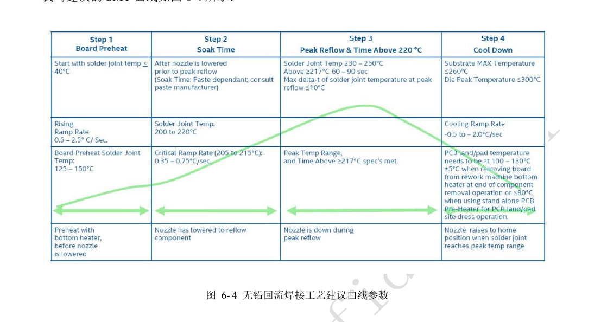
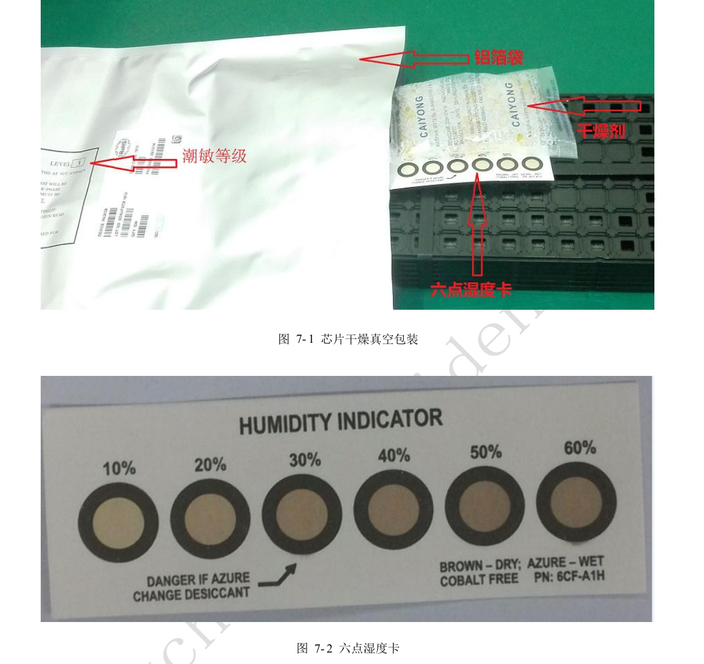
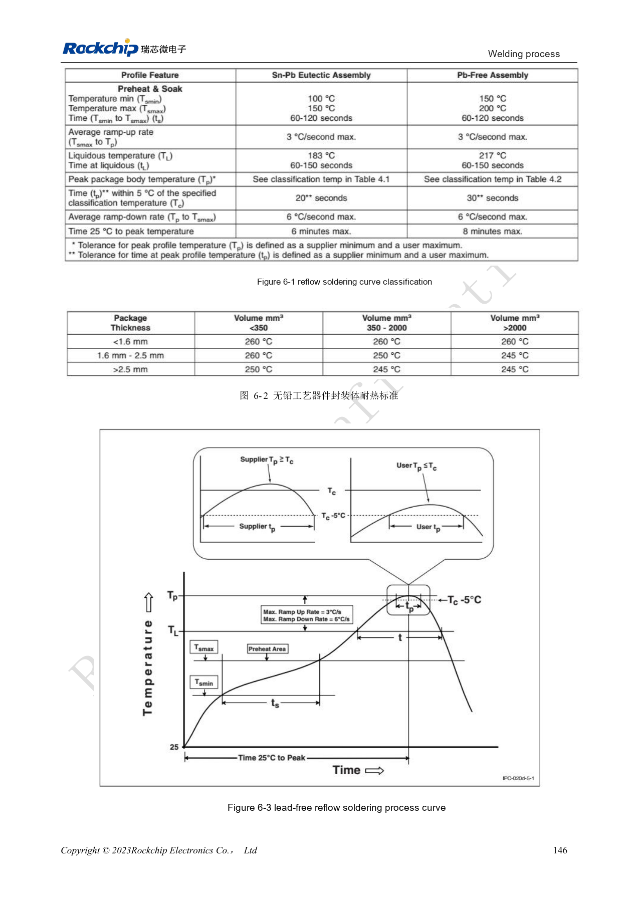
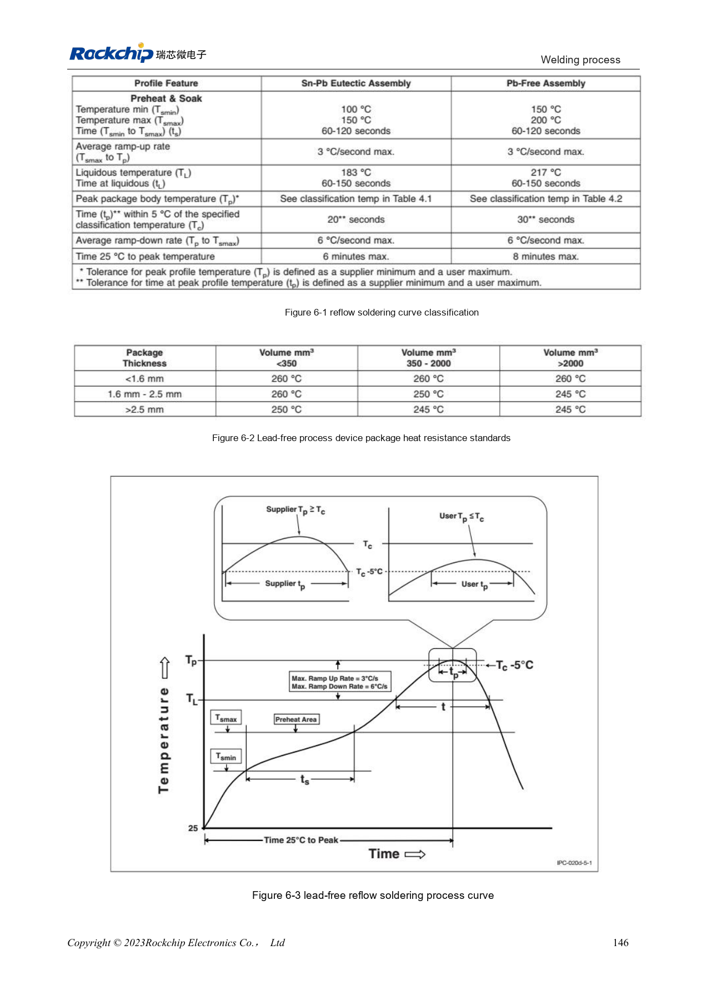

# RK3528 / RK3528A thermal design and production: cooling, reflow and moisture control

This engineering topic is based on the Chinese RK3528 V1.0 (2023-05-25) and RK3528A V1.0 (2023-07-12) hardware guides; it is not a verbatim translation of both PDFs. The discussed chapters are closely aligned, which does not establish drop-in chip compatibility. The official [Sige1 board documentation](https://docs.armsom.org/armsom-sige1) identifies RK3528 in ArmSoM [Sige1](https://www.armsom.org/sige1), providing a product for evaluating related applications. This does not identify Sige1 as an RK3528A board or establish interchangeability of the chips. SoC reference circuits are not the Sige1 schematic. Confirm pins, package, BSP/SDK, kernel and board revision for the actual product. Values are source references, not ArmSoM hardware measurements.

**§4, §6–7; PDF 152–164**

## Thermal simulation is not an ArmSoM measurement

The source uses FEM on a 140×180mm, 1.6mm, four-layer JEDEC PCB without a heatsink. Real enclosures, copper area, airflow and workload differ; simulation resistance cannot establish real junction temperature or sustained performance. The Linux section lists Power allocator, Step wise, Fair share and Userspace, with Power_allocator as the default. Verify thresholds, throttling and recovery in the actual BSP, and record sustained frequency, ambient temperature and hot spots rather than one temperature screenshot.

## Layout and assembly both affect reliability

The guide suggests roughly 20–50mm between SoC and DC/DC to avoid concentrated heat. Size high-current copper for its load; preferably give each ground ball a via, with a minimum reference of one via per 1.5 balls. Reflow profiles are vendor process references and need adjustment for actual thermal mass, oven and paste. The source specifies paste storage at 2–10°C, warming for 3–4h, then manual mixing for 3–5min or mechanical mixing for 3min. These are not universal release criteria for every paste brand; manufacturing records must identify the actual material and qualified process.

## Manage MSL3 with cumulative exposure time

Both guides classify the chip as MSL3. Cumulative time from bag opening to reflow is 168h at ≤30°C/60%RH; the source also specifies dry storage below 10%RH. Vacuum-packed storage reference is ≤40°C and <90%RH for 12 months. For exceeded exposure or an abnormal humidity card, use the re-bake table and package label. The MSL1 row contains the anomalous “≤300°C”; it is retained in review notes and not used as storage guidance. The table below gives source minimum bake times for thickness ≤1.4mm, MSL3, not arbitrary assembled boards or batteries.

## Reference parameters

| Item | Source value |
| --- | --- |
| Bake 125°C +10/−0°C: exceeded >72h / ≤72h | 9h / 7h |
| Bake 90°C +8/−0°C: exceeded >72h / ≤72h | 33h / 23h |
| Bake 40°C +5/−0°C: exceeded >72h / ≤72h | 13 days / 9 days |

## Source illustrations and locations

No corresponding English original was supplied. All four languages use the Chinese PDF figures below, labeled separately by chip and physical page; RK3528 images are not presented as RK3528A images.

RK3528 · CN · PDF 161

RK3528 · CN · PDF 163

RK3528 · CN · PDF 160

RK3528A · CN · PDF 161

RK3528A · CN · PDF 163

RK3528A · CN · PDF 160

## Development and documentation

Choose ArmSoM products from their own documentation; this series does not claim that ArmSoM offers an RK3528/RK3528A board. Interface and software experience from existing ArmSoM boards may inform your workflow, but does not make these voltage, pin or PCB rules interchangeable.

- [ArmSoM](https://www.armsom.org/) · [ArmSoM Docs](https://docs.armsom.org/)
- [RK3528 / RK3528A hardware design: nine engineering topics](/articles/rk3528-rk3528a-hardware-design-series/)
- [RK3528 / RK3528A PCB review: stackup, fanout, return paths and protection](/articles/rk3528-rk3528a-pcb-stackup-signal-integrity/)
