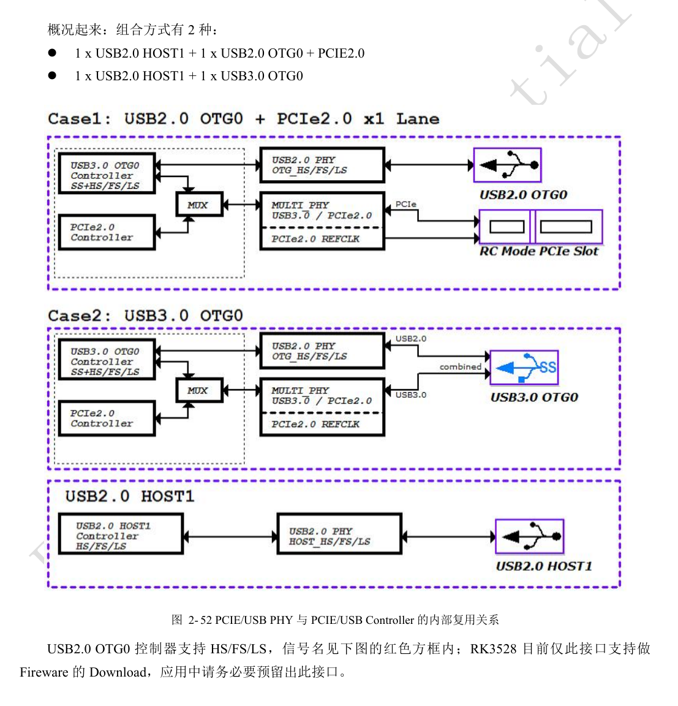
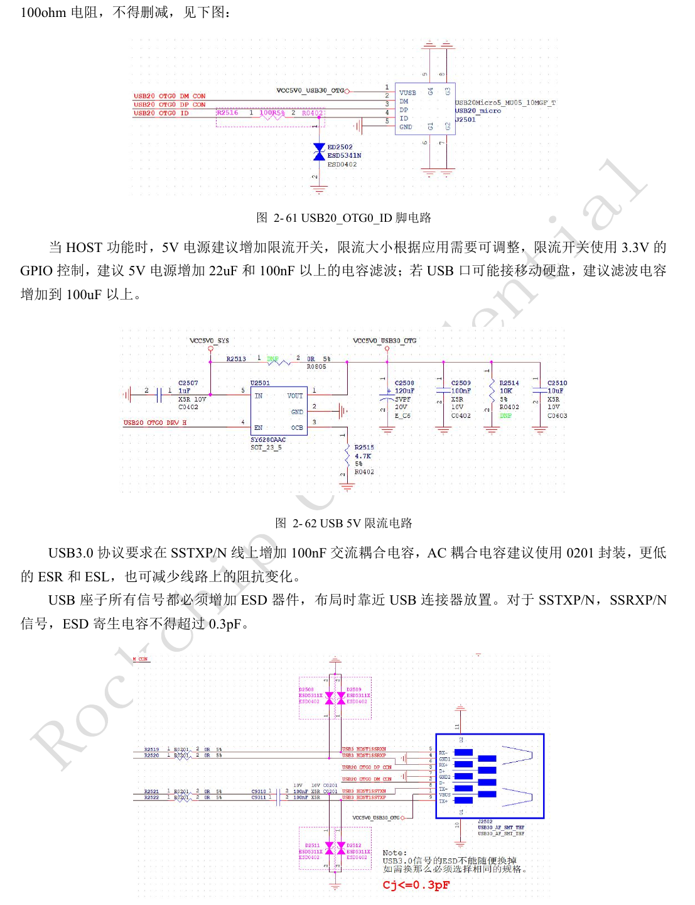
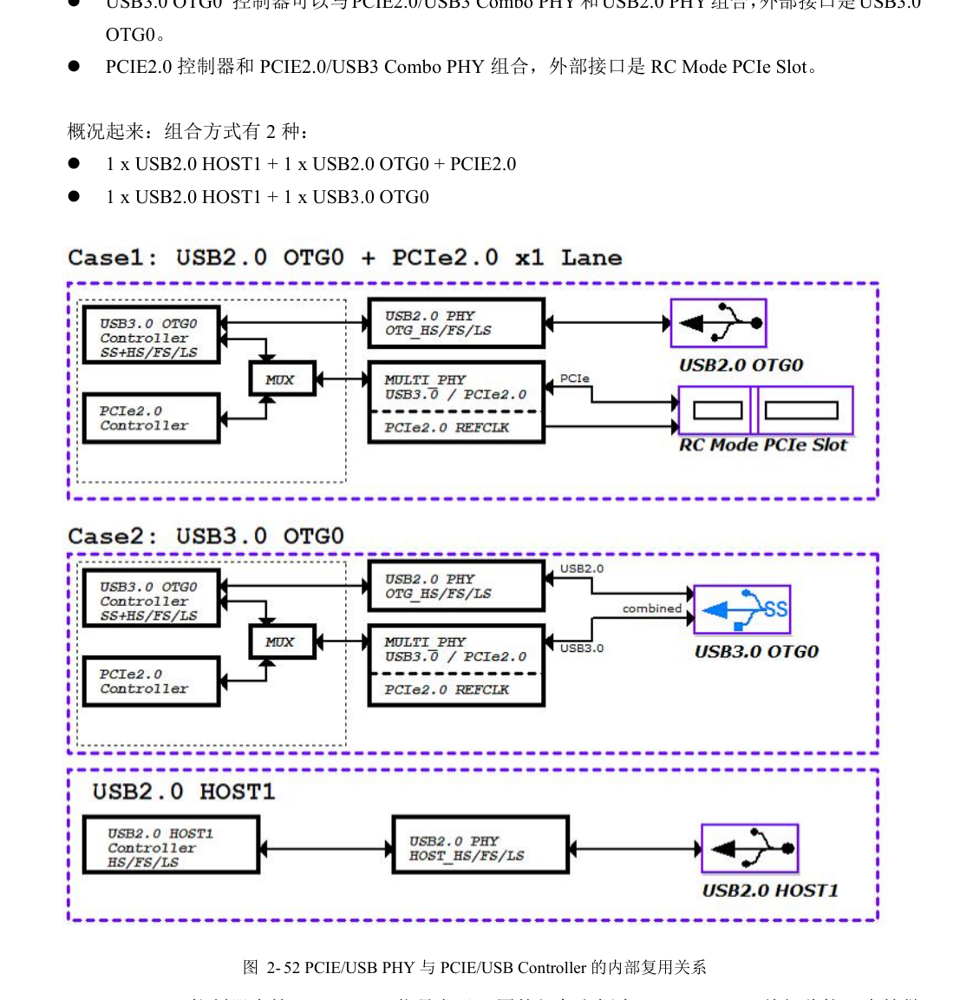
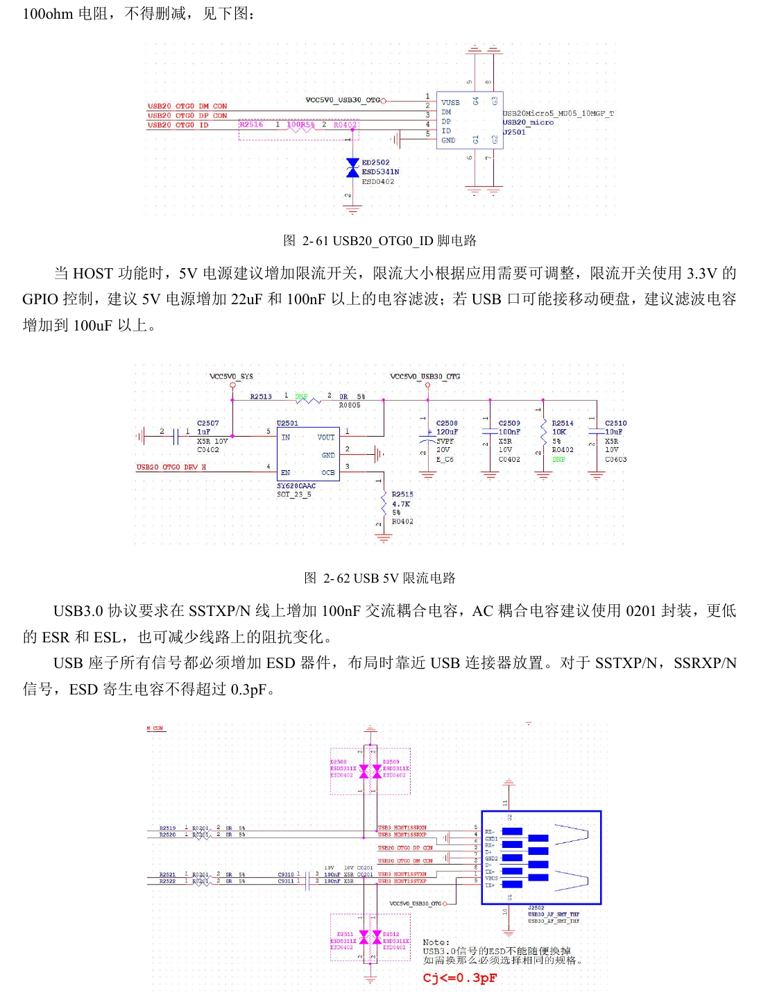
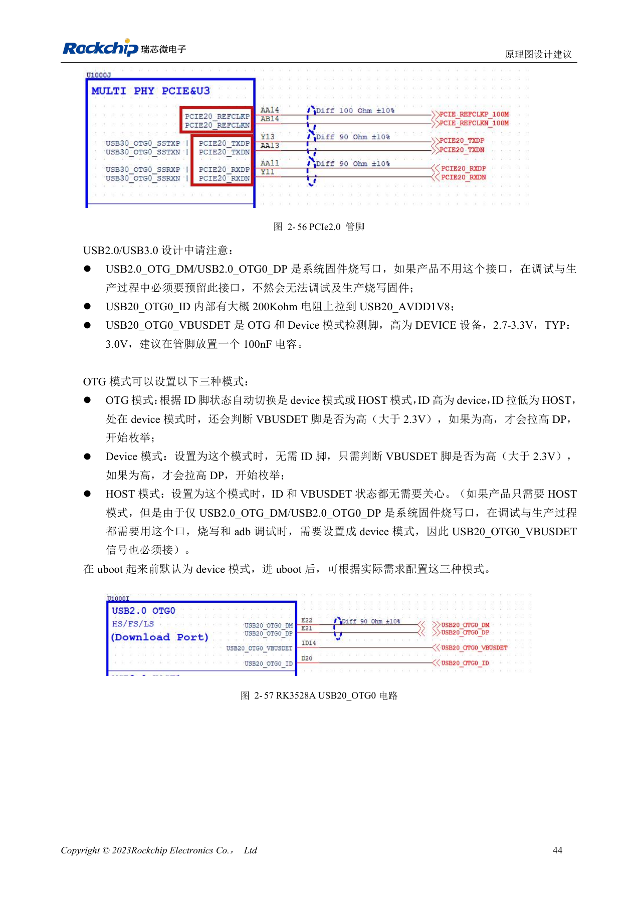

# RK3528 / RK3528A USB and PCIe: shared PHY and channel review

This engineering topic is based on the Chinese RK3528 V1.0 (2023-05-25) and RK3528A V1.0 (2023-07-12) hardware guides; it is not a verbatim translation of both PDFs. The discussed chapters are closely aligned, which does not establish drop-in chip compatibility. The official [Sige1 board documentation](https://docs.armsom.org/armsom-sige1) identifies RK3528 in ArmSoM [Sige1](https://www.armsom.org/sige1), providing a product for evaluating related applications. This does not identify Sige1 as an RK3528A board or establish interchangeability of the chips. SoC reference circuits are not the Sige1 schematic. Confirm pins, package, BSP/SDK, kernel and board revision for the actual product. Values are source references, not ArmSoM hardware measurements.

**§2.3.4; PDF 55–61, 141–145**

## Choose the combination before drawing connectors

Two USB2 PHYs and one PCIe2.0/USB3 Combo PHY do not imply all ports operate simultaneously. The guides list USB2 HOST1 + USB2 OTG0 + PCIe2.0, or USB2 HOST1 + USB3 OTG0. PCIe operates as RC. USB2 OTG0 is the firmware-download path: preserve D+/D− and VBUSDET for production and debug even if the product has no user USB port. Firmware, device tree and schematic allocation should share one resource matrix.

## Review power, termination and protection together

USB HOST 5V should use a current-limited switch with at least 22µF and 100nF filtering. For portable drives the source recommends more than 100µF, followed by actual inrush and switch-capability checks. USB2 data uses 2.2Ω; USB3 TX uses 100nF, preferably 0201, and RX reserves 0Ω. When used, OTG ID requires 100Ω and ESD protection. The circuit chapter gives USB3 ESD capacitance ≤0.3pF while the PCB table gives ≤0.2pF. Keep both references visible, review against the tighter budget and validate the selected part.

## Turn PCB values into explicit constraints

PCIe data uses differential 90Ω±10%, intra-pair mismatch <6mil, length <6in; REFCLK uses 100Ω±10% and mismatch <12mil, with preferably at most two vias. USB3 uses 90Ω±10%, mismatch <6mil, HOST length <6in and Device/OTG <5in, preferably at most two vias. USB2 uses 90Ω±10%, mismatch <20mil and length <6in; preferably at most four vias and never more than six. The PCIe table’s inter-pair matching entry is <6in without a meaningful timing explanation; do not treat it as a precise skew budget. Stitch guard ground at ≤300mil and preserve continuous reference ground.

## Reference parameters

| Item | Source value |
| --- | --- |
| USB3 / PCIe data impedance | 90Ω ±10% |
| PCIe REFCLK impedance | 100Ω ±10% |
| USB3 ESD: two source limits | ≤0.3pF / ≤0.2pF |

## Source illustrations and locations

No corresponding English original was supplied. All four languages use the Chinese PDF figures below, labeled separately by chip and physical page; RK3528 images are not presented as RK3528A images.

RK3528 · CN · PDF 56

RK3528 · CN · PDF 60

RK3528 · CN · PDF 58

RK3528A · CN · PDF 56

RK3528A · CN · PDF 60

RK3528A · CN · PDF 58

## Development and documentation

Choose ArmSoM products from their own documentation; this series does not claim that ArmSoM offers an RK3528/RK3528A board. Interface and software experience from existing ArmSoM boards may inform your workflow, but does not make these voltage, pin or PCB rules interchangeable.

- [ArmSoM](https://www.armsom.org/) · [ArmSoM Docs](https://docs.armsom.org/)
- [RK3528 / RK3528A hardware design: nine engineering topics](/articles/rk3528-rk3528a-hardware-design-series/)
- [RK3528 / RK3528A storage and wireless interfaces: eMMC, FSPI, SDMMC and SDIO](/articles/rk3528-rk3528a-storage-sdio-design/)
- [RK3528 / RK3528A display and audio: HDMI, CVBS, TSI and analog layout](/articles/rk3528-rk3528a-display-audio-design/)
