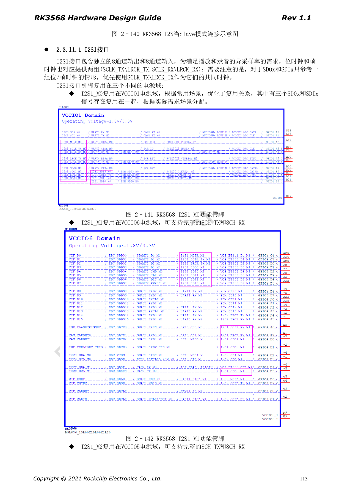
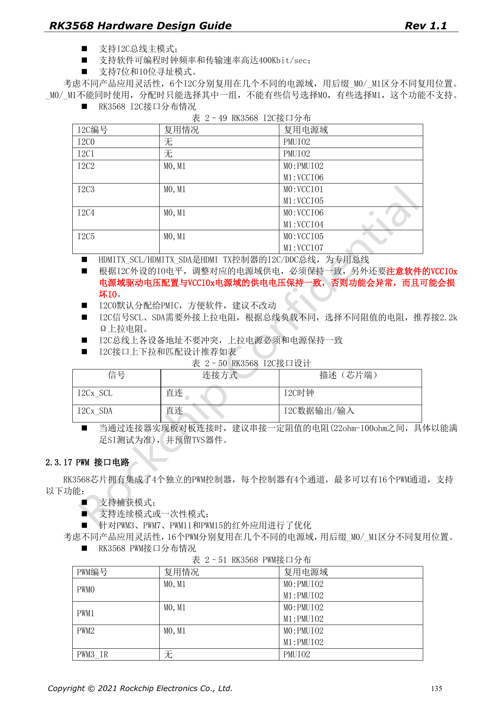

# RK3568 audio and control: I2S, UART, SPI, CAN and I2C

This series reorganizes RK3568 Hardware Design Guide V1.1 (Chinese, 2021-06-08) and the separate High Speed PCB Design Guide V1.0.0 (English, 2021-04-12) around engineering questions. ArmSoM [Sige3](https://www.armsom.org/sige3) uses RK3568B2. Its [board documentation](https://docs.armsom.org/armsom-sige3) provides a product reference for studying and evaluating these design topics. SoC reference circuits do not describe every Sige3 circuit or exposed interface. Confirm SDK/BSP, kernel, silicon revision, firmware and peripheral combinations. Values are source references, not ArmSoM hardware measurements.

**CN V1.1 §2.3.11; §2.3.13–2.3.17 · PDF 111–125,132–137**

## Internal audio is not an external pin group

Of four I2S controllers, I2S0 connects internally to HDMI2.0 TX and is not muxed to external IO. I2S1 provides 8 TX + 8 RX with I2S/PCM/TDM; I2S2 and I2S3 each provide 2 TX + 2 RX with I2S/PCM. The source lists 16–32-bit, up to 192kHz and master/slave operation, but protocol modes on one controller are mutually exclusive. Decide codec roles, MCLK/BCLK/LRCK, analog supply and IO levels together.

## Select mux groups as a whole

M0/M1/M2 on UART, SPI and CAN describe alternative locations of one function, not independent ports: TX_M0 cannot be paired with RX_M1. The source counts 10 UARTs, four general SPI, three CAN, six I2C and up to 16 PWM channels. These are controller resources, not a guarantee that a board exposes them. GPIO suffixes _u/_d/_z mean reset pull-up/pull-down/high-impedance; review reset and peripheral startup states.

## I2C, SPI and board-to-board wiring

I2C0 is reserved for the PMIC by default. The recommended SCL/SDA pull-up is 2.2kΩ, adjusted for bus loading and tied to the correct IO rail. Avoid address conflicts; HDMI DDC is dedicated. General SPI uses a reference 22Ω clock resistor and supports 4/8/16-bit, master/slave and full/half duplex. Validate series resistance, TVS, grounding and cable together on board-to-board links; bare SoC IO is not a field-level industrial interface.

## Resolve the CAN-rate wording

Page 134 lists CAN 2.0B together with 1Mbps and 8Mbps without clearly separating protocol modes or rate phases. This does not establish classical CAN at 8Mbps or verified CAN FD. Check the TRM, controller driver, transceiver and bus configuration. For PWM infrared reception, verify that the selected IO domain remains powered and can wake the system in standby.

## Source parameters and constraints

| Item | Source reference |
| --- | --- |
| I2S0 | internal HDMI |
| I2S1 | 8 TX + 8 RX |
| I2S2 / I2S3 | 2 TX + 2 RX each |
| I2C | ≤400Kbit/sec; 7-bit / 10-bit |
| SPI | 4 / 8 / 16-bit; CLK 22Ω |

## Source figures

The source-page screenshots preserve circuit labels and context; article text and parameter tables remain editable. No matching English edition of the main Chinese guide was supplied, so its figures remain Chinese in all four languages. Images from the separate English PCB guide are labeled accordingly. Page references are physical PDF pages.

Chinese hardware guide · PDF 113

Chinese hardware guide · PDF 135

## Further reading and development resources

- [RK3568 hardware design: 10 circuit, PCB and production topics](/articles/rk3568-hardware-design-series/)
- [RK3568 display and cameras: VOP, MIPI, HDMI and power](/articles/rk3568-display-camera-hardware/)
- [RK3568 PCB design: stackup, escape routing and return paths](/articles/rk3568-pcb-stackup-return-path-design/)
- [ArmSoM Docs](https://docs.armsom.org/)
- [ArmSoM](https://www.armsom.org/)
