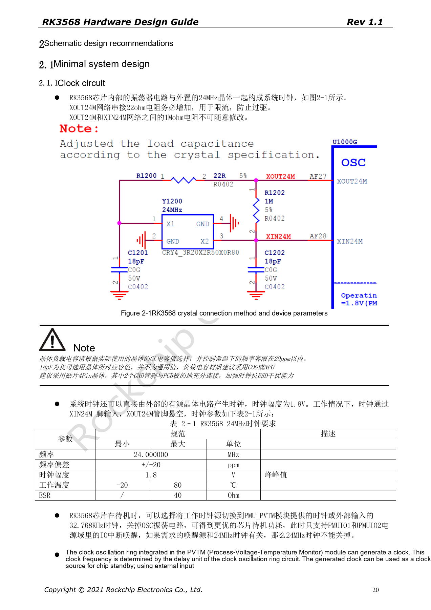
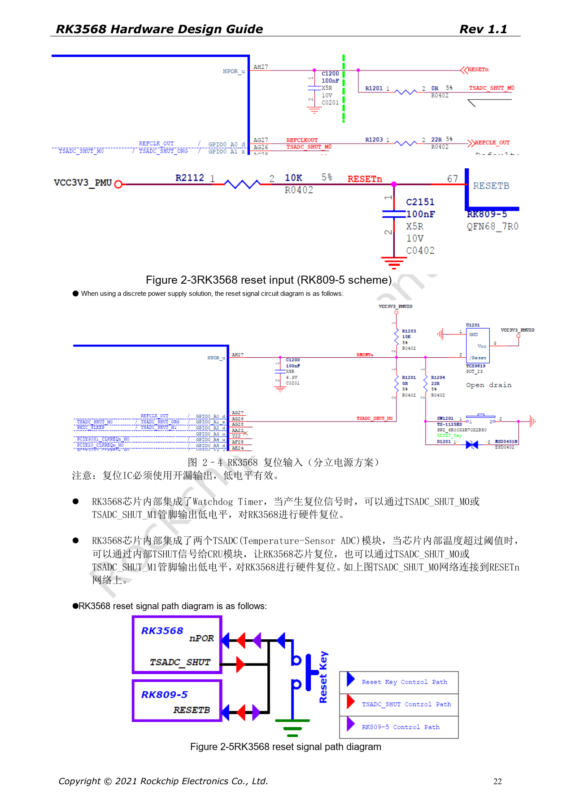

# RK3568 minimum system: clocks, reset, boot and debug

This series reorganizes RK3568 Hardware Design Guide V1.1 (Chinese, 2021-06-08) and the separate High Speed PCB Design Guide V1.0.0 (English, 2021-04-12) around engineering questions. ArmSoM [Sige3](https://www.armsom.org/sige3) uses RK3568B2. Its [board documentation](https://docs.armsom.org/armsom-sige3) provides a product reference for studying and evaluating these design topics. SoC reference circuits do not describe every Sige3 circuit or exposed interface. Confirm SDK/BSP, kernel, silicon revision, firmware and peripheral combinations. Values are source references, not ArmSoM hardware measurements.

**CN V1.1 §2.1.1–2.1.6; §2.3.2; §3.2.1 · PDF 20–25, 72, 141–142**

## Start with a recoverable system

Review the 24MHz clock, reset, rails, boot storage, download USB and debug UART as one chain. The source boot order is serial NOR (FSPI), serial NAND (FSPI), NAND, eMMC, then SDMMC0. When none contains valid boot code, downloading uses USB3_OTG0_DP/DM; preserve VBUSDET too. Even a product without a user-facing USB data port needs a manufacturing and recovery path.

## Do not copy crystal loading blindly

The XOUT24M series resistor is 22Ω for current limiting, with 1MΩ between XOUT24M and XIN24M. The illustrated 18pF belongs to the reference crystal: select capacitors from actual CL and parasitics, preferably C0G/NP0. A 1.8V active clock enters XIN24M with XOUT24M open. Place the crystal close to the SoC on the same side, retain continuous adjacent ground and keep other traces out of its projection; the reference ground-via interval is 200–300mil.

## Stabilize reset and straps before boot

NPOR is AH27, active low, with 100nF near the pin. Match the reset pull-up to PMUIO1 and use an open-drain supervisor. The source says “100 cycles at 24MHz, at least 4µs”; 100/24MHz is approximately 4.17µs. Meet the cycle requirement without rounding down. FLASH_VOL_SEL must be 1 for VCCIO2=1.8V and 0 for 3.3V. SDMMC0_DET=0 selects SDMMC0; 1 selects ARM JTAG.

## Keep debug and standby boundaries explicit

Retain the 100Ω resistors and TVS on UART2_RX_M0/TX_M0. Page 25 prints the baud rate as “1500000M”; this is recorded as a source issue, not a usable serial setting. Check the actual loader/U-Boot configuration. Before disabling 24MHz, verify that wake sources do not need it. Preserve the SARADC_VIN0 10kΩ pull-up to 1.8V. Recovery-key entry into Loader depends on the corresponding firmware being present and must not be confused with Maskrom.

## Source parameters and constraints

| Item | Source reference |
| --- | --- |
| 24MHz | ±20ppm; 1.8V; ESR ≤40Ω |
| 32.768kHz | ±30ppm; 50%; 0.65×VDD … VDD+0.3V (PMUIO2) |
| NPOR | 100 × (1/24MHz) ≈4.17µs; 100nF |
| FLASH_VOL_SEL | 1 → 1.8V; 0 → 3.3V |

## Source figures

The source-page screenshots preserve circuit labels and context; article text and parameter tables remain editable. No matching English edition of the main Chinese guide was supplied, so its figures remain Chinese in all four languages. Images from the separate English PCB guide are labeled accordingly. Page references are physical PDF pages.

Chinese hardware guide · PDF 20

Chinese hardware guide · PDF 22

## Further reading and development resources

- [RK3568 hardware design: 10 circuit, PCB and production topics](/articles/rk3568-hardware-design-series/)
- [RK3568 power and IO domains: RK809-5, discrete rails and standby](/articles/rk3568-power-io-domain-hardware/)
- [ArmSoM Docs](https://docs.armsom.org/)
- [ArmSoM](https://www.armsom.org/)
