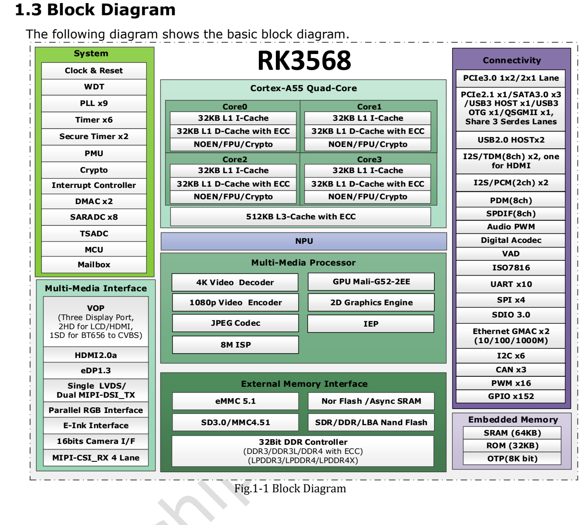

This task-focused guide explains the source with key specifications, limitations and original figures. It is not a page-by-page translation or a complete pin/register manual. Vendor examples are not ArmSoM measurements. Check the actual board revision, schematic, SDK/BSP, kernel and drivers before applying them; no new hardware validation was performed for this article.

**Primary source：** `Rockchip RK3568 Datasheet V1.2-20210601.pdf` · PDF 62 pages.

## Start with the workload, then allocate interfaces

RK3568 combines four Cortex-A55 cores, dedicated media engines and a broad set of embedded interfaces. Allocate networking, display, storage and inference resources together. ArmSoM documents identify Sige3 as an RK3568B2 board; this older RK3568 V1.2 datasheet is an architectural reference. Check the B2 revision, fitted memory and exposed interfaces against Sige3 documentation.

*RK3568 vendor block diagram — Original English figure. `Rockchip RK3568 Datasheet V1.2-20210601.pdf`, PDF p. 19.*

## Specifications that guide the design

| Block | Source specification | Design implication |
| --- | --- | --- |
| CPU | 4× Cortex-A55; ARMv8; Neon and TrustZone | Budget application, communication and media scheduling separately |
| NPU | Up to 1 TOPS; INT8/INT16/FP16/BFP16 | Check operators, quantization and toolchain support; TOPS does not predict frame rate |
| GPU | Mali-G52 1-Core-2EE; OpenGL ES 1.1/2.0/3.2, OpenCL 2.0, Vulkan 1.1 | Available APIs depend on the image and driver |
| Memory | 32-bit; DDR3/DDR3L/DDR4/LPDDR3/LPDDR4/LPDDR4X; up to 8GB addressing | Memory types are alternatives; the address limit is not a board's fitted capacity |
| Video | H.264/H.265 decoding up to 4096×2304@60fps; encoding at 1920×1080@60fps | Codec limits do not establish concurrent multi-stream throughput |
| Camera | MIPI CSI as 1×4-lane or 2×2-lane; up to 2.5Gbps per lane | Match sensor, connector, clock, power and driver |
| Ethernet | 2 MACs; Gigabit RGMII or Fast Ethernet RMII | A MAC still needs a PHY, magnetics and suitable routing |

Maximum CPU/GPU frequencies remain `TBD` on PDF p. 56. A frequency advertised for another product must not be inserted as a conclusion of this datasheet. Some features also depend on product configuration and third-party licensing.

## SATA, USB and PCIe are not additive totals

Pages 16–17 define three Multi-PHY resources. Draw the paths that must work simultaneously before selecting a board or designing a carrier.

| Resource | Alternative functions within that resource |
| --- | --- |
| Multi-PHY0 | USB3.0 OTG / SATA0 |
| Multi-PHY1 | USB3.0 Host / SATA1 / QSGMII/SGMII |
| Multi-PHY2 | PCIe2.1 / SATA2 / QSGMII/SGMII |
| Separate PCIe3.0 PHY | 2 lanes; controller arrangement as 1×x2 or 2×x1 |

A design needing fast USB, a SATA data disk and PCIe expansion must check the physical connection of each path and its device-tree PHY mode. An interface existing in the chip does not mean every combination is exposed on Sige3.

## Three useful application directions

**Equipment gateway and lightweight services.** Separate acquisition, protocol conversion, buffering and the management interface. Validate packet loss, storage power-loss recovery and sustained writes before running several services together. Select field-bus transceivers and isolation for the installation.

**Information displays and operator terminals.** HDMI, MIPI DSI, LVDS, eDP, RGB and EBC offer several display paths. The source lists three simultaneous displays, but LVDS is unavailable in dual-MIPI mode. Resolution alone is insufficient: check timing, touch, rotation, planes and the rendering backend.

**Compact edge vision.** Test capture, resize, colour conversion, NPU inference and reporting as a pipeline. Successful PC-side export does not prove that every operator accelerates on the board. Measure end-to-end latency, CPU fallback and dropped frames rather than only one inference step.

## Electrical and thermal boundaries

Page 56 requires GPIO configuration to match the actual supply. A matching connector shape does not make 1.8V and 3.3V signals interchangeable. The source lists 0–80℃ ambient operation; its thermal chapter requires junction temperature below 125℃. Ambient and junction temperatures are different quantities and do not establish an industrial rating for the assembled product.

Thermal-resistance figures use specified reference-PCB simulation/reference conditions. With an enclosure, expansion board and thermal pad, measure the hottest workload and throttling again. Include USB devices, storage and the display in the power budget.

## A reproducible Sige3 evaluation

Record the board revision, image checksum, kernel, device tree, driver and application versions. Test cold boot, individual interfaces, combined load, operation after thermal stabilization and unexpected power-loss recovery. Sige3 is an RK3568B2 development starting point; its results do not automatically qualify a different RK3568 board.

## Products and development resources

- **Sige3** — [Product](https://www.armsom.org/sige3) · [Documentation](https://docs.armsom.org/armsom-sige3)

## Further reading

<!-- datasheet-series-20261110 -->

## Datasheet series and original PDF

- [RK3568 overview](/articles/rk3568-datasheet-v12/)
- [RK3568 package and pins: all 636 ball assignments](/articles/rk3568-package-pin-reference/)
- [RK3568 architecture: DDR, displays and shared PHYs](/articles/rk3568-architecture-phy-resource-planning/)
- [RK3568 electrical and thermal guide: supplies, I/O and thermal resistance](/articles/rk3568-electrical-power-thermal/)
- [Download the complete original PDF](/assets/datasheet-series-20261110/Rockchip-RK3568-Datasheet-V1.2-20210601.pdf)

<!-- datasheet-related-20261110 -->
## Other chip datasheets

These links support cross-platform reading; electrical conditions and pins are not interchangeable.

- [RK3506B](/articles/rk3506b-datasheet-v10/)
- [RK3576](/articles/rk3576-datasheet-v10/)
- [RK3588](/articles/rk3588-datasheet-v14/)
- [RK3528](/articles/rk3528-datasheet-v10/)
- [RK730](/articles/rk730-audio-codec-design/)
