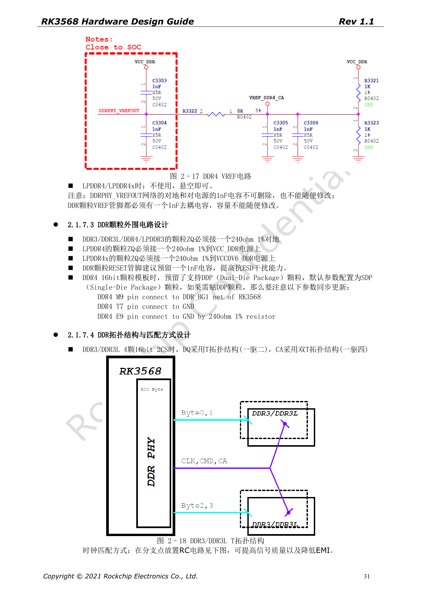
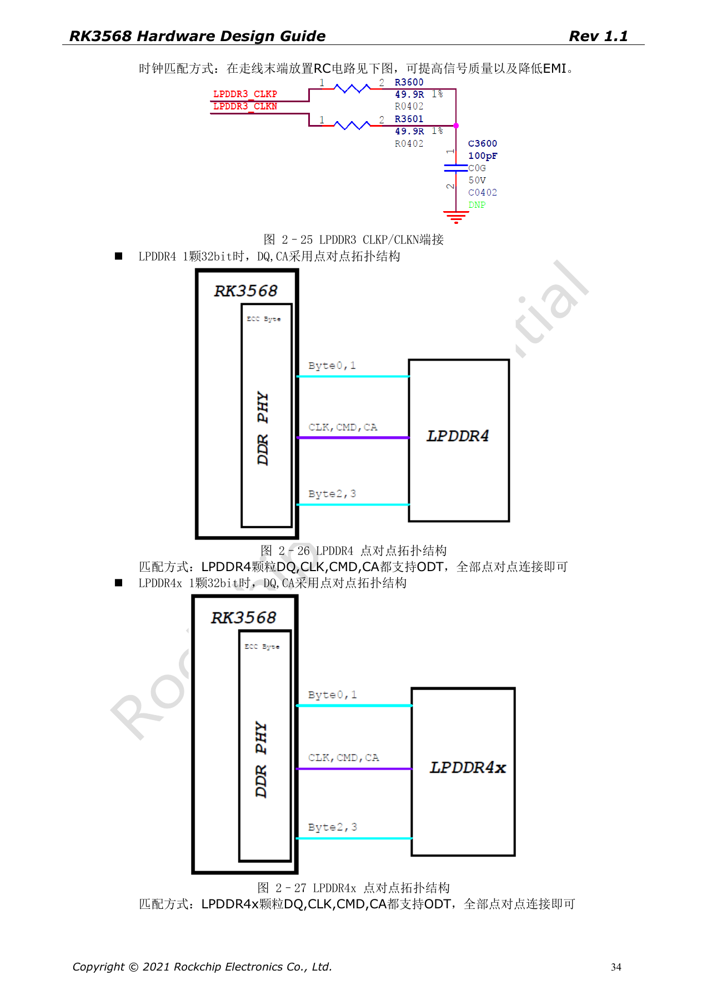
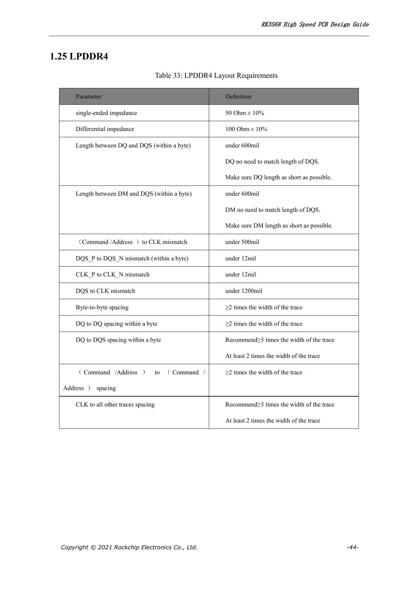
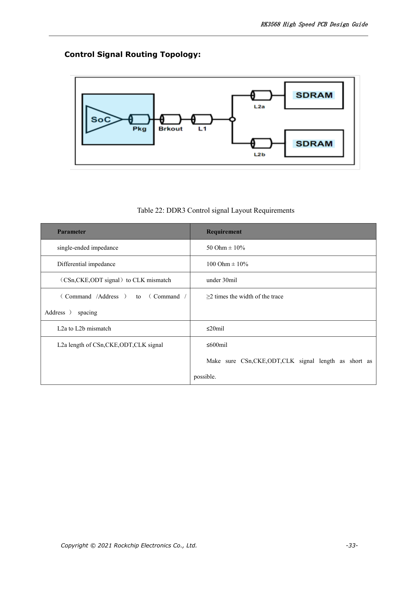
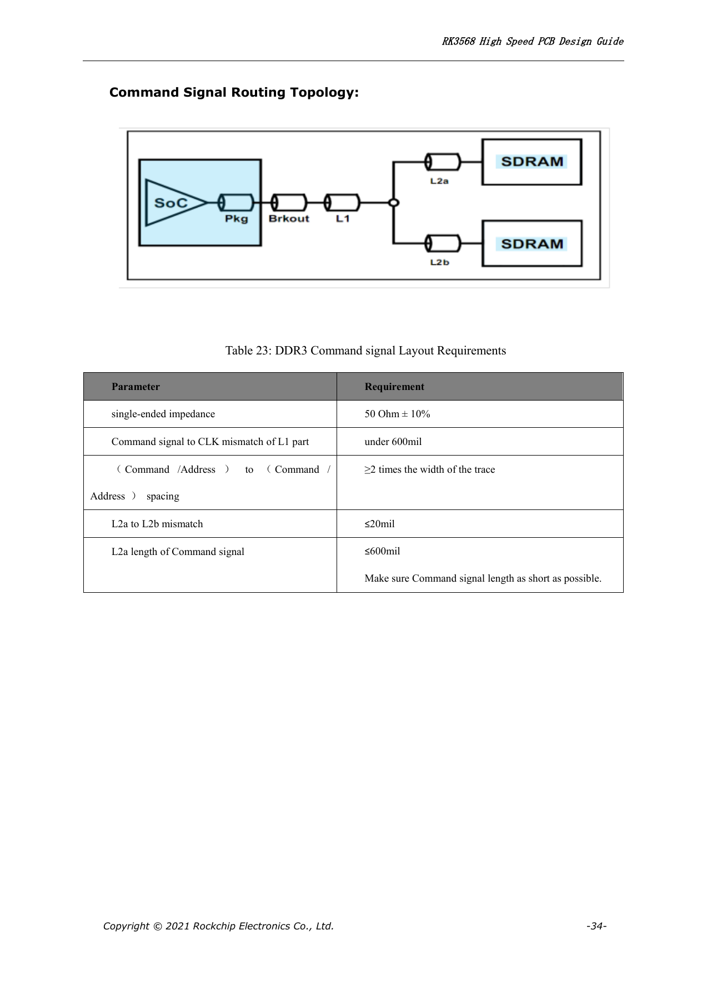
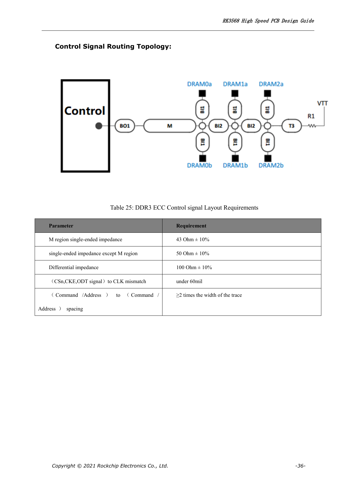
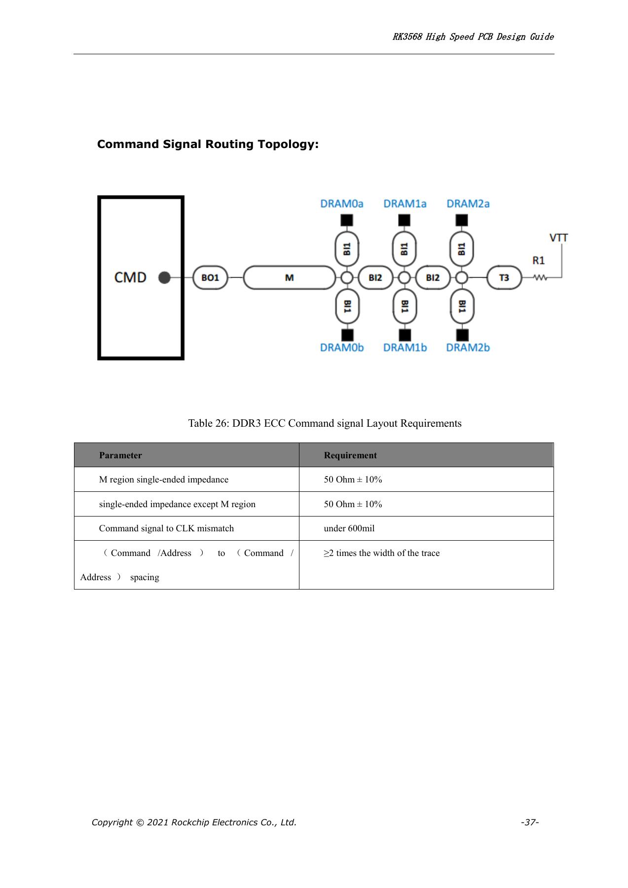

# RK3568 DDR design: devices, topology, ECC and routing constraints

This series reorganizes RK3568 Hardware Design Guide V1.1 (Chinese, 2021-06-08) and the separate High Speed PCB Design Guide V1.0.0 (English, 2021-04-12) around engineering questions. ArmSoM [Sige3](https://www.armsom.org/sige3) uses RK3568B2. Its [board documentation](https://docs.armsom.org/armsom-sige3) provides a product reference for studying and evaluating these design topics. SoC reference circuits do not describe every Sige3 circuit or exposed interface. Confirm SDK/BSP, kernel, silicon revision, firmware and peripheral combinations. Values are source references, not ArmSoM hardware measurements.

**CN V1.1 §2.1.7; §3.2.2 · EN PCB V1.0.0 §1.20–1.26**

## Choose memory type and mapping first

The guide lists DDR3/DDR3L/LPDDR3/DDR4/LPDDR4/LPDDR4X, a 32-bit bus, two ranks and up to 8GB addressing. Its 8-bit ECC support applies to the listed DDR3/DDR3L/DDR4 modes, not every type. The PHY mapping on PDF pages 26–28 changes with memory type. Do not reuse a DDR4 net map as LPDDR4; schematic, training data, topology and supported-device list must agree.

## Topology is more than routing convenience

The Chinese guide illustrates T and fly-by arrangements for DDR3/DDR3L and DDR4, and point-to-point connections for LPDDR3/4/4X. Review termination, VREF, RZQ, decoupling and sequencing together. An LPDDR4/4X-compatible design must check DDRPHY_VDDQ/VDDQL and DRAM rails; changing the software part number is insufficient. Include capacity, temperature grade, rank count and placement changes in training and stress validation.

## Read LPDDR matching rules correctly

The English PCB tables allow DQ/DM-to-DQS difference within a byte below 600mil for LPDDR3/4/4X and explicitly say not to lengthen DQ/DM merely to match DQS: keep them short. LPDDR3 CA–CLK is <30mil and DQS–CLK <1500mil; LPDDR4/4X use <500mil and <1200mil respectively. Intra-pair mismatch for DQS and CLK is <12mil. These rules do not replace the segmented T/fly-by constraints for DDR3/DDR4.

## Turn PCB rules into repeatable validation

Reference impedance is 50Ω±10% single-ended and 100Ω±10% differential. Byte-to-byte, DQ-to-DQ within a byte and CA spacing are at least 2W. DQ-to-DQS and clock-to-other spacing prefer 3W, minimum 2W. Produce a constraint report by net group with topology, stackup and vias, then validate cold starts, repeated power cycles, temperature limits and target-frequency load. No ArmSoM measured bandwidth or error-rate data is claimed.

## Pin-swapping and RZQ restrictions

DDR3/DDR3L and DDR4 permit whole-byte swapping and DQ swapping within a byte, but not CA swapping. The ECC byte cannot swap with a normal byte; DDR4 ECC DQ order is also fixed. LPDDR3 must preserve its first D0–D7 byte and associated DQS/DM; other bytes follow the source swapping rules. LPDDR4/4X permit neither DQ nor CA swapping. DDR_RZQ (H7) uses 120Ω, 1% to ground for DDR3/DDR3L/DDR4/LPDDR3, but to DDRPHY_VDDQ for LPDDR4/4X. The identical resistance does not mean identical termination.

## Source ECC wiring issue

Chinese page 28 says DDR3/DDR3L DQSU connects both to supply and to ground, repeating a net name. This is not converted into a wiring instruction; check Figure 2–12 and the actual DRAM datasheet for polarity. The following table retains all 85 PHY rows from Table 2–5 for net-by-net review, not as a universal DRAM schematic.

| PHY | DDR4 | LPDDR4/LPDDR4x | DDR3 | LPDDR3 |
| --- | --- | --- | --- | --- |
| DDR_DQ0_A | DDR4_DQL0_A | LPDDR4_DQ0_A | DDR3_DQ0 | LPDDR3_D15 |
| DDR_DQ1_A | DDR4_DQL2_A | LPDDR4_DQ1_A | DDR3_DQ1 | LPDDR3_D14 |
| DDR_DQ2_A | DDR4_DQL4_A | LPDDR4_DQ2_A | DDR3_DQ2 | LPDDR3_D10 |
| DDR_DQ3_A | DDR4_DQL6_A | LPDDR4_DQ3_A | DDR3_DQ3 | LPDDR3_D9 |
| DDR_DQ4_A | DDR4_DQL7_A | LPDDR4_DQ4_A | DDR3_DQ4 | LPDDR3_D13 |
| DDR_DQ5_A | DDR4_DQL5_A | LPDDR4_DQ5_A | DDR3_DQ5 | LPDDR3_D12 |
| DDR_DQ6_A | DDR4_DQL3_A | LPDDR4_DQ6_A | DDR3_DQ6 | LPDDR3_D8 |
| DDR_DQ7_A | DDR4_DQL1_A | LPDDR4_DQ7_A | DDR3_DQ7 | LPDDR3_D11 |
| DDR_DM0_A | DDR4_DML_A | LPDDR4_DM0_A | DDR3_DM0 | LPDDR3_DM1 |
| DDR_DQS0P_A | DDR4_DQSL_P_A | LPDDR4_DQS0P_A | DDR3_DQS0P | LPDDR3_DQS1P |
| DDR_DQS0N_A | DDR4_DQSL_N_A | LPDDR4_DQS0N_A | DDR3_DQS0N | LPDDR3_DQS1N |
| DDR_DQ8_A | DDR4_DQU3_A | LPDDR4_DQ8_A | DDR3_DQ8 | LPDDR3_D25 |
| DDR_DQ9_A | DDR4_DQU1_A | LPDDR4_DQ9_A | DDR3_DQ9 | LPDDR3_D24 |
| DDR_DQ10_A | DDR4_DQU7_A | LPDDR4_DQ10_A | DDR3_DQ10 | LPDDR3_D28 |
| DDR_DQ11_A | DDR4_DQU5_A | LPDDR4_DQ11_A | DDR3_DQ11 | LPDDR3_D29 |
| DDR_DQ12_A | DDR4_DQU2_A | LPDDR4_DQ12_A | DDR3_DQ12 | LPDDR3_D26 |
| DDR_DQ13_A | DDR4_DQU4_A | LPDDR4_DQ13_A | DDR3_DQ13 | LPDDR3_D31 |
| DDR_DQ14_A | DDR4_DQU6_A | LPDDR4_DQ14_A | DDR3_DQ14 | LPDDR3_D30 |
| DDR_DQ15_A | DDR4_DQU0_A | LPDDR4_DQ15_A | DDR3_DQ15 | LPDDR3_D27 |
| DDR_DM1_A | DDR4_DMU_A | LPDDR4_DM1_A | DDR3_DM1 | LPDDR3_DM3 |
| DDR_DQS1P_A | DDR4_DQSU_P_A | LPDDR4_DQS1P_A | DDR3_DQS1P | LPDDR3_DQS3P |
| DDR_DQS1N_A | DDR4_DQSU_N_A | LPDDR4_DQS1N_A | DDR3_DQS1N | LPDDR3_DQS3N |
| DDR_DQ0_B | DDR4_DQU7_B | LPDDR4_DQ0_B | DDR3_DQ16 | LPDDR3_D1 |
| DDR_DQ1_B | DDR4_DQU5_B | LPDDR4_DQ1_B | DDR3_DQ17 | LPDDR3_D5 |
| DDR_DQ2_B | DDR4_DQU3_B | LPDDR4_DQ2_B | DDR3_DQ18 | LPDDR3_D6 |
| DDR_DQ3_B | DDR4_DQU1_B | LPDDR4_DQ3_B | DDR3_DQ19 | LPDDR3_D4 |
| DDR_DQ4_B | DDR4_DQU0_B | LPDDR4_DQ4_B | DDR3_DQ20 | LPDDR3_D2 |
| DDR_DQ5_B | DDR4_DQU6_B | LPDDR4_DQ5_B | DDR3_DQ21 | LPDDR3_D3 |
| DDR_DQ6_B | DDR4_DQU4_B | LPDDR4_DQ6_B | DDR3_DQ22 | LPDDR3_D7 |
| DDR_DQ7_B | DDR4_DQU2_B | LPDDR4_DQ7_B | DDR3_DQ23 | LPDDR3_D0 |
| DDR_DM0_B | DDR4_DMU_B | LPDDR4_DM0_B | DDR3_DM2 | LPDDR3_DM0 |
| DDR_DQS0P_B | DDR4_DQSU_P_B | LPDDR4_DQS0P_B | DDR3_DQS2P | LPDDR3_DQS0P |
| DDR_DQS0N_B | DDR4_DQSU_N_B | LPDDR4_DQS0N_B | DDR3_DQS2N | LPDDR3_DQS0N |
| DDR_DQ8_B | DDR4_DQL0_B | LPDDR4_DQ8_B | DDR3_DQ24 | LPDDR3_D18 |
| DDR_DQ9_B | DDR4_DQL2_B | LPDDR4_DQ9_B | DDR3_DQ25 | LPDDR3_D19 |
| DDR_DQ10_B | DDR4_DQL4_B | LPDDR4_DQ10_B | DDR3_DQ26 | LPDDR3_D22 |
| DDR_DQ11_B | DDR4_DQL6_B | LPDDR4_DQ11_B | DDR3_DQ27 | LPDDR3_D23 |
| DDR_DQ12_B | DDR4_DQL7_B | LPDDR4_DQ12_B | DDR3_DQ28 | LPDDR3_D16 |
| DDR_DQ13_B | DDR4_DQL5_B | LPDDR4_DQ13_B | DDR3_DQ29 | LPDDR3_D17 |
| DDR_DQ14_B | DDR4_DQL1_B | LPDDR4_DQ14_B | DDR3_DQ30 | LPDDR3_D20 |
| DDR_DQ15_B | DDR4_DQL3_B | LPDDR4_DQ15_B | DDR3_DQ31 | LPDDR3_D21 |
| DDR_DM1_B | DDR4_DML_B | LPDDR4_DM1_B | DDR3_DM3 | LPDDR3_DM2 |
| DDR_DQS1P_B | DDR4_DQSL_P_B | LPDDR4_DQS1P_B | DDR3_DQS3P | LPDDR3_DQS2P |
| DDR_DQS1N_B | DDR4_DQSL_N_B | LPDDR4_DQS1N_B | DDR3_DQS3N | LPDDR3_DQS2N |
| DDR_ECC_DQ0 | DDR4_ECC_DQ7 | - | DDR3_ECC_DQ0 | - |
| DDR_ECC_DQ1 | DDR4_ECC_DQ0 | - | DDR3_ECC_DQ1 | - |
| DDR_ECC_DQ2 | DDR4_ECC_DQ2 | - | DDR3_ECC_DQ2 | - |
| DDR_ECC_DQ3 | DDR4_ECC_DQ1 | - | DDR3_ECC_DQ3 | - |
| DDR_ECC_DQ4 | DDR4_ECC_DQ6 | - | DDR3_ECC_DQ4 | - |
| DDR_ECC_DQ5 | DDR4_ECC_DQ4 | - | DDR3_ECC_DQ5 | - |
| DDR_ECC_DQ6 | DDR4_ECC_DQ3 | - | DDR3_ECC_DQ6 | - |
| DDR_ECC_DQ7 | DDR4_ECC_DQ5 | - | DDR3_ECC_DQ7 | - |
| DDR_ECC_DM | DDR4_ECC_DM | - | DDR3_ECC_DM | - |
| DDR_ECC_DQSP | DDR4_ECC_DQSP | - | DDR3_ECC_DQSP | - |
| DDR_ECC_DQSN | DDR4_ECC_DQSN | - | DDR3_ECC_DQSN | - |
| AC0 | DDR4_A0 | LPDDR4_CLKP_B | DDR3_A9 | - |
| AC1 | DDR4_A1 | - | DDR3_A2 | - |
| AC2 | DDR4_A2 | LPDDR4_A1_A | DDR3_A4 | LPDDR3_A6 |
| AC3 | DDR4_A3 | LPDDR4_CKE1_A | DDR3_A3 | - |
| AC4 | DDR4_A4 | LPDDR4_A3_B | DDR3_BA1 | LPDDR3_A3 |
| AC5 | DDR4_A5 | LPDDR4_A5_B | DDR3_A11 | LPDDR3_A2 |
| AC6 | DDR4_A6 | LPDDR4_A1_B | DDR3_A13 | LPDDR3_A1 |
| AC7 | DDR4_A7 | LPDDR4_ODT0_CA_B | DDR3_A8 | - |
| AC8 | DDR4_A8 | LPDDR4_ODT0_CA_A | DDR3_A6 | LPDDR3_A9 |
| AC9 | DDR4_A9 | LPDDR4_CLKN_B | DDR3_A5 | - |
| AC10 | DDR4_A10 | LPDDR4_CKE0_B | DDR3_A10 | - |
| AC11 | DDR4_A11 | LPDDR4_A0_A | DDR3_A7 | LPDDR3_A8 |
| AC12 | DDR4_A12 | LPDDR4_A3_A | DDR3_BA2 | - |
| AC13 | DDR4_A13 | LPDDR4_A0_B | DDR3_A14 | LPDDR3_A0 |
| AC14 | DDR4_A14_WEN | LPDDR4_A4_A | DDR3_A15 | LPDDR3_A5 |
| AC15 | DDR4_A15_CASN | LPDDR4_A2_A | DDR3_A0 | - |
| AC16 | DDR4_A16_RASN | LPDDR4_A5_A | DDR3_RASN | LPDDR3_A7 |
| AC17 | DDR4_ACTN | LPDDR4_CKE1_B | DDR3_CASN | - |
| AC18 | DDR4_BA0 | LPDDR4_A2_B | DDR3_A1 | - |
| AC19 | DDR4_BA1 | LPDDR4_A4_B | DDR3_A12 | LPDDR3_A4 |
| AC20 | DDR4_BG0 | LPDDR4_ODT1_CA_B | DDR3_WEN | - |
| AC21 | DDR4_BG1 | LPDDR4_ODT1_CA_A | DDR3_BA0 | - |
| AC22 | DDR4_CKE | LPDDR4_CKE0_A | DDR3_CKE | LPDDR3_CKE |
| AC23 | DDR4_CLKP | LPDDR4_CLKP_A | DDR3_CLKP | LPDDR3_CLKP |
| AC24 | DDR4_CLKN | LPDDR4_CLKN_A | DDR3_CLKN | LPDDR3_CLKN |
| AC25 | DDR4_CS0N | LPDDR4_CS0N_A | DDR3_ODT1 | LPDDR3_ODT0 |
| AC26 | DDR4_CS1N | LPDDR4_CS1N_A | DDR3_CS1N | LPDDR3_ODT1 |
| AC27 | DDR4_ODT0 | LPDDR4_CS1N_B | DDR3_ODT0 | LPDDR3_CS1N |
| AC28 | DDR4_ODT1 | LPDDR4_CS0N_B | DDR3_CS0N | LPDDR3_CS0N |
| AC29 | DDR4_RESETN | LPDDR4_RESETN | DDR3_RESETN | - |

## Segmented DDR3/DDR4 and ECC routing tables

English PCB pages 32–43 separate data, control and command routing. DDR3/DDR4 and their ECC data tables share the data rules below, but the M region in ECC control topology is 43Ω±10%, not the ordinary 50Ω. Interpret M, L1, L2a and L2b using the corresponding diagram; applying a limit to the wrong branch is invalid. The source requires short control/command routes and CA spacing ≥2W.

| Mode | Impedance | Source length constraints |
| --- | --- | --- |
| DDR3 / DDR3 ECC / DDR4 / DDR4 ECC: data | 50Ω±10% / 100Ω±10% | DQ–DQS <600mil; DM–DQS <600mil; DQS–CLK <1500mil; P/N <12mil |
| DDR3 control | 50Ω±10% / 100Ω±10% | CSn/CKE/ODT–CLK <30mil; L2a–L2b ≤20mil; L2a(CSn/CKE/ODT/CLK) ≤600mil |
| DDR4 control | 50Ω±10% / 100Ω±10% | CSn/CKE/ODT–CLK <30mil; L2a–L2b ≤20mil; L2a(CSn/CKE/ODT) ≤600mil |
| DDR3 / DDR4 command | 50Ω±10% | L1(command–CLK) <600mil; L2a–L2b ≤20mil; L2a(command) ≤600mil |
| DDR3 ECC / DDR4 ECC control | M:43Ω±10%; outside M:50Ω±10%; differential:100Ω±10% | CSn/CKE/ODT–CLK <60mil |
| DDR3 ECC / DDR4 ECC command | M:50Ω±10%; outside M:50Ω±10% | command–CLK <600mil |

## Source parameters and constraints

| Item | Source reference |
| --- | --- |
| LPDDR3 CA–CLK / DQS–CLK | <30mil / <1500mil |
| LPDDR4/4X CA–CLK / DQS–CLK | <500mil / <1200mil |
| DQ/DM–DQS | <600mil |
| DQS P/N; CLK P/N | <12mil |

## Source figures

The source-page screenshots preserve circuit labels and context; article text and parameter tables remain editable. No matching English edition of the main Chinese guide was supplied, so its figures remain Chinese in all four languages. Images from the separate English PCB guide are labeled accordingly. Page references are physical PDF pages.

Chinese hardware guide · PDF 31

Chinese hardware guide · PDF 34

English high-speed PCB guide · PDF 44

English high-speed PCB guide · PDF 33

English high-speed PCB guide · PDF 34

English high-speed PCB guide · PDF 36

English high-speed PCB guide · PDF 37

## Further reading and development resources

- [RK3568 hardware design: 10 circuit, PCB and production topics](/articles/rk3568-hardware-design-series/)
- [RK3568 power and IO domains: RK809-5, discrete rails and standby](/articles/rk3568-power-io-domain-hardware/)
- [RK3568 boot storage: eMMC, FSPI, NAND and SDMMC circuits](/articles/rk3568-storage-emmc-fspi-sdmmc-hardware/)
- [ArmSoM Docs](https://docs.armsom.org/)
- [ArmSoM](https://www.armsom.org/)
