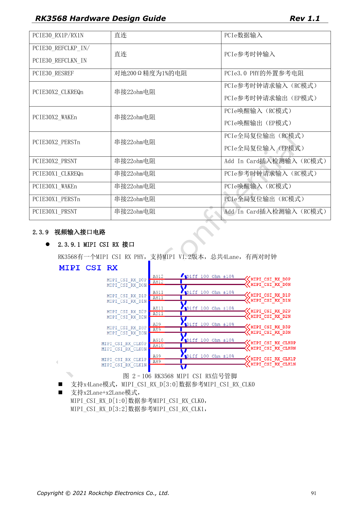
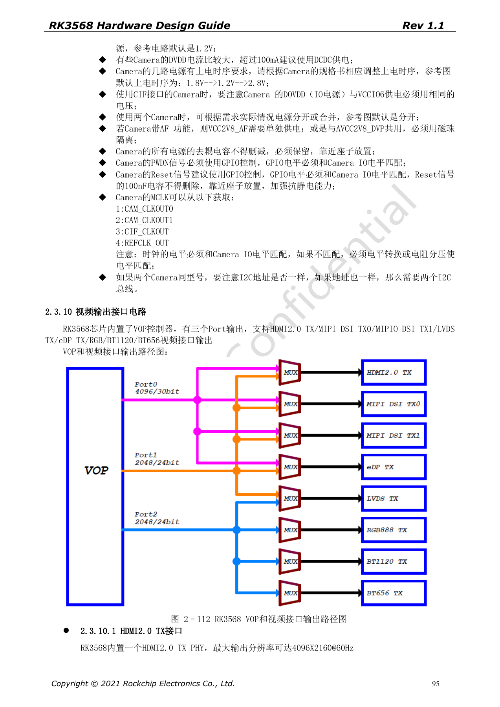
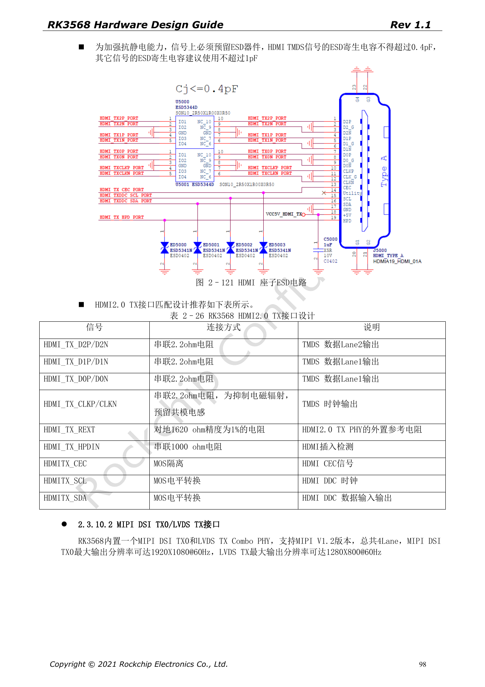

# RK3568 display and cameras: VOP, MIPI, HDMI and power

This series reorganizes RK3568 Hardware Design Guide V1.1 (Chinese, 2021-06-08) and the separate High Speed PCB Design Guide V1.0.0 (English, 2021-04-12) around engineering questions. ArmSoM [Sige3](https://www.armsom.org/sige3) uses RK3568B2. Its [board documentation](https://docs.armsom.org/armsom-sige3) provides a product reference for studying and evaluating these design topics. SoC reference circuits do not describe every Sige3 circuit or exposed interface. Confirm SDK/BSP, kernel, silicon revision, firmware and peripheral combinations. Values are source references, not ArmSoM hardware measurements.

**CN V1.1 §2.3.9–2.3.10; §3.2.25–3.2.26 · EN PCB §1.4, §1.7, §1.9–1.10, §1.16–1.18**

## Display controllers are not connector counts

The source VOP has three output ports feeding HDMI2.0, MIPI DSI, LVDS, eDP, RGB and BT1120/656 paths, subject to multiplexing. HDMI2.0 is specified up to 4096×2160@60Hz. DSI TX0 is 1920×1080@60Hz and shares its Combo PHY with LVDS TX, specified at 1280×800@60Hz. Verify VOP routing and BSP for concurrent outputs rather than adding all interface names.

## Review camera data, clocks and rails as a set

The four-lane CSI RX PHY supports one four-lane or two two-lane links; in split mode D[1:0] use CLK0 and D[3:2] use CLK1. Select AVDD/DOVDD/DVDD, PWDN, reset, I2C and MCLK from the actual sensor datasheet. The illustrated 1.8V→1.2V→2.8V sequence is a reference, not universal. Two sensors with identical I2C addresses need conflict handling; the guide suggests separate I2C buses.

## Protection and high-speed constraints

HDMI TMDS ESD parasitic capacitance is ≤0.4pF; other signals are recommended ≤1pF. REXT is 1620Ω, 1%. HDMI PCB intra-pair mismatch is <12mil and clock/data-pair mismatch <480mil. MIPI uses <12mil within pairs and <36mil data-to-clock. Separate adjacent differential pairs with ground pins at connectors, with short test-point stubs near the connector. Include backlight, touch and sensor supplies in validation.

## VGA requires a bridge

RK3568 does not provide native VGA; the source uses an external bridge such as RTD2166. A display feature list is not evidence of a native VGA port. Follow the bridge design for power, reset, HPD, 5V sync, 75Ω video termination and connector TVS. For example, do not casually remove the RTD2166 Pin32 100kΩ pull-down when porting the schematic.

## Source parameters and constraints

| Item | Source reference |
| --- | --- |
| HDMI | 100Ω±10%; intra <12mil; CLK/data <480mil |
| MIPI | 100Ω±10%; intra <12mil; data/CLK <36mil |
| LVDS | 100Ω±10%; intra <20mil; data/CLK 60mil |
| eDP | 100Ω±10%; intra <12mil; 100nF±20% |

## Source figures

The source-page screenshots preserve circuit labels and context; article text and parameter tables remain editable. No matching English edition of the main Chinese guide was supplied, so its figures remain Chinese in all four languages. Images from the separate English PCB guide are labeled accordingly. Page references are physical PDF pages.

Chinese hardware guide · PDF 91

Chinese hardware guide · PDF 95

Chinese hardware guide · PDF 98

## Further reading and development resources

- [RK3568 hardware design: 10 circuit, PCB and production topics](/articles/rk3568-hardware-design-series/)
- [RK3568 Ethernet hardware: dual GMAC, RGMII and QSGMII](/articles/rk3568-ethernet-rgmii-qsgmii-hardware/)
- [RK3568 audio and control: I2S, UART, SPI, CAN and I2C](/articles/rk3568-audio-control-interfaces-hardware/)
- [ArmSoM Docs](https://docs.armsom.org/)
- [ArmSoM](https://www.armsom.org/)
