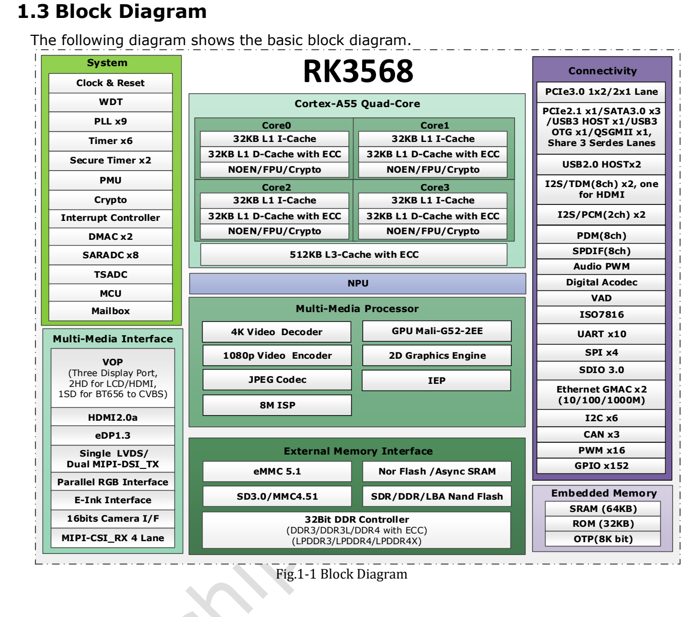

This article uses the specified datasheet revision. Values are vendor specifications, not ArmSoM measurements; no new hardware validation was performed. Check the actual silicon revision, board schematic, SDK/BSP, kernel and drivers. The explanations and editable tables assist reading; consult the original PDF for the complete specification and bit definitions not expanded here.

**RK3568 · Rockchip RK3568 Datasheet V1.2-20210601.pdf · PDF 54–62.**

*Original English figure, source PDF p. 19.*

## Stress limits and operating points

Absolute maxima are not regulator setpoints. Recommended Min/Typ/Max values do not replace sequencing, transient analysis or silicon-specific frequency/voltage tables. Measure at the chip during startup, idle and load transitions, not only at the regulator output.

## Recommended supplies and clocks

### PDF 55

| Rail / clock | Min | Typ | Max | Unit |
|---|---|---|---|---|
| VDD_CPU | 0.8 | 0.9 | 1.2 | V |
| VDD_GPU | 0.8 | 0.9 | 1.1 | V |
| VDD_NPU | 0.8 | 0.9 | 1.1 | V |
| VDD_LOGIC | 0.81 | 0.9 | 0.99 | V |
| PMU_VDD_LOGIC_0V9 | 0.81 | 0.9 | 0.99 | V |
| PMUIO1 | 2.97 | 3.3 | 3.63 | V |
| VCCIO1,VCCIO2, VCCIO3, VCCIO4VCCIO5, VCCIO6, VCCIO7, PMUIO2 | 2.97 1.62 | 3.3 1.8 | 3.63 1.98 | V |
| DDR3 / DDRPHY_VDDQ/DDRPHY_VDDQL | 1.425 | 1.5 | 1.575 | V |
| DDR3L / DDRPHY_VDDQ/DDRPHY_VDDQL | 1.283 | 1.35 | 1.417 | V |
| LPDDR3 / DDRPHY_VDDQ/DDRPHY_VDDQL | 0.994 | 1.2 | 1.3 | V |
| DDR4 / DDRPHY_VDDQ/DDRPHY_VDDQL | 0.994 | 1.2 | 1.3 | V |
| LPDDR4 / DDRPHY_VDDQ/DDRPHY_VDDQL | 1.0 | 1.1 | 1.21 | V |
| LPDDR4X / DDRPHY_VDDQ | 1.0 | 1.1 | 1.21 | V |
| LPDDR4X / DDRPHY_VDDQL | 0.54 | 0.6 | 0.66 | V |
| PMUPLL_AVDD_0V9 | 0.81 | 0.9 | 0.99 | V |
| PMUPLL_AVDD_1V8 | 1.62 | 1.8 | 1.98 | V |
| SYSPLL_AVDD_0V9 | 0.81 | 0.9 | 0.99 | V |
| SYSPLL_AVDD_1V8 | 1.62 | 1.8 | 1.98 | V |
| USB2_AVDD_0V9 | 0.81 | 0.9 | 0.99 | V |
| USB2_AVDD_1V8 | 1.62 | 1.8 | 1.98 | V |
| USB2_AVDD_3V3 | 2.97 | 3.3 | 3.63 | V |
| USB3_AVDD_0V9 | 0.81 | 0.9 | 0.99 | V |
| USB3_AVDD_1V8 | 1.62 | 1.8 | 1.98 | V |
| USB3_AVDD_3V3 | 2.97 | 3.3 | 3.63 | V |
| MULTI_PHY_AVDD_0V9 | 0.81 | 0.9 | 0.99 | V |
| MULTI_PHY_AVDD_1V8 | 1.62 | 1.8 | 1.98 | V |
| PCIE30_AVDD_0V9 | 0.81 | 0.9 | 0.99 | V |
| PCIE30_AVDD_1V8 | 1.62 | 1.8 | 1.98 | V |
| MIPI_CSI_RX_AVDD_0V9 | 0.81 | 0.9 | 0.99 | V |
| MIPI_CSI_RX_AVDD_1V8 | 1.62 | 1.8 | 1.98 | V |
| MIPI_DSI_TX0/LVDS_TX0_AVDD_0V9 | 0.81 | 0.9 | 0.99 | V |
| MIPI_DSI_TX0/LVDS_TX0_AVDD_1V8 | 1.62 | 1.8 | 1.98 | V |
| MIPI_DSI_TX1_AVDD_0V9 | 0.81 | 0.9 | 0.99 | V |
| MIPI_DSI_TX1_AVDD_1V8 | 1.62 | 1.8 | 1.98 | V |
| EDP/DP_TX_AVDD_0V9 | 0.81 | 0.9 | 0.99 | V |
| EDP/DP_TX_AVDD_1V8 | 1.62 | 1.8 | 1.98 | V |
| HDMI_TX_AVDD_0V9 | 0.81 | 0.9 | 0.99 | V |
| HDMI_TX_AVDD_1V8 | 1.62 | 1.8 | 1.98 | V |
| SARADC_AVDD_1V8 | 1.62 | 1.8 | 1.98 | V |

### PDF 56

| Rail / clock | Min | Typ | Max | Unit |
|---|---|---|---|---|
| OTP_VCC_1V8 | 1.62 | 1.8 | 1.98 | V |
| OSC | NA | 24 | NA | MHz |
| CPU | NA | NA | TBD | GHz |
| GPU | NA | NA | TBD | MHz |
| NPU | NA | NA | 1.0 | GHz |
| TA | 0 | NA | 80 | ℃ |

## GPIO levels and internal resistors

| Item | Specification / source note |
|---|---|
| 3.3 V I/O: VIL | −0.3…0.8 V |
| 3.3 V I/O: VIH | 2.0…VDDO+0.3 V |
| 3.3 V I/O: VOL | −0.3…0.4 V |
| 3.3 V I/O: VOH | 2.4…VDDO+0.3 V |
| 1.8 V I/O: VIL max | 0.35 × VDDO |
| 1.8 V I/O: VIH min | 0.65 × VDDO |
| 1.8 V I/O: VOH min | 1.4 V |
| Internal pulls | 16 / NA / 43 kΩ (Min/Typ/Max) |

## PLL and USB parameters

| Item | Specification / source note |
|---|---|
| PLL integer: Fin / Fvco / Fout | 10–800 / 475–1900 / 9–1900 MHz |
| PLL integer: lock | 1000 typ / 1500 max input-clock cycles |
| PLL fractional: Fin / Fvco / Fout | 1–1200 / 950–3800 / 19–3800 MHz |
| PLL fractional: lock | 250 typ / 500 max input-clock cycles |
| USB output resistance | 40.5 / 45 / 49.5 Ω |
| USB HS high | 360 / 400 / 440 mV |
| USB HS low | −40 / 0 / 40 mV |
| USB disconnect | 570 / 590 / 625 mV |
| USB squelch | 100 / 112 / 150 mV |

## Temperature and cooling limits

Thermal resistance is a vendor simulation on a specified PCB, not an ArmSoM measurement. Enclosure, copper area, airflow, heatsink and power distribution affect temperature rise. Sensor range is not ambient operating range.

| Item | Specification / source note |
|---|---|
| θJA / θJB / θJC | 15.925 / 10.813 / 0.487 °C/W |
| Thermal model | 4-layer PCB · 114.3 × 101.6 mm · 1.6 mm · ambient 25 °C |
| Tj | Source requires below 125 °C |
| Ta | 0…80 °C |
| SARADC | 10 bit · ≤1 MS/s |
| TSADC | −20…120 °C; electrical table: ±5 °C resolution |

## Preserved source issues

RK3568 absolute/recommended maxima differ: CPU 1.25/1.2 V; GPU/NPU 1.2/1.1 V. CPU/GPU frequency maxima remain TBD; NPU lists up to 1 GHz. The source’s LPDDR3/DDR4 minimum is 0.994 V, preserved rather than silently changed to 1.14 V. An 80–120 Ω Multi-PHY entry uses de-emphasis wording; verify the name and unit against the PHY specification.

Do not copy RK3528 USB disconnect or squelch thresholds. DDR leakage has a 125 °C test condition and cannot directly define room-temperature power budgets.

## ArmSoM products and application limits

Sige3 uses RK3568B2. This article refers to the general RK3568 V1.2 datasheet and does not replace checking the B2 ordering variant, board revision and exposed interfaces.

- [Sige3](https://www.armsom.org/sige3) · [Docs](https://docs.armsom.org/armsom-sige3)

## Datasheet series and original PDF

- [RK3568 overview](/articles/rk3568-datasheet-v12/)
- [RK3568 package and pins: all 636 ball assignments](/articles/rk3568-package-pin-reference/)
- [RK3568 architecture: DDR, displays and shared PHYs](/articles/rk3568-architecture-phy-resource-planning/)
- [RK3568 electrical and thermal guide: supplies, I/O and thermal resistance](/articles/rk3568-electrical-power-thermal/)
- [Download the complete original PDF](/assets/datasheet-series-20261110/Rockchip-RK3568-Datasheet-V1.2-20210601.pdf)
