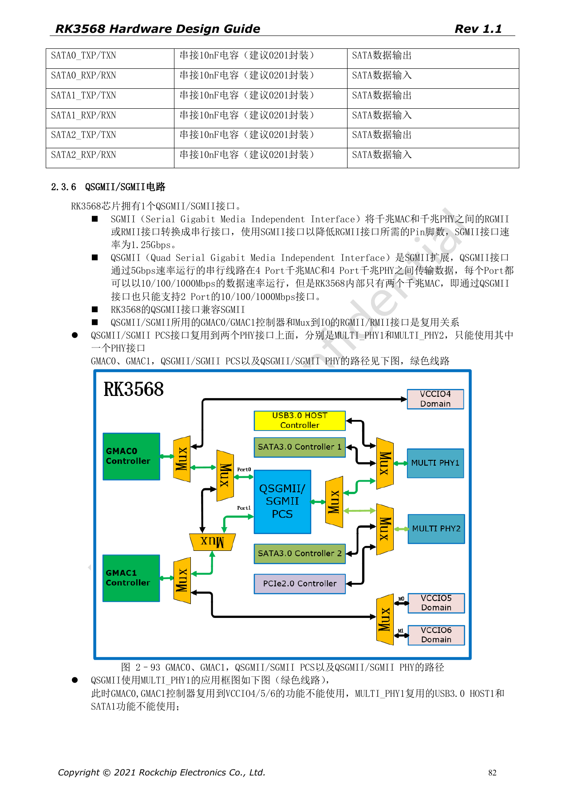
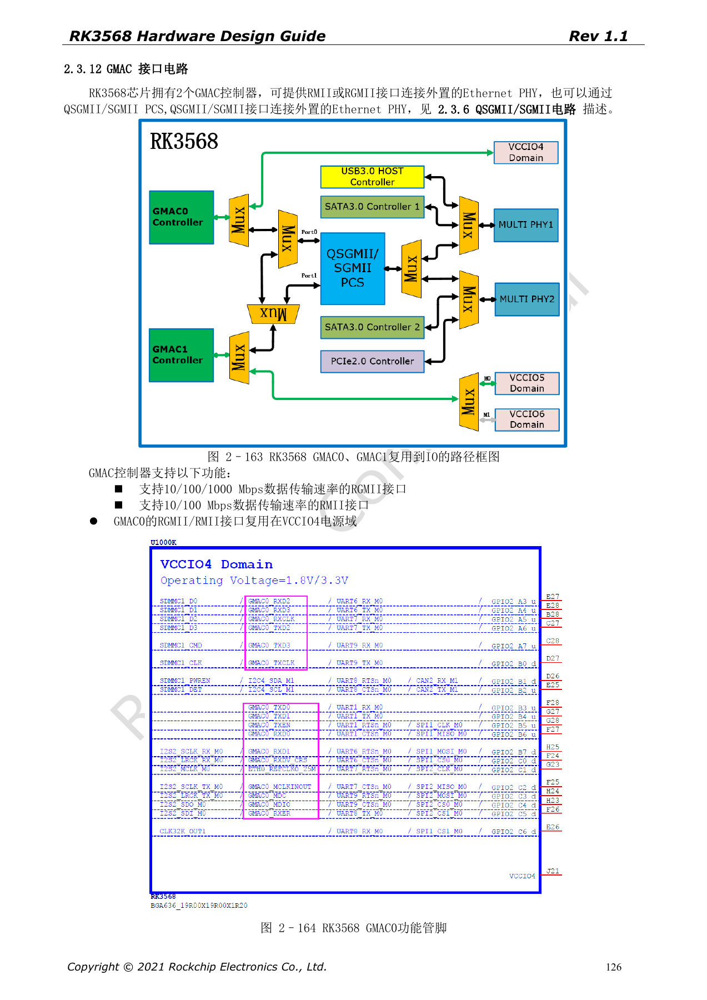
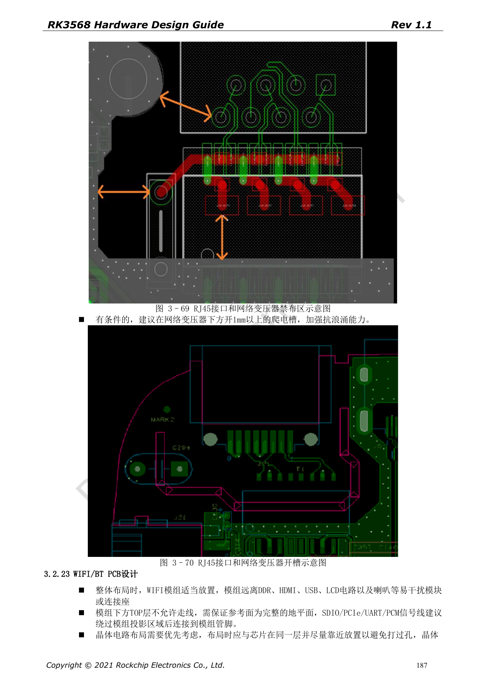

# RK3568 Ethernet hardware: dual GMAC, RGMII and QSGMII

This series reorganizes RK3568 Hardware Design Guide V1.1 (Chinese, 2021-06-08) and the separate High Speed PCB Design Guide V1.0.0 (English, 2021-04-12) around engineering questions. ArmSoM [Sige3](https://www.armsom.org/sige3) uses RK3568B2. Its [board documentation](https://docs.armsom.org/armsom-sige3) provides a product reference for studying and evaluating these design topics. SoC reference circuits do not describe every Sige3 circuit or exposed interface. Confirm SDK/BSP, kernel, silicon revision, firmware and peripheral combinations. Values are source references, not ArmSoM hardware measurements.

**CN V1.1 §2.3.6; §2.3.12; §3.2.22 · EN PCB §1.8; §1.19**

## Separate MACs, PHYs and interface modes

RK3568 has two GMACs: RGMII supports 10/100/1000Mbps, RMII 10/100Mbps. QSGMII can carry four ports in the protocol, but this chip has only two MACs, so the guide explicitly limits it to two Ethernet ports. Serial QSGMII/SGMII shares MAC resources with IO-based RGMII/RMII, and its PCS chooses either MULTI_PHY1 or MULTI_PHY2, not both.

## The RTL8211F example is not universal

In the source example, RTL8211F/FI reset is 3.3V-only with 100nF nearby. RSET is 2.49kΩ, 1%; MDIO uses a recommended external 1.5–1.8kΩ pull-up. A different PHY needs a new review of reset, rails, straps, clock, internal delay and transformer center taps. Check the RJ45 Tab up/down pin orientation against the footprint, not just its outline.

## Check timing together with isolation

Match RGMII TX data/enable to TXCLK and RX data/valid to RXCLK separately. The English PCB guide specifies <120mil mismatch, <5in length and 50Ω±10% single-ended impedance; TX and RX are not one matching group. QSGMII/SGMII uses 100Ω±10%, intra-pair <12mil, length <6in and reference 100nF±20% coupling. Review transformer keepouts, isolation and surge return paths too. Protection examples are not system certification results.

## Source parameters and constraints

| Item | Source reference |
| --- | --- |
| GMAC | 2 |
| QSGMII / SGMII | 5Gbps / 1.25Gbps |
| RGMII | 50Ω±10%; <120mil; <5in |
| RTL8211F/FI RSET | 2.49kΩ ±1% |
| MDIO | 1.5–1.8kΩ pull-up |

## Source figures

The source-page screenshots preserve circuit labels and context; article text and parameter tables remain editable. No matching English edition of the main Chinese guide was supplied, so its figures remain Chinese in all four languages. Images from the separate English PCB guide are labeled accordingly. Page references are physical PDF pages.

Chinese hardware guide · PDF 82

Chinese hardware guide · PDF 126

Chinese hardware guide · PDF 187

## Further reading and development resources

- [RK3568 hardware design: 10 circuit, PCB and production topics](/articles/rk3568-hardware-design-series/)
- [RK3568 high-speed expansion: USB, SATA, PCIe muxing and clocks](/articles/rk3568-usb-sata-pcie-hardware/)
- [RK3568 display and cameras: VOP, MIPI, HDMI and power](/articles/rk3568-display-camera-hardware/)
- [ArmSoM Docs](https://docs.armsom.org/)
- [ArmSoM](https://www.armsom.org/)
