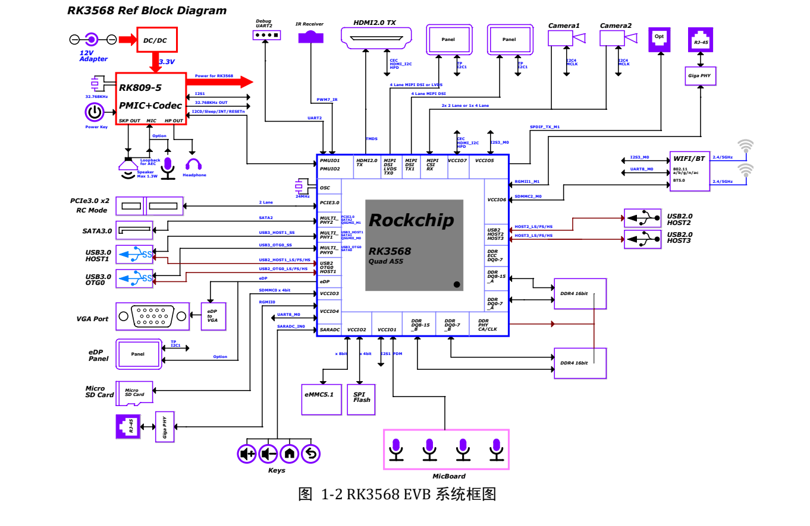
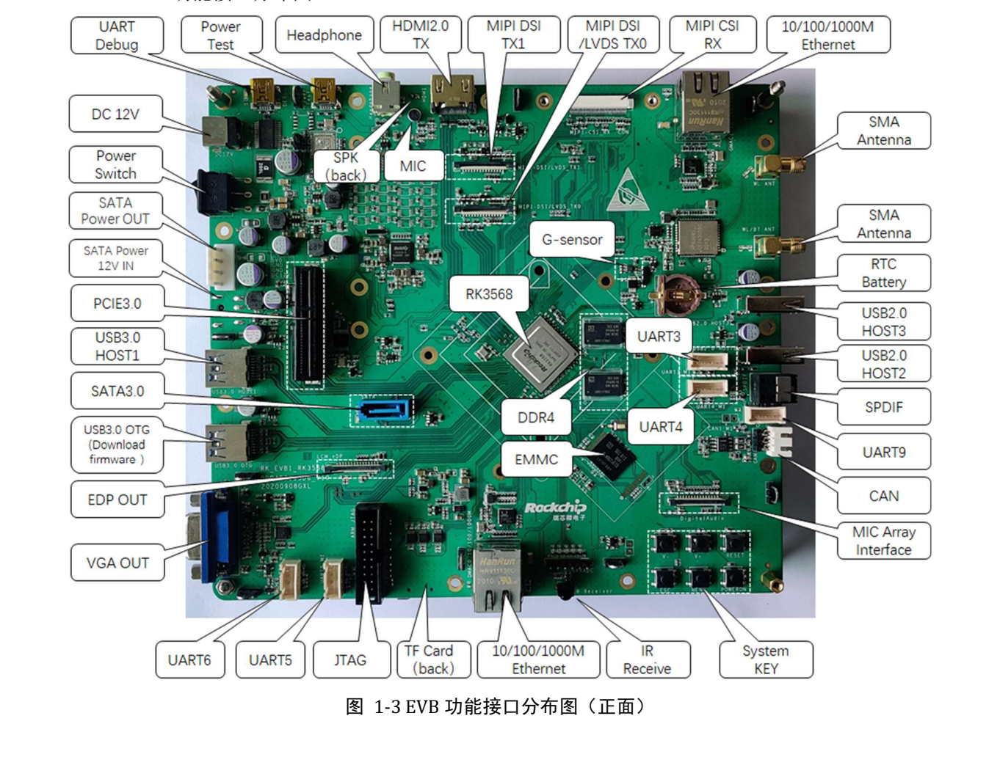

This task-focused guide explains the source with key specifications, limitations and original figures. It is not a page-by-page translation or a complete pin/register manual. Vendor examples are not ArmSoM measurements. Check the actual board revision, schematic, SDK/BSP, kernel and drivers before applying them; no new hardware validation was performed for this article.

**Primary source：** `Rockchip_RK3568_EVB_User_Guide_V1.0_CN.pdf` · PDF 43 pages.

## Separate the reference configuration from Sige3

The manual targets `RK_EVB1_RK3568_DDR4P216SD6_V10_20200908`: RK809-5 power management, 2GB DDR4, 32GB eMMC and a 12V/2A kit adapter. Sige3 is documented as RK3568B2. Confirm its memory, power input, connectors and firmware from its own product documentation.


[](/assets/hardware-reference-20261110/rk3568-evb-p11.png)

*RK3568 EVB system connections — Original Chinese figure; no corresponding English figure was found in this batch. `Rockchip_RK3568_EVB_User_Guide_V1.0_CN.pdf`, PDF p. 11.*


## Records for the first debug session

Photograph board revision and connections; record supply, image and download tool. Connect USB Debug to the PC and identify COM. The source uses UART2 through FT232RL at `1500000` (1.5M), with RTS/CTS unchecked. For garbled output, check rate, port, wiring and voltage before concluding that boot failed.


[](/assets/hardware-reference-20261110/rk3568-evb-p13.png)

*RK3568 EVB front interface layout — Original Chinese figure; no corresponding English figure was found in this batch. `Rockchip_RK3568_EVB_User_Guide_V1.0_CN.pdf`, PDF p. 13.*


## Loader versus Maskrom

The Loader procedure connects USB3.0 OTG, holds RECOVER during power-on/reset and releases after detection. The source describes low `SARADC_VIN0` as the entry condition. The reference MASKROM button causes eMMC boot failure; the manual describes an `eMMC_D0` ground condition, but use the documented button procedure for the actual revision rather than shorting arbitrary boards.

After detection, select matching Loader, Parameter, Uboot and other images, backing up before writing. The driver example is under `SDK\RKTools\windows\Release_DriverAssitant`. The source's `Rcovery` spelling is retained as an editorial issue, not used to guess the actual firmware filename.

If the image enables ADB, check the connection after boot:

```sh
adb devices
adb shell
```

Serial output covers early boot; ADB requires a running system and service. Neither replaces the other.

## Review shared interfaces in hardware and software

| Function | Source description | Check |
| --- | --- | --- |
| Camera | 1×4-lane or 2×2-lane MIPI CSI | Driver, clock, power, reset and connector |
| Display | MIPI DSI/LVDS, second MIPI, HDMI, eDP/VGA | eDP/VGA selection and population options, not just connector count |
| Expansion | Shared CIF/EBC/RGMII/BT656 resources | Resistors and pinmux in §3.19 |
| PCIe | PCIe3.0, 2 lanes, RC mode | Card, reference clock, reset, supply and negotiation |
| SATA | Separate data and power connections | Default 12V path is not populated, as below |

Page 41 requires separate SATA 12V power. The provision to feed disks from system 12V is unconnected by default, with FB8301 identified as the configuration position. This is an EVB assembly option, not a Sige3 modification instruction. A connected SATA cable does not establish disk power.

## Silent audio may be a routing issue

On p. 36, S7000 positions 1-8 and 2-7 ON with 3-6 and 4-5 OFF select the normal MIC path; reversing them selects speaker loopback. S1900/S1901 also select the I2S1 path. These switches change analogue/digital routing, so software volume is only one possible cause.

Validate capture, playback and loopback separately before full duplex. Keep schematic, switch state and mixer configuration together. These component references apply only to that EVB, not Sige3.

## I2C is more than an address list

Page 21 lists RK809-5 at `0X20` and TCS4525 at `0X1C` on I2C0, both 3.3V; camera I2C4 is 1.8V with an unspecified address. Several expansion addresses are `TBD`. Confirm supply domain and pull-ups before adding devices rather than checking address conflicts alone.

## Apply the method to Sige3

Reuse the order power → serial → downloading → storage → single interface → concurrent load, but populate it with Sige3 pins, storage, device tree and image versions. Add sustained thermal-load, power-loss and suspend/resume tests. The RK3399 header left on source pp. 17–18 is a template error, not a change to this RK3568 guide's subject.


## Products and development resources

- **Sige3** — [Product](https://www.armsom.org/sige3) · [Documentation](https://docs.armsom.org/armsom-sige3)


## Further reading

- [RK3568 resources and selection](/articles/rk3568-datasheet-v12/)
