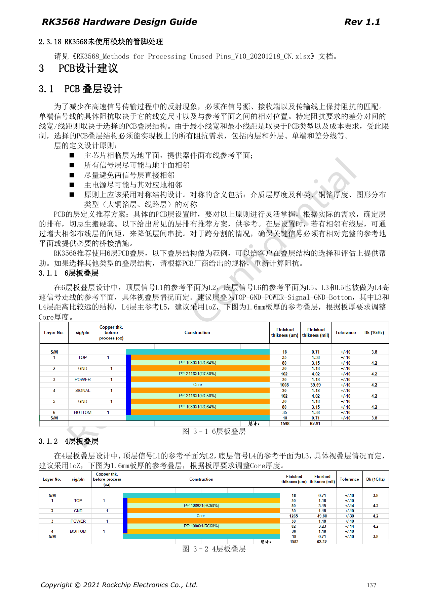
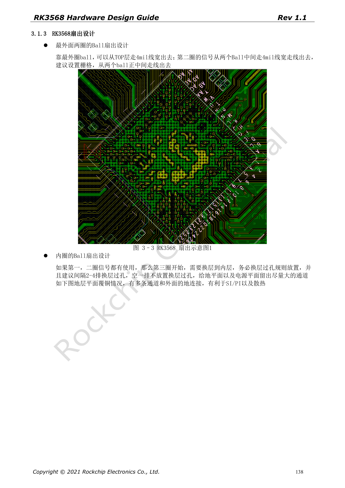
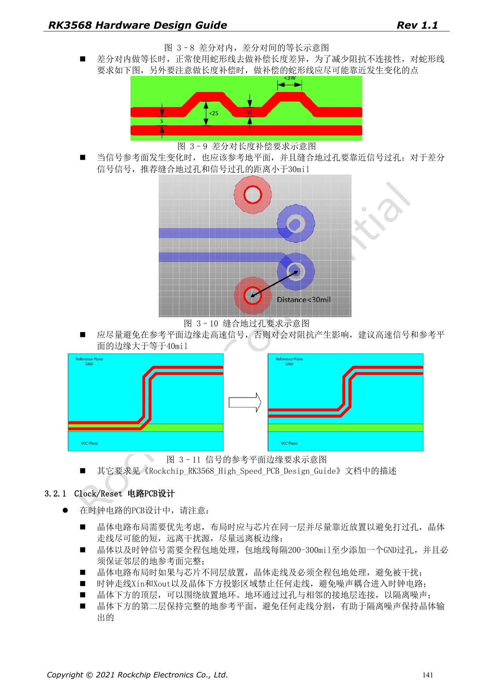

# RK3568 PCB design: stackup, escape routing and return paths

This series reorganizes RK3568 Hardware Design Guide V1.1 (Chinese, 2021-06-08) and the separate High Speed PCB Design Guide V1.0.0 (English, 2021-04-12) around engineering questions. ArmSoM [Sige3](https://www.armsom.org/sige3) uses RK3568B2. Its [board documentation](https://docs.armsom.org/armsom-sige3) provides a product reference for studying and evaluating these design topics. SoC reference circuits do not describe every Sige3 circuit or exposed interface. Confirm SDK/BSP, kernel, silicon revision, firmware and peripheral combinations. Values are source references, not ArmSoM hardware measurements.

**CN V1.1 §3.1–3.2 · EN PCB V1.0.0 §1.1–1.26**

## A reference stackup is not a fabrication order

The Chinese guide illustrates four and six layers. The six-layer example is TOP–GND–POWER–Signal–GND–Bottom; 1.6mm thickness and 1oz copper are reference conditions. Dielectric, copper and lamination affect impedance, so recalculate width/spacing with the fabricator against target impedance and tolerance. A four-layer example does not guarantee every peripheral configuration will meet signal and thermal requirements on four layers.

## Leave power and ground channels during escape

The outer two ball rows use a reference 4mil escape. Organize inner-row vias regularly; the source suggests a vacant via row after every two to four rows to preserve plane channels. When high-speed signals change reference planes, place stitching ground vias nearby; the differential reference distance is <30mil. Keep high-speed traces ≥40mil from plane edges and compensate mismatch near where it arises.

## Use the English guide as a separate constraint source

The 45-page English document adds USB, SATA, PCIe, display, storage, RGMII and DDR routing rules; it is not a translation of the 199-page Chinese guide. Preserve units, strict versus inclusive limits, and recommendations versus minima. DDR command, data, control and ECC tables depend on topology; one all-bus length rule cannot replace them. Sign-off should include constraints, exceptions and simulation records.

## Review power layout as well as connectors

Decoupling return paths, PMIC switching loops, SoC feedback and high-current copper all affect stability. Keep Wi-Fi modules away from DDR/HDMI/USB/display interference. The antenna feed is a reference 50Ω, short and branch-free; VBAT reference width is >40mil. Complete SI/PI and radio validation using the actual stackup, fabrication, cables and enclosure. Source line widths are not universal impedance values for every laminate.

## Source parameters and constraints

| Item | Source reference |
| --- | --- |
| 6-layer example | TOP–GND–POWER–Signal–GND–Bottom |
| Outer ball escape | 4mil reference |
| Signal via → GND via | <30mil reference |
| Signal → plane edge | ≥40mil reference |

## Source figures

The source-page screenshots preserve circuit labels and context; article text and parameter tables remain editable. No matching English edition of the main Chinese guide was supplied, so its figures remain Chinese in all four languages. Images from the separate English PCB guide are labeled accordingly. Page references are physical PDF pages.

Chinese hardware guide · PDF 137

Chinese hardware guide · PDF 138

Chinese hardware guide · PDF 141

## Further reading and development resources

- [RK3568 hardware design: 10 circuit, PCB and production topics](/articles/rk3568-hardware-design-series/)
- [RK3568 audio and control: I2S, UART, SPI, CAN and I2C](/articles/rk3568-audio-control-interfaces-hardware/)
- [RK3568 production review: thermal design, ESD, assembly and storage](/articles/rk3568-thermal-esd-assembly-hardware/)
- [ArmSoM Docs](https://docs.armsom.org/)
- [ArmSoM](https://www.armsom.org/)
