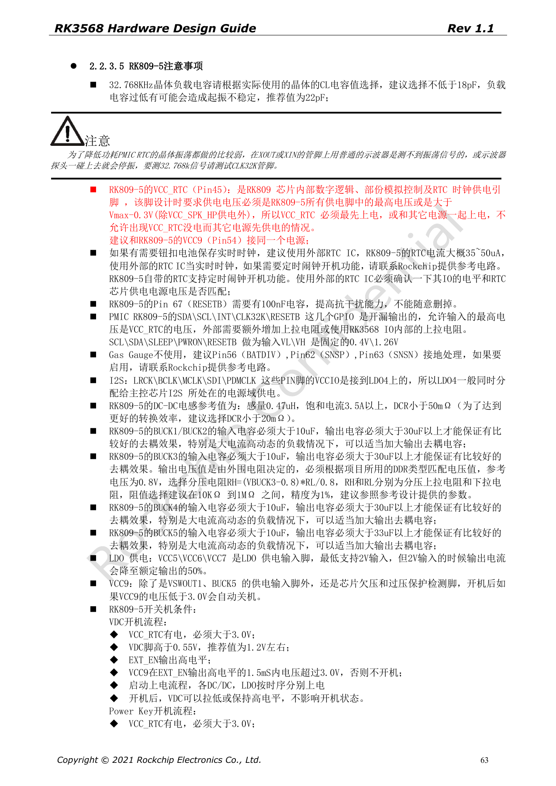
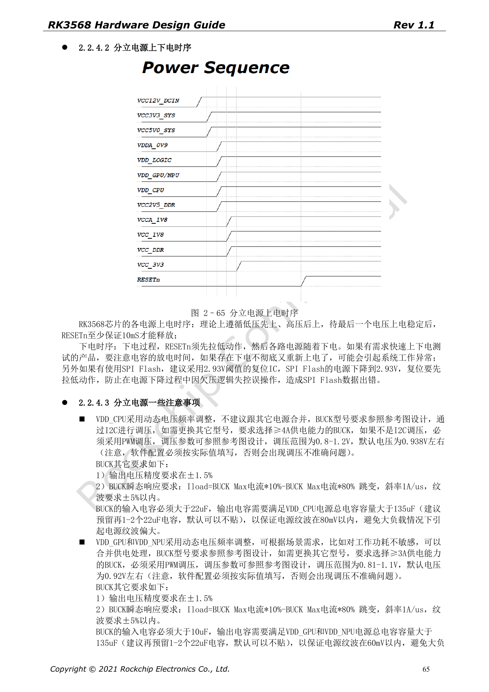

# RK3568 power and IO domains: RK809-5, discrete rails and standby

This series reorganizes RK3568 Hardware Design Guide V1.1 (Chinese, 2021-06-08) and the separate High Speed PCB Design Guide V1.0.0 (English, 2021-04-12) around engineering questions. ArmSoM [Sige3](https://www.armsom.org/sige3) uses RK3568B2. Its [board documentation](https://docs.armsom.org/armsom-sige3) provides a product reference for studying and evaluating these design topics. SoC reference circuits do not describe every Sige3 circuit or exposed interface. Confirm SDK/BSP, kernel, silicon revision, firmware and peripheral combinations. Values are source references, not ArmSoM hardware measurements.

**CN V1.1 §2.1.11; §2.2 · PDF 44–67**

## Align physical rails and software

PMUIO0 is fixed at 1.8V and PMUIO1 at 3.3V. PMUIO2 and VCCIO1–7 support 1.8V/3.3V, but VCCIO2 is selected by FLASH_VOL_SEL hardware. DTS settings for other configurable domains must match physical rails. Peripheral levels and pull-ups must match too. Before removing an unused domain supply, also inspect the mandatory first-power-up table; “unused” alone is not sufficient.

## Peak current is not system power

The general recommendations specify a CPU BUCK rated at least 4A and GPU/NPU/LOGIC BUCKs at least 2A. Total CPU decoupling exceeds 135µF; the general GPU/NPU/LOGIC sections specify over 90µF. Connect VDD_CPU_COM to the BUCK feedback path to account for PCB drop. Page 67 lists reference module peaks: do not sum them into a SoC peak or use that sum for cooling. Measure startup, steady load, DVFS and load transients.

## Review sequencing together with standby

For the discrete scheme, keep RESETn asserted for at least 10ms after the final rail settles; assert it before rails decay at shutdown. Rapid cycling requires capacitor-discharge analysis. PMIC_SLEEP is low in operation, high in standby and low again on wake. Retain DDR self-refresh, PMU and required wake-IO supplies. USB HID wake requires the USB PHY powered, so the deepest-standby table cannot be applied blindly. Disable DTS nodes of unpowered modules to avoid initialization hangs.

## Keep source discrepancies visible

Page 53 requires a LOGIC BUCK ≥2A, whereas the discrete scheme on page 66 says ≥1.5A. General load-step ripple is ±3%, versus ±5% in the discrete section; LOGIC decoupling is also stated as >90µF and >99µF. This article does not silently merge those specifications. Resolve them against current errata, reference design and regulator transient models, then validate the PCB, temperature and real load.

## Complete source peak-current table

Table 2–14, PDF page 67. TBD remains unspecified. Do not sum these values as SoC power.

| PowerName | V | mA |
| --- | --- | --- |
| PMUPLL_AVDD_0V9 | 0.9 | 10 |
| PMUPLL_AVDD_1V8 | 1.8 | 9 |
| SYSPLL_AVDD_0V9 | 0.9 | 30 |
| SYSPLL_AVDD_1V8 | 1.8 | 18 |
| PMU_VDD_LOGIC_0V9 | 0.9 | 50 |
| VDD_CPU | DVFS | 3000 |
| VDD_GPU | DVFS | 1200 |
| VDD_NPU | DVFS | 1000 |
| VDD_LOGIC | 0.9 | 1200 |
| DDRPHY_VDDQ | 1.1/1.2/1.35/1.5 | TBD |
| DDRPHY_VDDQL | 0.6/1.1/1.2/1.35/1.5 | TBD |
| USB3_AVDD_0V9 | 0.9 | 5 |
| USB3_AVDD_1V8 | 1.8 | 30 |
| USB3_AVDD_3V3 | 3.3 | 10 |
| USB2_AVDD_0V9 | 0.9 | 5 |
| USB2_AVDD_1V8 | 1.8 | 30 |
| USB2_AVDD_3V3 | 3.3 | 10 |
| MULTI_PHY_AVDD_0V9 | 0.9 | 150 |
| MULTI_PHY_AVDD_1V8 | 1.8 | 21 |
| PCIE30_AVDD_0V9 | 0.9 | 160 |
| PCIE30_AVDD_1V8 | 1.8 | 60 |
| MIPI_CSI_RX_AVDD_0V9 | 0.9 | 10 |
| MIPI_CSI_RX_AVDD_1V8 | 1.8 | 2.5 |
| MIPI_DSI_TX0/LVDS_TX0_AVDD_0V9 | 0.9 | 50 |
| MIPI_DSI_TX0/LVDS_TX0_AVDD_1V8 | 1.8 | 15 |
| MIPI_DSI_TX1_AVDD_0V9 | 0.9 | 50 |
| MIPI_DSI_TX1_AVDD_1V8 | 1.8 | 15 |
| eDP_TX_AVDD_0V9 | 0.9 | 150 |
| eDP_TX_AVDD_1V8 | 1.8 | 100 |
| HDMI_TX_AVDD_0V9 | 0.9 | 25 |
| HDMI_TX_AVDD_1V8 | 1.8 | 16 |
| SARADC_AVDD_1V8 | 1.8 | 1.5 |
| OTP_VCC18 | 1.8 | 59 |
| PMUIO0 | 1.8 | TBD |
| PMUIO1 | 3.3 | TBD |
| PMUIO2/VCCIO1/2/3/4/5/6/7/ | 1.8/3.3 | TBD |


## Source parameters and constraints

| Item | Source reference |
| --- | --- |
| VDD_CPU | BUCK ≥4A; C >135µF |
| VDD_GPU / VDD_NPU | BUCK ≥2A; C >90µF |
| VDD_LOGIC | p53 ≥2A / p66 ≥1.5A |
| RESETn | ≥10ms after final rail stable |
| PMIC_SLEEP | RUN=0; SLEEP=1 |

Source DTS example for VCCIO4 physically powered at 3.3V. Its supply reference must match. Do not paste over another board configuration.

```dts
&pmu_io_domains {
    status = "okay";
    pmuio2-supply = <&vcc_3v3>;
    vccio1-supply = <&vcc_3v3>;
    vccio3-supply = <&vcc_3v3>;
    vccio4-supply = <&vcc_3v3>;
    vccio5-supply = <&vcc_3v3>;
    vccio6-supply = <&vcc_3v3>;
    vccio7-supply = <&vcc_3v3>;
};
```

## Source figures

The source-page screenshots preserve circuit labels and context; article text and parameter tables remain editable. No matching English edition of the main Chinese guide was supplied, so its figures remain Chinese in all four languages. Images from the separate English PCB guide are labeled accordingly. Page references are physical PDF pages.

[](/assets/rk3568-hardware-series/rk3568-cn-p63.png)

Chinese hardware guide · PDF 63

[](/assets/rk3568-hardware-series/rk3568-cn-p65.png)

Chinese hardware guide · PDF 65

## Further reading and development resources

- [RK3568 hardware design: 10 circuit, PCB and production topics](/articles/rk3568-hardware-design-series/)
- [RK3568 minimum system: clocks, reset, boot and debug](/articles/rk3568-boot-clock-reset-hardware/)
- [RK3568 DDR design: devices, topology, ECC and routing constraints](/articles/rk3568-ddr-topology-routing/)
- [ArmSoM Docs](https://docs.armsom.org/)
- [ArmSoM](https://www.armsom.org/)
