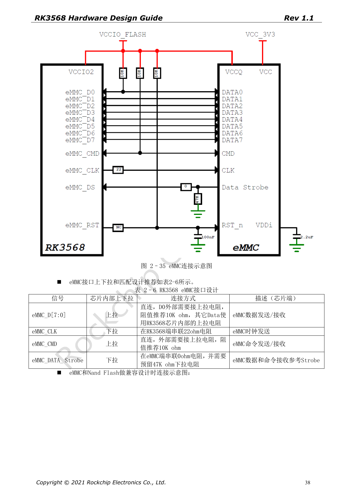
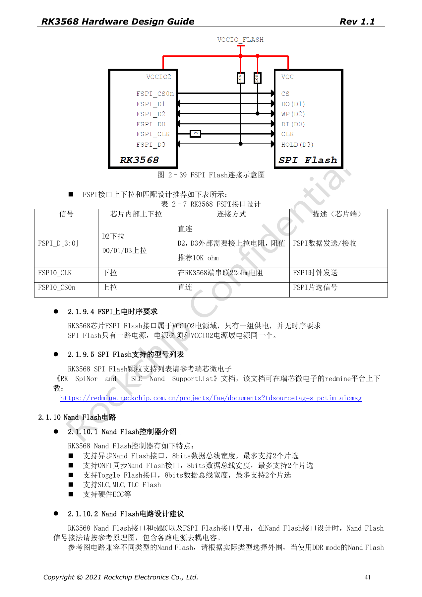
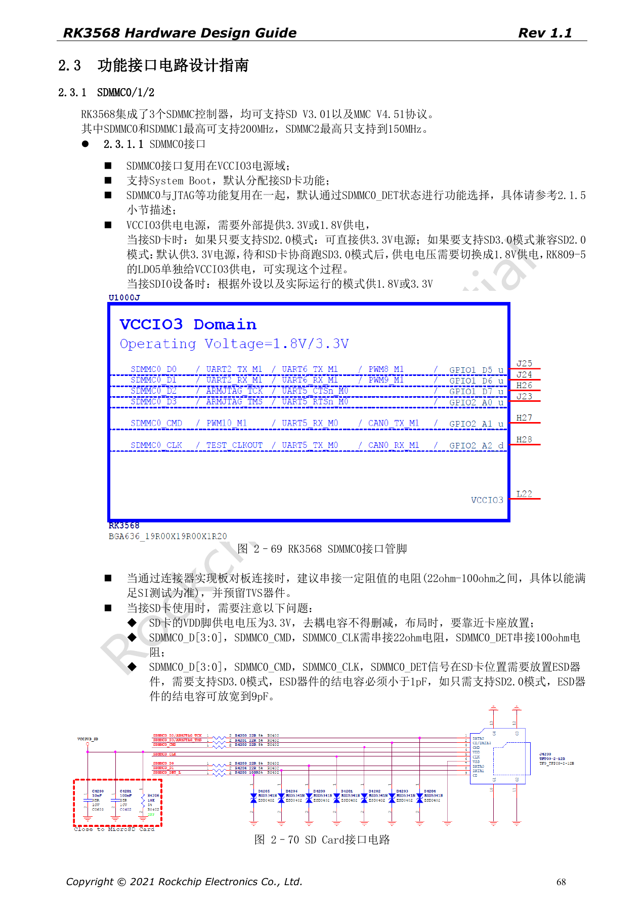

# RK3568 boot storage: eMMC, FSPI, NAND and SDMMC circuits

This series reorganizes RK3568 Hardware Design Guide V1.1 (Chinese, 2021-06-08) and the separate High Speed PCB Design Guide V1.0.0 (English, 2021-04-12) around engineering questions. ArmSoM [Sige3](https://www.armsom.org/sige3) uses RK3568B2. Its [board documentation](https://docs.armsom.org/armsom-sige3) provides a product reference for studying and evaluating these design topics. SoC reference circuits do not describe every Sige3 circuit or exposed interface. Confirm SDK/BSP, kernel, silicon revision, firmware and peripheral combinations. Values are source references, not ArmSoM hardware measurements.

**CN V1.1 §2.1.8–2.1.10; §2.3.1 · EN PCB §1.11–1.15**

## Shared pins determine the boot design

eMMC, NAND and FSPI share interface resources. VCCIO2 and FLASH_VOL_SEL must agree before power-up; software correction after boot is too late. The guide lists eMMC 4.41/4.51/5.0/5.1, 1/4/8-bit modes and HS200. Select a mode supported by the actual device, loader and BSP. A multi-footprint layout needs branch and unpopulated-stub review, not just matching net names.

## Resistors, pull-ups and recovery

eMMC D0 and CMD use external 10kΩ pull-ups, CLK has 22Ω at the SoC, and Data Strobe has 0Ω at the eMMC with provision for 47kΩ pull-down. FSPI D2/D3 use 10kΩ pull-ups and CLK 22Ω; Flash and VCCIO2 share a supply. The source also describes service-only test-point boot suppression for Maskrom, requires releasing the short after detection and warns against routine use because IO can be damaged. Preserve a normal Loader download path first.

## SD-card power differs from signal voltage

Boot-capable SDMMC0 is in VCCIO3. SDMMC1 defaults to SDIO Wi-Fi in VCCIO4 and is not a system boot source. The source controller limits are 200MHz for SDMMC0/1 and 150MHz for SDMMC2. SD-card VDD stays at 3.3V; SD3.0 operation switches the IO domain from 3.3V to 1.8V after negotiation. ESD capacitance is <1pF for SD3.0, relaxed to 9pF for SD2.0. Do not confuse IO switching with switching card power.

## Translate speed targets into PCB constraints

The English PCB tables specify 50Ω±10% for these single-ended buses. eMMC data-to-clock mismatch is <120mil with length <4in; FSPI mismatch <200mil and length <4in. SDIO/SDMMC mismatch is <120mil, with length <6in at ≤50Mbps and <4in above 50Mbps. The source unit Mbps is retained, not silently changed to MHz. Test target speed, device variation, power-loss recovery and sustained IO.

## Source parameters and constraints

| Item | Source reference |
| --- | --- |
| eMMC CLK / D0 / CMD | 22Ω / 10kΩ pull-up / 10kΩ pull-up |
| FSPI CLK / D2 / D3 | 22Ω / 10kΩ pull-up / 10kΩ pull-up |
| eMMC / FSPI length | <4in / <4in |
| SDMMC0/1 / SDMMC2 | ≤200MHz / ≤150MHz |

## Source figures

The source-page screenshots preserve circuit labels and context; article text and parameter tables remain editable. No matching English edition of the main Chinese guide was supplied, so its figures remain Chinese in all four languages. Images from the separate English PCB guide are labeled accordingly. Page references are physical PDF pages.

Chinese hardware guide · PDF 38

Chinese hardware guide · PDF 41

Chinese hardware guide · PDF 68

## Further reading and development resources

- [RK3568 hardware design: 10 circuit, PCB and production topics](/articles/rk3568-hardware-design-series/)
- [RK3568 DDR design: devices, topology, ECC and routing constraints](/articles/rk3568-ddr-topology-routing/)
- [RK3568 high-speed expansion: USB, SATA, PCIe muxing and clocks](/articles/rk3568-usb-sata-pcie-hardware/)
- [ArmSoM Docs](https://docs.armsom.org/)
- [ArmSoM](https://www.armsom.org/)
