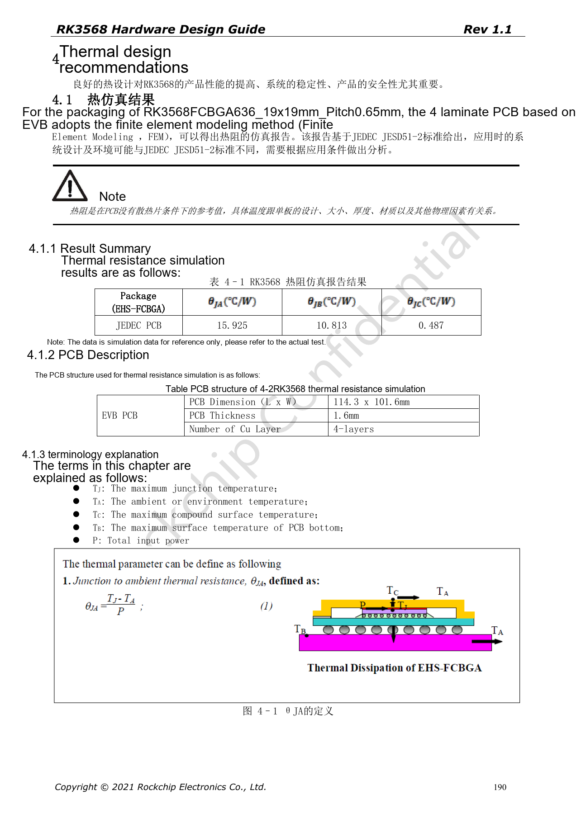
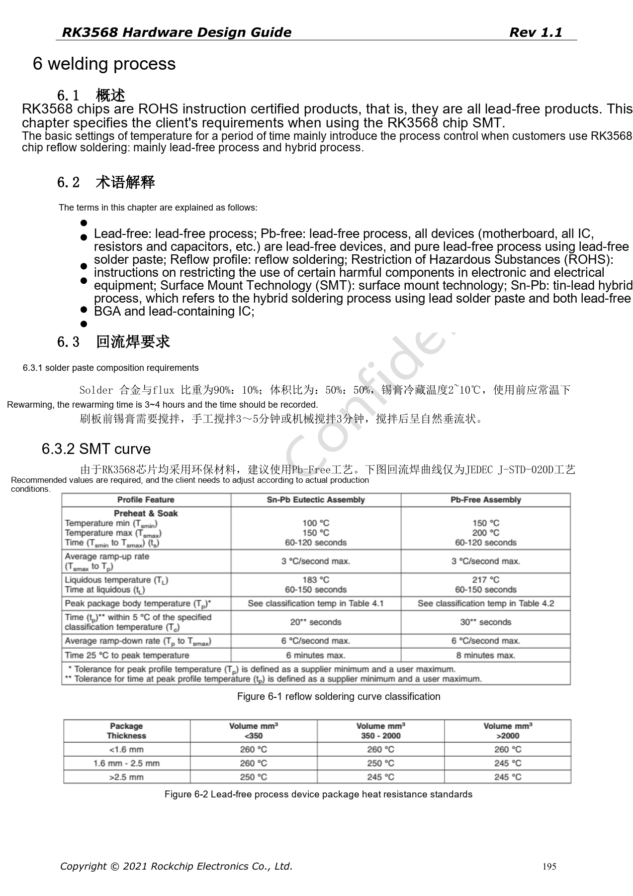
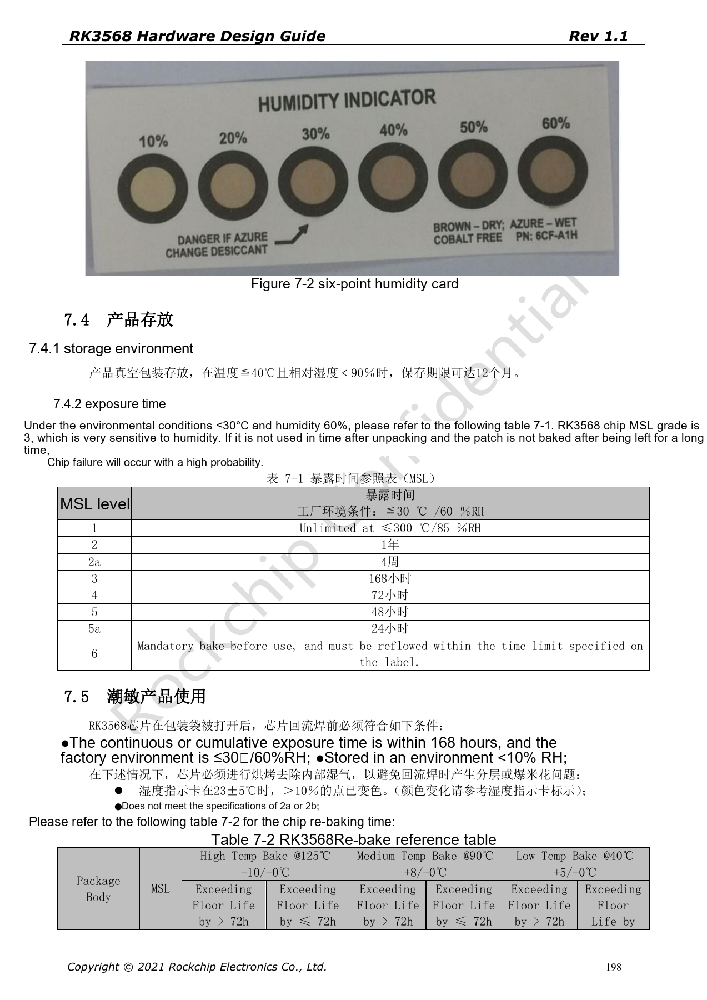

# RK3568 production review: thermal design, ESD, assembly and storage

This series reorganizes RK3568 Hardware Design Guide V1.1 (Chinese, 2021-06-08) and the separate High Speed PCB Design Guide V1.0.0 (English, 2021-04-12) around engineering questions. ArmSoM [Sige3](https://www.armsom.org/sige3) uses RK3568B2. Its [board documentation](https://docs.armsom.org/armsom-sige3) provides a product reference for studying and evaluating these design topics. SoC reference circuits do not describe every Sige3 circuit or exposed interface. Confirm SDK/BSP, kernel, silicon revision, firmware and peripheral combinations. Values are source references, not ArmSoM hardware measurements.

**CN V1.1 §4–7 · PDF 190–199**

## Thermal results belong to specific conditions

The source simulation uses FCBGA636, 19×19mm, 0.65mm pitch on a 114.3×101.6mm, 1.6mm-thick, four-layer EVB PCB without a heatsink. It is not a junction-temperature guarantee for an arbitrary carrier or enclosure. Visual verification of Table 4-1 gives θJA=15.925°C/W, θJB=10.813°C/W and θJC=0.487°C/W. These are vendor simulation references, not measurements from this project.

## Thermal design extends beyond the SoC

The guide recommends 20–50mm between SoC and RK809-5, adequate copper and ground vias, and avoiding concentrated heat sources. High-current copper must carry its load. Test the closed product under real CPU/GPU/NPU, video and IO concurrency, recording ambient conditions, firmware, frequency and throttling. Measure PMIC, inductors and backlight supply as well as SoC sensors.

## ESD depends on return paths

Place protection near external connectors or discharge entry points and preserve surface-ground return paths. Avoid signal cuts through connector ground areas. The source requires sensitive reset, clock and interrupt nets at least 5mm from board edges; keep nPOR 100nF near the pin with a short ground path. Enclosure, shields, connectors and supply grounding determine discharge flow together. The guide does not replace system EMC/ESD testing.

## Manage MSL3 before reflow

The source classifies RK3568 as MSL3, with a 168-hour accumulated exposure reference at ≤30°C/60%RH. Vacuum-packed storage is stated as ≤40°C, <90%RH, up to 12 months, subject to package labeling. Re-bake times distinguish package thickness ≤1.4mm and floor-life overrun above or below 72h; do not mix times for 125°C, 90°C and 40°C. The source MSL1 row contains “≤300°C”; this apparent error is logged and is not a storage instruction.

## Source parameters and constraints

| Item | Source reference |
| --- | --- |
| MSL3 floor life | 168h at ≤30°C /60%RH |
| Package thickness | ≤1.4mm |
| Re-bake 125°C +10/−0°C | >72h: 9h; ≤72h: 7h |
| Re-bake 90°C +8/−0°C | >72h: 33h; ≤72h: 23h |
| Re-bake 40°C +5/−0°C | >72h: 13d; ≤72h: 9d |

## Source figures

The source-page screenshots preserve circuit labels and context; article text and parameter tables remain editable. No matching English edition of the main Chinese guide was supplied, so its figures remain Chinese in all four languages. Images from the separate English PCB guide are labeled accordingly. Page references are physical PDF pages.

Chinese hardware guide · PDF 190

Chinese hardware guide · PDF 195

Chinese hardware guide · PDF 198

## Further reading and development resources

- [RK3568 hardware design: 10 circuit, PCB and production topics](/articles/rk3568-hardware-design-series/)
- [RK3568 PCB design: stackup, escape routing and return paths](/articles/rk3568-pcb-stackup-return-path-design/)
- [ArmSoM Docs](https://docs.armsom.org/)
- [ArmSoM](https://www.armsom.org/)
