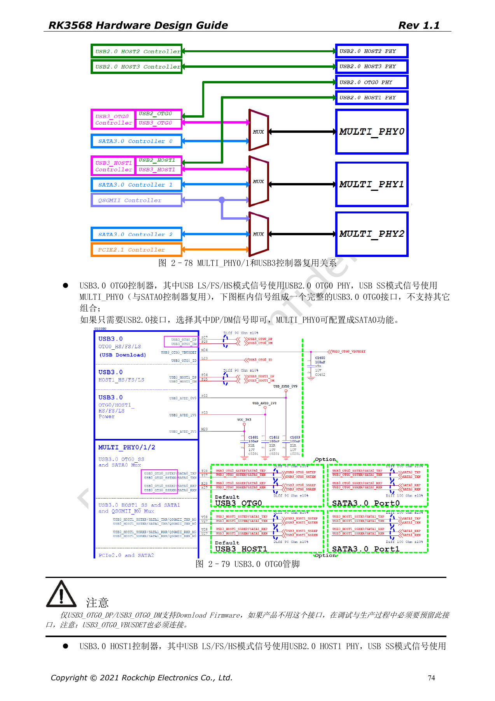
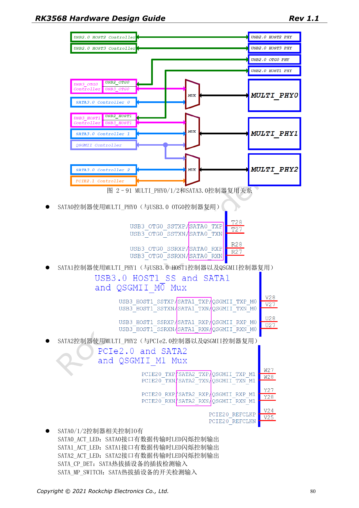
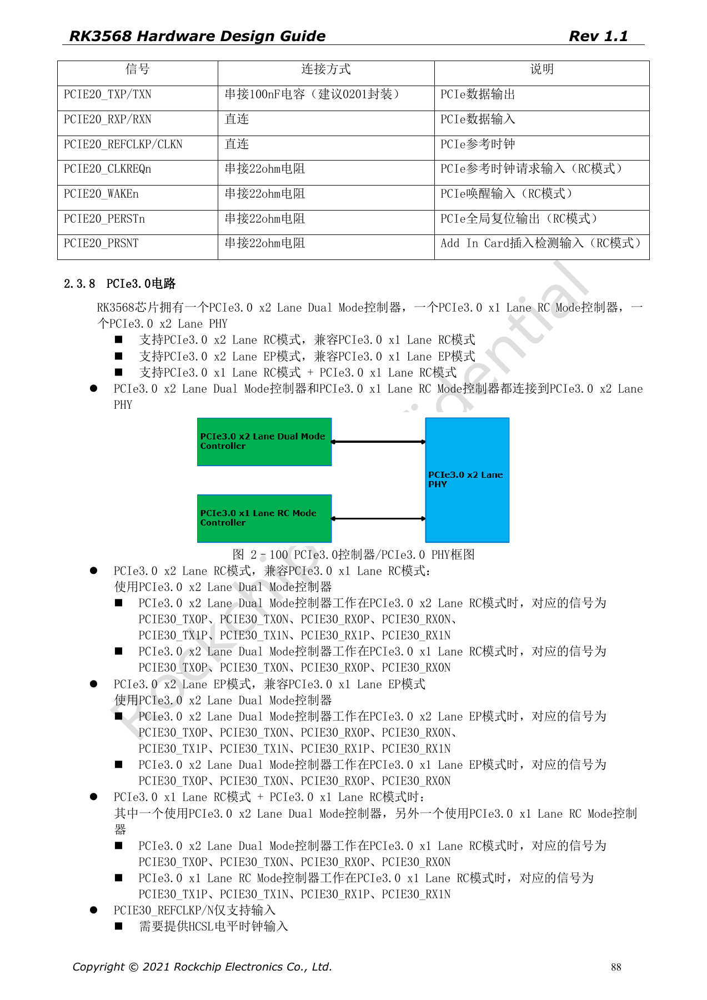

# RK3568 high-speed expansion: USB, SATA, PCIe muxing and clocks

This series reorganizes RK3568 Hardware Design Guide V1.1 (Chinese, 2021-06-08) and the separate High Speed PCB Design Guide V1.0.0 (English, 2021-04-12) around engineering questions. ArmSoM [Sige3](https://www.armsom.org/sige3) uses RK3568B2. Its [board documentation](https://docs.armsom.org/armsom-sige3) provides a product reference for studying and evaluating these design topics. SoC reference circuits do not describe every Sige3 circuit or exposed interface. Confirm SDK/BSP, kernel, silicon revision, firmware and peripheral combinations. Values are source references, not ArmSoM hardware measurements.

**CN V1.1 §2.3.4–2.3.8 · EN PCB §1.1–1.6**

## Draw the PHY allocation matrix first

MULTI_PHY0 selects USB3 OTG0 or SATA0. MULTI_PHY1 selects USB3 HOST1, SATA1 or QSGMII/SGMII. MULTI_PHY2 selects PCIe2.0, SATA2 or QSGMII/SGMII. Controller counts cannot be added as simultaneously usable ports. Pair USB3 SuperSpeed with its prescribed USB2 PHY; OTG0 DP/DM and VBUSDET remain the firmware download path.

## PCIe2 and PCIe3 have different clock directions

PCIe2.0 is x1 RC; REFCLK defaults to output and may also be input. PCIe3.0 has a two-lane PHY configured as x2 RC, x2 EP or two x1 RC ports. Its REFCLK is input-only and requires a PCIe3.0-compliant HCSL source. Use functional CLKREQn/WAKEn pins and one M0/M1/M2 group per interface. PERSTn may be GPIO; functional PERSTn must match the group. Standard slot controls are 3.3V and must match the IO domain.

## Manage coupling and impedance by interface

The English PCB source specifies USB3 TX 100nF, SATA TX/RX 10nF, PCIe2 TX 100nF and PCIe3 TX 220nF, all ±20%, preferably 0201. USB data uses 90Ω±10%, SATA 100Ω±10%, PCIe data 85Ω±10% and PCIe REFCLK 100Ω±10%. A universal “100Ω for all high-speed pairs” rule is incorrect. Post-layout simulation is recommended for PCIe3, including connector, vias, capacitors and full-channel loss.

## Validate the real interface combination

Freeze the controller, PHY, clock, IO group, power and DTS matrix before enumeration, target-rate, suspend/resume and sustained-transfer testing. The source lists up to five devices per SATA port through a port multiplier; this does not qualify arbitrary drivers or expansion boards. Its PCIe table also says “Max inter-pair skew <6inches”, equal to the total length limit. Retain this source wording without treating it as a precise matching target.

## Source parameters and constraints

| Item | Source reference |
| --- | --- |
| USB3 | 90Ω±10%; <12mil; <6in; 100nF±20% |
| SATA3 | 100Ω±10%; <12mil; <6in; 10nF±20% |
| PCIe2 | 85Ω±10%; <12mil; <6in; 100nF±20% |
| PCIe3 | 85Ω±10%; <12mil; <6in; 220nF±20% |

## Source figures

The source-page screenshots preserve circuit labels and context; article text and parameter tables remain editable. No matching English edition of the main Chinese guide was supplied, so its figures remain Chinese in all four languages. Images from the separate English PCB guide are labeled accordingly. Page references are physical PDF pages.

Chinese hardware guide · PDF 74

Chinese hardware guide · PDF 80

Chinese hardware guide · PDF 88

## Further reading and development resources

- [RK3568 hardware design: 10 circuit, PCB and production topics](/articles/rk3568-hardware-design-series/)
- [RK3568 boot storage: eMMC, FSPI, NAND and SDMMC circuits](/articles/rk3568-storage-emmc-fspi-sdmmc-hardware/)
- [RK3568 Ethernet hardware: dual GMAC, RGMII and QSGMII](/articles/rk3568-ethernet-rgmii-qsgmii-hardware/)
- [ArmSoM Docs](https://docs.armsom.org/)
- [ArmSoM](https://www.armsom.org/)
