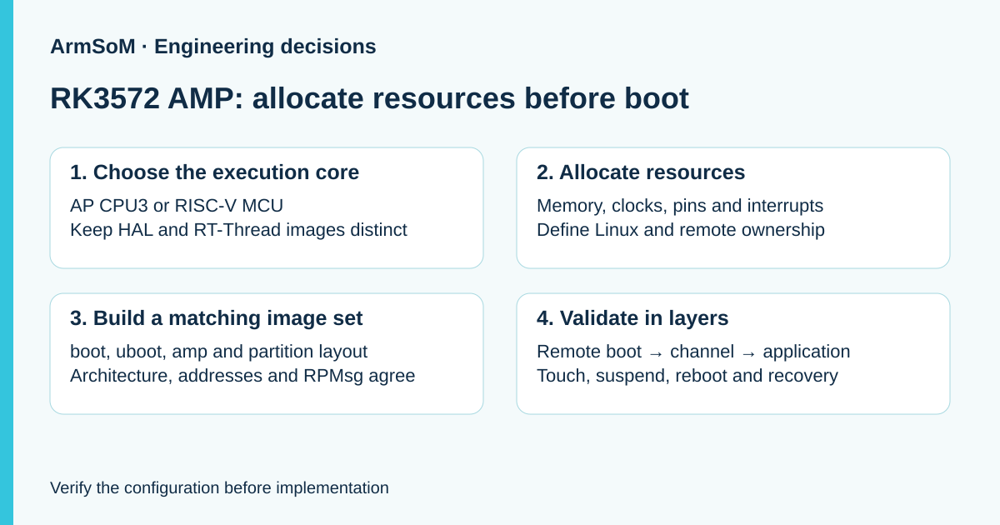

**Resource ownership is the first RK3572 AMP task—not simply compiling RT-Thread.** Android and the auxiliary firmware must agree on memory, peripherals, interrupts and entry points before a design can leave UI and networking on Android while assigning selected control work to another core.

This ArmSoM evaluation guide uses the supplied **RK3572 EVB1, Android 16 and Linux 6.12** project record. It is not a validated image tutorial for an ArmSoM RK3572 product. Addresses, paths and configuration belong to that example baseline. The screenshot ends during recovery instructions; missing steps are not reconstructed.



## 1. Select one of four combinations

| Combination | Auxiliary resource | Firmware | Android requirement |
| --- | --- | --- | --- |
| 1 | AP CPU3 | Rockchip HAL | Remove that core from Linux SMP ownership |
| 2 | AP CPU3 | RT-Thread | Same, with matching AP architecture and entry |
| 3 | RISC-V MCU | Rockchip HAL | AP cores remain for Android; allocate peripherals separately |
| 4 | RISC-V MCU | RT-Thread | Main path in this guide; independently built firmware |

AP and MCU images are not interchangeable because both are named `amp.img`. The example AP output is `rk3572-64/Image/amp.img`; the MCU output is `rk3572-mcu/Image/amp.img`. U-Boot's AP startup and MCU standalone paths differ too.

RPMsg provides interprocessor messaging, not automatic protection of shared resources. Linux documentation notes that remote processors can access physical memory and peripherals, making channel and message-access restrictions important. [Linux RPMsg](https://docs.kernel.org/staging/rpmsg.html)

## 2. Pin repositories, toolchain and build scope

Use a matching release of `u-boot`, `rkbin`, `kernel-6.12`, `device/rockchip` and `rt-thread-rk3572`. Android's `build.sh` is not the RT-Thread builder: auxiliary firmware is built separately.

For the MCU path below, replace the toolchain location with a real absolute path and confirm the compiler version required by the SDK:

```bash
cd rt-thread-rk3572/bsp/rockchip/rk3572-mcu
export RTT_EXEC_PATH=/absolute/path/to/riscv-toolchain/bin
test -x "$RTT_EXEC_PATH/riscv64-unknown-elf-gcc"
scons --menuconfig
scons -j8
./mkimage.sh
```

`RT_USING_RPMSG_LITE` enables the messaging stack. Test commands may depend on `RT_USING_COMMON_TEST` and GPIO/WDT options. Keep `.config`, `rtconfig.h` and the actual output consistent. The example `mkimage.sh` wraps `rtt.bin` into FIT-formatted `Image/amp.img`, with MCU load address `0x45000000`; this is not a default for other BSPs.

## 3. Both sides must agree on reserved memory

This is the source project's allocation, provided for comparison rather than direct reuse on arbitrary boards.

| Region | Base | Reservation |
| --- | --- | --- |
| mcu_reserved | 0x45000000 | 2 MiB |
| amp_shmem_reserved | 0x45200000 | 2 MiB |
| rpmsg_reserved | 0x45400000 | 2 MiB |
| rpmsg_dma_reserved | 0x45600000 | 2 MiB |
| amp_reserved | 0x45800000 | 32 MiB |
| amp_uart_reserved | 0x47800000 | 128 KiB |

The exclusive end of `amp_reserved` is `0x47800000`, adjacent to the next region without overlap. The source AP CPU3 entry is `0x46400000`, distinct from the MCU entry.

The RPMsg example maps only the `0x20000`-byte vring area and references a separate DMA pool through `memory-region`. Reservation size, mapped size and payload capacity are different concepts:

```dts
rpmsg: rpmsg@45400000 {
    compatible = "rockchip,rpmsg";
    mbox-names = "rpmsg-rx", "rpmsg-tx";
    mboxes = <&mailbox0 0 &mailbox3 0>;
    rockchip,vdev-nums = <1>;
    rockchip,link-id = <0x03>;
    reg = <0x0 0x45400000 0x0 0x20000>;
    memory-region = <&rpmsg_dma_reserved>;
    status = "okay";
};
```

Match `rockchip,link-id`, mailboxes and addresses to the remote rpmsg-lite configuration. `0x03` is the source value, not something inferred from a channel name. Inspect the merged device tree and linker scripts: both sides can compile successfully while using different memory.

## 4. Android kernel and board configuration

The source uses a non-GKI baseline. This does not establish that every AMP platform must disable GKI; check the target SDK's supported combination first.

```makefile
BOARD_BUILD_GKI := false
PRODUCT_KERNEL_CONFIG += rockchip_amp.config
BOARD_WITH_SPECIAL_PARTITIONS += amp:4M
```

Example kernel settings:

```text
CONFIG_ROCKCHIP_AMP=y
CONFIG_MAILBOX=y
CONFIG_ROCKCHIP_MBOX=y
CONFIG_RPMSG=y
CONFIG_RPMSG_VIRTIO=y
CONFIG_RPMSG_NS=y
CONFIG_RPMSG_ROCKCHIP_MBOX=y
CONFIG_RPMSG_TTY=y
CONFIG_VIRTIO=y
```

The source includes `rk3572-amp.dtsi` after `rk3572-android.dtsi`. Only its AP CPU3 combinations disable the corresponding CPU node:

```dts
&cpu_l3 {
    status = "disabled";
};
```

Do not apply that change unnecessarily to an MCU combination. `nproc` can reflect online state or process affinity and is not standalone ownership evidence; correlate the final DTS, CPU online list and boot logs.

## 5. Assign peripherals, interrupts and GPIO

When a peripheral moves to the remote core, inspect the Linux node, clocks, resets, pinctrl, DMA and interrupts together. Disabling one driver node does not automatically release every resource.

The source branch's `amp-irqs` uses global GIC interrupt IDs. For a DTS interrupt explicitly typed as SPI, apply the binding's `+32` conversion exactly once. This is not a dynamically allocated Linux virtual IRQ; do not copy the left-hand number in `/proc/interrupts` directly.

GPIO ownership may operate at bank/output granularity rather than at arbitrary individual pins. The source author reports Android touch failure after MCU initialization takes a GPIO bank and proposes deferring interrupt acquisition. The complete patch was not supplied, so **a screenshot fragment is not presented as a verified universal driver fix**. Inventory all Linux and MCU users of the bank and check the driver's actual sharing and ownership rules.

## 6. Make auxiliary firmware part of a reproducible build

The source Android build entry is shown below. Verify option meanings and output directories in your script first:

```bash
./build.sh -ACKUu
ls -lh rockdev/Image-rk3572_a16/
sha256sum rockdev/Image-rk3572_a16/amp.img
```

| Output | Review |
| --- | --- |
| `boot.img` | Kernel, DTS, AMP and RPMsg match the chosen combination |
| `uboot.img` | Correct firmware type and loading path |
| `amp.img` | Architecture, FIT metadata, entry and shared-memory contract |
| `parameter.txt` | Partition size, layout and actual packaging rules |
| `update.img` | Correct versions of every required image are included |

If packaging recreates `rockdev`, a one-time manual copy of `amp.img` can vanish in the next build. Integrate copying and a missing-file failure check into the build, and record hashes. The source's skip-if-missing snippet can aid debugging, but production packaging must not silently omit required firmware.

## 7. Pre-deployment checks and staged validation

These queries do not write partitions. Log access may need a development image; retain any failures:

```bash
adb shell cat /sys/devices/system/cpu/online
adb shell ls -l /dev/ttyRPMSG0
adb shell dmesg | grep -Ei 'amp|rpmsg|mailbox'
adb shell cat /proc/interrupts
adb shell ls -l /dev/block/by-name/
```

For initial deployment or a changed partition table, use a complete firmware set checked against the board, storage, loader, signatures and layout. Back up data and establish recovery first. The source's full-image command follows; **it writes firmware and is not a diagnostic query**. Use it only for the confirmed development device in the appropriate upgrade mode:

```bash
./upgrade_tool uf update.img
```

No fixed `/dev/block/sda13` or LBA-write recipe is supplied here, and the missing Maskrom recovery section is not invented. Partition changes invalidate those assumptions. Updating `amp` alone also requires an unchanged layout, compatible images and a recovery path.

Validate in order: U-Boot loads the remote image; remote console/logs work; RPMsg name and endpoints appear; small messages pass with length checks; the application runs; touch/network/storage operate concurrently; reboot, power loss, suspend and recovery pass. The example `/dev/ttyRPMSG0` is an observation point, not a guaranteed node on every image.

A successful boot does not establish hard real-time performance. Record load, measurement method, worst-case latency and fault recovery. The [ArmSoM AMP guide](/articles/022-rockchip-amp/) explains background concepts, but settings for other SoCs do not replace RK3572 configuration. [Supplied project record](https://mp.weixin.qq.com/s/LZsdrAUAg8sIBmwEcc1PAw)

## Products and further reading

Start an ArmSoM evaluation with the RK3588-based [Sige7](https://www.armsom.org/sige7), [AIM7](https://www.armsom.org/aim7) or [LM7](https://www.armsom.org/lm7), or the RK3576-based [CM5](https://www.armsom.org/cm5) and [Sige5](https://www.armsom.org/sige5). Check interfaces and available images in the [Sige7](https://docs.armsom.org/armsom-sige7), [CM5](https://docs.armsom.org/armsom-cm5) and [Sige5](https://docs.armsom.org/armsom-sige5) documentation. These links support product selection; they do not certify every SDK combination discussed here.
