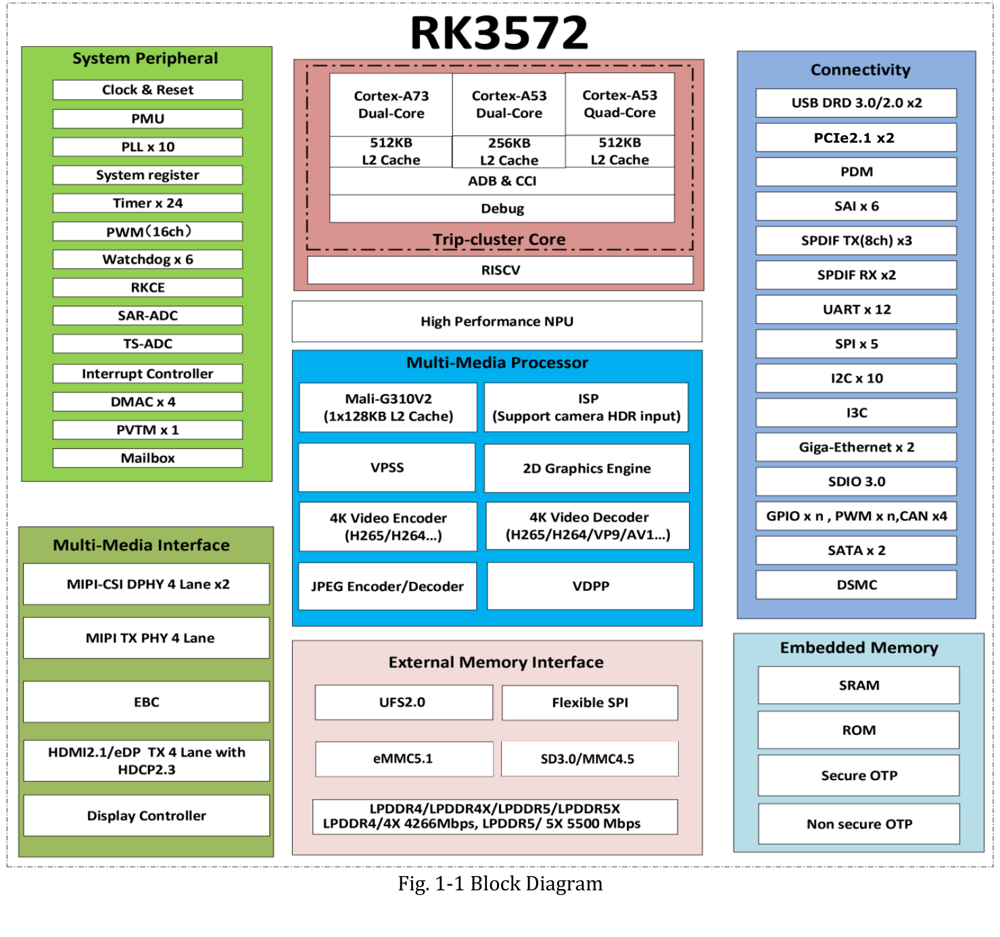

## Applicability

This guide supports RK3572 board design and evaluation for the ArmSoM Zero5 project. It uses the RK3572 Hardware Design Guide V1.1 and the supplied hardware package. SoC interfaces are not necessarily exposed on a board. Final Zero5 configurations, operating systems and kernel versions must be checked against the documentation for the specific hardware revision. No ArmSoM hardware measurements were performed for this article.

RK3572 selection depends on the combination of CPU, NPU, multimedia and interfaces. Separate chip capability, PHY multiplexing and board implementation before choosing memory, storage and connectors. This page moves to V1.1 while retaining its existing URL so earlier references remain useful.

## What changed from V1.0 to V1.1

| Item | Specification and limit |
|---|---|
| GPU API | Vulkan 1.2 → Vulkan 1.4 |
| LPDDR4 / LPDDR4X | Added restriction: R17 is not supported when the rank number is 2. The capacity limit does not validate every DRAM organization. |
| VideoPort1 | 2048 × 1080 @ 60 Hz, 8-bit |

The source is the 47-page `Rockchip RK3572 Datasheet V1.1-20260413.pdf`. The previous article used V1.0 (2026-03-24, 51 pages). A page-count change does not imply a proportional change in chip functionality. New values and conditions take precedence; v10 in the URL is retained solely for link continuity.

*RK3572 functional block diagram*

## CPU, GPU, NPU and memory

| Item | Specification and limit |
|---|---|
| CPU | 2 × Cortex-A73 + 6 × Cortex-A53; ARMv8-A |
| CPU clusters | 2 × A73 / 4 × A53 / 2 × A53; L2: 512 / 512 / 256 KB respectively |
| GPU | Mali-G310V2 MC1; OpenGL ES 3.2; OpenCL 3.0 Full Profile; Vulkan 1.4 |
| NPU | 4 TOPS (INT8 Sparse); INT4/INT8/INT16; FP4/FP8/FP16/BF16; W4A16 |
| DRAM | LPDDR4/4X-4266; LPDDR5/5X-5500; 32-bit; ≤16 GB; ≤4 ranks |
| MCU | RISC-V Nuclei N320; 24 KB ILM; 8 KB I-cache; 8 KB D-cache |

Read 4 TOPS together with its INT8 Sparse qualification; it is not the throughput of every model. The 16 GB figure is an addressing limit, not a confirmed Zero5 memory option. Model speed, memory bandwidth, cooling and system power require validation on a specific board, firmware and model.

## Video codecs, display and image input

| Item | Specification and limit |
|---|---|
| H.265 / VP9 / AV1 / AVS2 decode | 8K @ 30 / 4K @ 120 |
| H.264 decode | 4K @ 60 |
| H.264 / H.265 encode | 4K @ 40 |
| JPEG | 4K @ 60 |
| ISP | 12 MP |
| VideoPort0 | 4096 × 2160 @ 60 Hz; 10-bit |
| VideoPort1 | 2048 × 1080 @ 60 Hz; 8-bit |
| HDMI / eDP | HDMI 2.1 / eDP 1.3 Combo PHY; HDMI ≤4K @ 60 |
| MIPI DSI | 4 lanes; 2.5 Gbit/s/lane |
| MIPI CSI | 2 × 4-lane D-PHY; DVP |

Maximum decoding, output-link bandwidth and simultaneous displays are separate limits. The V1.1 block diagram still labels the decoder “4K Video Decoder”, whereas its text lists 8K@30. This table follows the textual codec and frame-rate specification. The hardware guide’s example of 4096×2160@60 plus 2560×1600@60 conflicts with the datasheet’s VideoPort1 limit. That combination is not promised here; verify the formal silicon specification and actual BSP.

## Storage, peripherals and package

| Item | Specification and limit |
|---|---|
| Storage | eMMC 5.1; UFS 2.0 HS-G3 ×2; SDMMC; FSPI 1/2/4/8-bit |
| Network | 2 × GMAC |
| USB | 2 × USB 3.0 / USB 2.0 DRD |
| Low-speed I/O | 12 × UART; 10 × I2C; 5 × SPI; 4 × CAN; 16 × PWM |
| Package | FCCSP550L; 14.3 × 15.5 mm; ball 0.25 mm; pitch 0.42 / 0.52 / 0.65 mm |
| Assembly | MSL 3; SnAgCu |
| Junction temperature | <125 °C |
| Thermal coefficients | θJA / θJB / θJC / ψJT: TBD |

Interface counts require the mux diagrams. V1.1 lists two PCIe/SATA/USB Combo interfaces and one PCIe/SATA Combo interface. These are three multiplexed PHY paths, not three independent controllers. The guide describes two PCIe controllers, two SATA controllers and three shared PHYs. Circuit articles in this series follow that controller mapping and do not count alternative mux positions as independent ports. Thermal coefficients remain TBD, so heatsink calculations must not use invented thermal resistance.

## ArmSoM products and next steps

For a compact RK3572 product, start with ArmSoM’s Zero-form-factor plan and list the display, storage, network and power interfaces your design needs. The planning article is not a released model specification or final schematic. Use the official product catalogue and Docs when selecting an available platform and checking its interfaces.

- [RK3572 / ArmSoM Zero product plan](/articles/rockchip-rk3572-armsom-zero-preview/)
- [ArmSoM](https://www.armsom.org/category/all-products) · [ArmSoM Docs](https://docs.armsom.org/)

## Reading path through this series

- [RK3572 datasheet V1.1: specifications, interfaces and revision changes](/articles/rk3572-datasheet-v10/)
- [RK3572 hardware design: from reference selection to first-board validation](/articles/rk3572-hardware-design-series/)
- [RK3572 minimum system: 24 MHz clock, reset, boot and UART bring-up](/articles/rk3572-minimum-system-bringup/)
- [RK3572 power design: domains, RK806-5 and dual-PMIC options](/articles/rk3572-power-domains-pmic/)
- [RK3572 DDR design: LPDDR4X and LPDDR5 circuits and PCB constraints](/articles/rk3572-ddr-circuit-pcb/)
- [RK3572 DDRBIN configuration: templates, ADC selection and multiple profiles](/articles/rk3572-ddrbin-adc-configuration/)
- [RK3572 storage and boot: eMMC, UFS and FSPI wiring and power](/articles/rk3572-storage-boot-design/)
- [RK3572 USB and Type-C: programming, roles and power detection](/articles/rk3572-usb-typec-power-design/)
- [RK3572 PCIe and SATA: Combo PHY multiplexing, clocks and routing](/articles/rk3572-high-speed-interface-design/)
- [RK3572 displays and cameras: HDMI, eDP, MIPI and voltage matching](/articles/rk3572-display-camera-design/)
