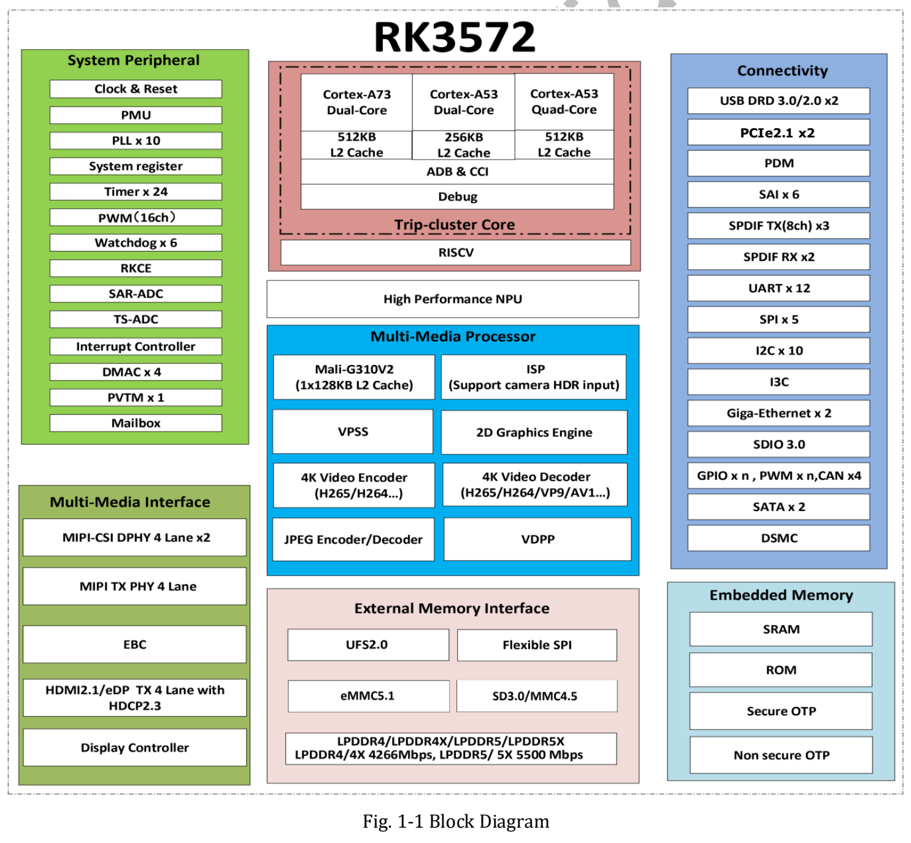
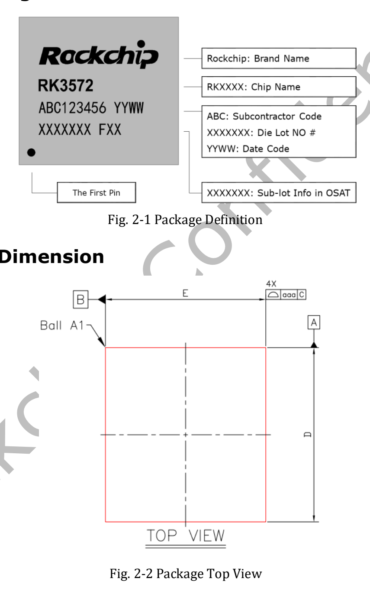
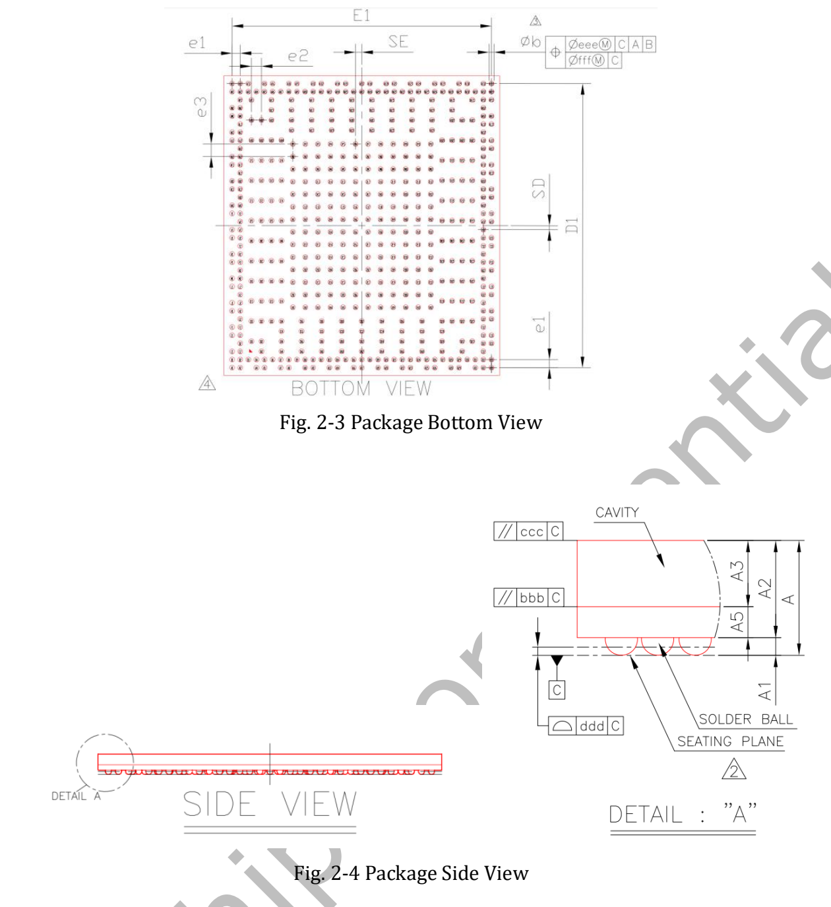
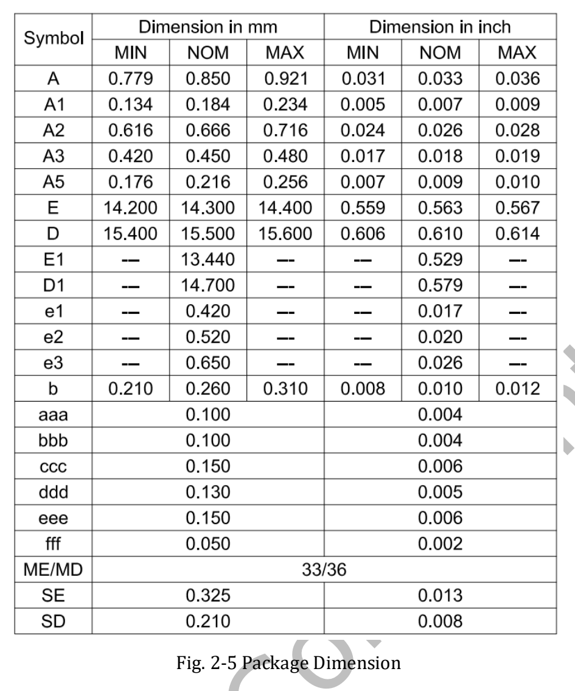

RK3572 combines eight CPU cores, an NPU, image processing and video codecs for compact AIoT devices. This guide uses **RK3572 Datasheet V1.0, 51 pages, initial revision dated 2026-03-24**, and explains the conditions behind its specifications.

[Download the original RK3572 Datasheet V1.0 (PDF, about 2.33 MiB)](/assets/rk3572-datasheet/RK3572-Datasheet-V1.0.pdf)

This is a reading and selection guide, not a verbatim reproduction of 51 pages. The original file is preserved for electrical design and pin verification. V1.0 is not presented as the latest revision.

## CPU, memory and AI compute

| Item | V1.0 specification | PDF page |
|---|---|---|
| CPU | 2× Cortex-A73 + 6× Cortex-A53, Armv8-A | 7–8 |
| Clusters | Two A73, four A53, two A53; L2: 512kB, 512kB, 256kB respectively | 7–8 |
| Memory | LPDDR4/4X-4266, LPDDR5/5X-5500; 32-bit; up to 16GB address space | 8 |
| GPU | Mali G310V2 MC1; OpenGL ES 3.2, OpenCL 3.0 Full Profile, Vulkan 1.2 | 13 |
| NPU | 4 TOPS INT8, footnoted as Sparsity | 13 |
| Formats | INT4/INT8/INT16, FP4/FP8/FP16/BF16; asymmetric W4A16 MAC | 13 |

**Retain the sparsity qualification on 4 TOPS.** It is not dense throughput for every model or end-to-end frame rate. Model structure, sparsity, quantization, operators and runtime affect results. Format support does not imply 4 TOPS at every precision. Controller capability and address space also do not establish the memory fitted to a future ArmSoM product.

## Chip block diagram

The block diagram says “4K Video Decoder”, while the overview states up to 8K@30fps. Both original descriptions are retained; verify specific modes against detailed features and the actual BSP.

The diagram organizes compute, media and peripheral blocks. Verify controller counts and multiplexing against detailed sections, pins and board schematics; not every illustrated block becomes a simultaneously available external port.

## Video and camera processing

Page 7 lists H.265, VP9, AV1 and AVS2 decoding up to 8K@30fps or 4K@120fps, and H.264 up to 4K@60fps. H.264/H.265 encoding reaches up to 4K@40fps; JPEG encoding/decoding up to 4K@60fps. Check individual formats, profiles, bit depths and combinations in the feature sections rather than assuming every format reaches every maximum concurrently.

The 12MP-class ISP includes HDR, 3A, CAC, denoising, sharpening, dehaze and lens-distortion correction. Camera quality depends on sensor drivers, optics and IQ tuning. RGA v2.5 supports suitable scaling, rotation and format processing while the CPU runs application logic. These suggest local vision, interactive displays and smart terminals, not measured performance claims.

## Package and production information

The source specifies FCCSP550L, a 14.3 × 15.5 mm body, 0.25 mm balls and mixed 0.42/0.52/0.65 mm pitch. MSL is 3; ball material is SnAgCu. Read tolerances, orientation and units from the drawings. These are chip dimensions, not board dimensions.

## Electrical and thermal boundaries

Absolute ratings start on page 41; recommended operating conditions start on page 42. Use the relevant voltage-domain conditions for supplies and IO. Absolute limits are not operating targets, and GPIO must not be assumed 5V tolerant.

Page 51 requires junction temperature below 125°C, not an ambient rating. θJA, θJB, θJC and ψJT are all **TBD** in V1.0. They cannot support a system thermal-resistance, power or fanless-operation claim. Validate power, temperature rise and sustained load on the actual board.

## Navigating the document

| PDF pages | Content |
|---|---|
| 7–23 | Overview, features and block diagram |
| 24–26 | Ordering, marking, package, MSL and ball material |
| 27–40 | Pin list |
| 41–50 | Electrical conditions, IO, LPDDR, PLL, PHY and ADC |
| 51 | Thermal management and pending parameters |

The earlier blog article reflects launch material mentioning Vulkan 1.4; this older V1.0 datasheet states Vulkan 1.2. These sources and dates are kept distinct. Verify actual APIs against the final BSP and GPU driver.

## ArmSoM's RK3572 plan

ArmSoM plans a Raspberry Pi Zero-form-factor product based on RK3572 for compact vision, interaction and edge AI evaluation. Model name, memory, ports, OS support, price and launch date are not announced here. Form factor does not establish pin or software compatibility.

[RK3572 and the ArmSoM Zero product plan](/articles/rockchip-rk3572-armsom-zero-preview/) · [ArmSoM](https://www.armsom.org/)
