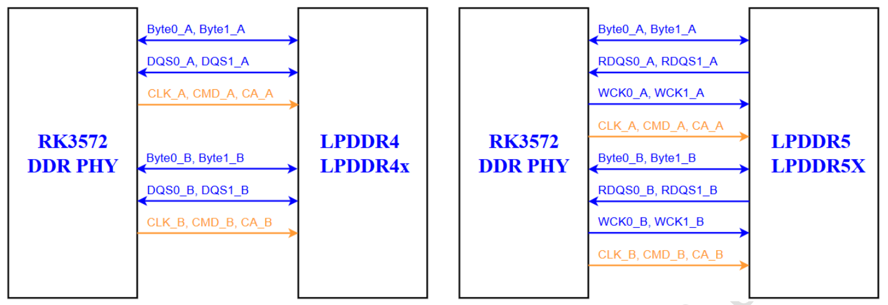
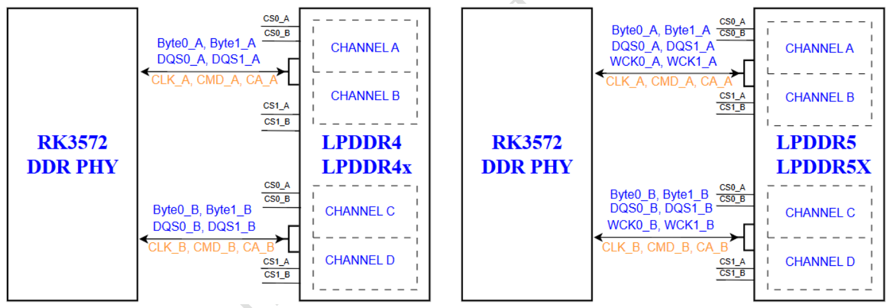
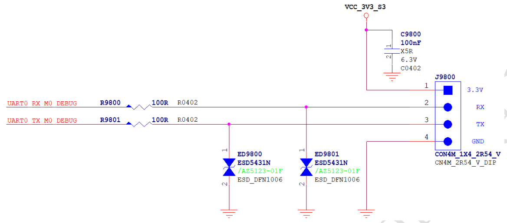
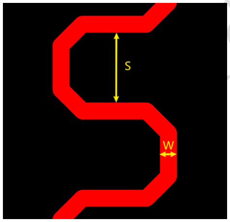
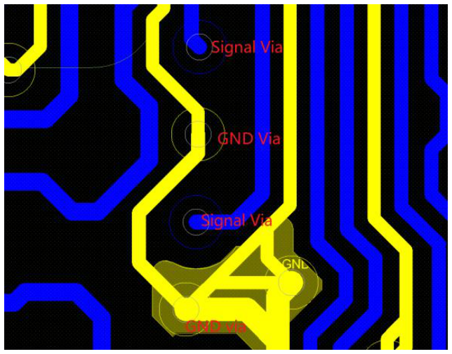
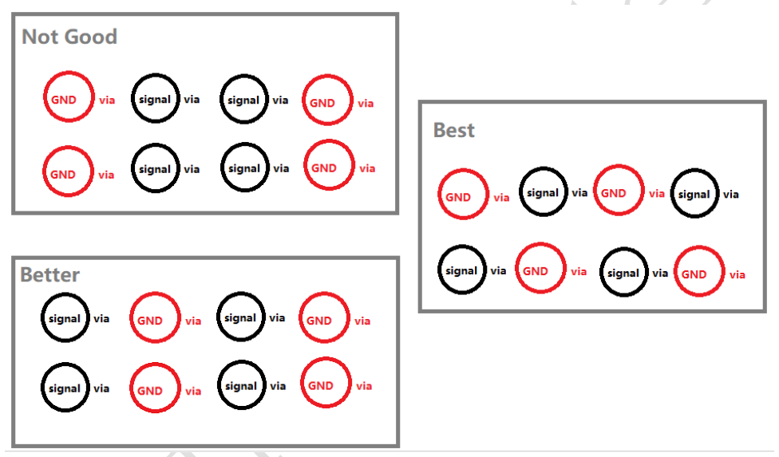

## Applicability

This guide supports RK3572 board design and evaluation for the ArmSoM Zero5 project. It uses the RK3572 Hardware Design Guide V1.1 and the supplied hardware package. SoC interfaces are not necessarily exposed on a board. Final Zero5 configurations, operating systems and kernel versions must be checked against the documentation for the specific hardware revision. No ArmSoM hardware measurements were performed for this article.

RK3572 DDR design requires a coordinated choice of DRAM organization, wiring, PCB template and DDRBIN. “LPDDR5, 8 GB” alone is insufficient: ranks, package, byte mapping, supplies and training parameters affect reliable startup. Start from a matching vendor template, then verify timing and power integrity for the actual stack-up.

## 1. Bus width, capacity and topology

| Item | Requirement |
|---|---|
| Controller | 32-bit; 1 channel; ≤4 ranks; ≤16 GB |
| LPDDR4 / LPDDR4X | ≤4266 MT/s |
| LPDDR5 / LPDDR5X | ≤5500 MT/s |
| LPDDR4 / LPDDR4X, V1.1 | R17 is unsupported with two ranks |

Limits do not validate every capacity, package and rank combination. “64-bit DRAM” in a reference drawing describes the memory package organization and connection scheme; it does not make the RK3572 controller 64-bit. The two-device reference requires equal capacities. Match part, package and CS organization to the template and DDRBIN.

*Point-to-point connection with 32-bit DRAM*

*Alternative DRAM package topology*

## 2. Which signals may be swapped

| Item | Requirement |
|---|---|
| Byte lanes | Only byte 0↔1 and byte 2↔3; no cross-group swaps |
| DQ | May swap within a byte; record the mapping |
| DM / CLK / CS / WCK / DQS | Do not apply arbitrary DQ-style swaps |
| CA_A0–CA_A5 | Swappable within the group; CA_A6 is excluded |
| 4 ranks | Keep mapping consistent across ranks |

## 3. Supplies and ZQ: distinguish SoC from DRAM

| Node | LPDDR4 | LPDDR4X | LPDDR5 / 5X |
|---|---|---|---|
| DRAM VDD1 | 1.8 V | 1.8 V | 1.8 V |
| DRAM VDD2 / VDD2H | 1.1 V | 1.1 V | 1.05 V |
| DRAM VDD2L | — | — | 0.9 / 1.05 V |
| DRAM VDDQ | 1.1 V | 0.6 V | 0.5 V |
| PHY VDDQ / CKVDDQ | 0.75 V | 0.6 V | 0.5 V |
| PHY VDDQH | 1.1 V | 1.1 V | 1.05 V |

The table reflects the guide’s supply examples; the selected DRAM datasheet remains authoritative for that device. SoC ZQ uses 120 Ω, 1% to DDRPHY_VDDQ_S0. DRAM ZQ uses 240 Ω, 1%: to VDD2 for LPDDR4 and VDDQ for LPDDR4X/LPDDR5. LPDDR4 ODT_CA connects to VDD2. Check both resistance and destination net; the two ZQ circuits are not identical.

*RK3572 DDR ZQ pin*

*DRAM ZQ and ODT references*

## 4. LPDDR5 CK, WCK and RDQS

LPDDR5 separates command clock CK from data clock WCK, which can run at two or four times CK; reads also use RDQS. Routing groups, delay matching and training must follow this architecture rather than inherit every LPDDR4 rule. DDRPHY_VDDQH is still required for the low-power retention state; verify self-refresh and resume before removing other supplies.

## 5. PCB impedance and delay matching

| Item | Requirement |
|---|---|
| DQ / DM / CA | 40–45 Ω ±10%; prefer 40 Ω |
| CLK / DQS / WCK | 90 Ω differential ±10% |
| DQ/DM ↔ DQS/WCK | ≤45 ps / ≤90 mil |
| CA/control ↔ CLK | ≤45 ps / ≤90 mil |
| Intra-pair skew | ≤1 ps / ≤5 mil |
| LPDDR5: DQS/WCK ↔ CLK | ≤130 ps / ≤550 mil |
| LPDDR4: DQS ↔ CLK | ≤90 ps / ≤410 mil |

The guide lists ps and mil constraints; they do not establish a universal conversion factor. Delay depends on stack-up, dielectric and vias. Check flight time first, including vias. Ordinary spacing is at least 2W; clocks or strobes versus other traces should preferably use at least 3W, with 2W as the minimum. Serpentine spacing S is at least 3W; tightly packed meanders are not a substitute for timing analysis.

*Serpentine spacing constraints*

## 6. Reference planes, return vias and power integrity

*Return vias near layer transitions*

*Signal and return-via arrangement*

At layer transitions, the guide limits the center-to-center distance to a nearby return via to 25 mil. Provide adjacent return paths, continuous ground references and at least 12 mil from traces to reference-plane edges. Check at least 0.8 ground vias per DRAM ground pin. Clock ground-guard via spacing is no more than 400 mil. Removing unused via pads must still respect manufacturing and reliability constraints.

| Rail | 100 kHz–30 MHz | 30–100 MHz |
|---|---|---|
| LPDDR4X VDD2 / VDDQ; LPDDR5 VDDQ / VDD2H | ≤0.03 Ω | ≤0.04 Ω |
| LPDDR5 VDD2L | ≤0.075 Ω | ≤0.08 Ω |

Evaluate these PDN targets with package, decoupling and PCB simulation. Dense signal vias must not sever power planes. Keep capacitor return paths short; the guide calls for at least two relevant power/ground vias for 0603/0805 capacitors. First-board tests should cover cold starts, repeated resets, capacity detection, memory stress, temperature variation and suspend/resume. One successful boot is not DDR qualification.

## ArmSoM products and next steps

For a compact RK3572 product, start with ArmSoM’s Zero-form-factor plan and list the display, storage, network and power interfaces your design needs. The planning article is not a released model specification or final schematic. Use the official product catalogue and Docs when selecting an available platform and checking its interfaces.

- [RK3572 / ArmSoM Zero product plan](/articles/rockchip-rk3572-armsom-zero-preview/)
- [ArmSoM](https://www.armsom.org/category/all-products) · [ArmSoM Docs](https://docs.armsom.org/)

## Reading path through this series

- [RK3572 datasheet V1.1: specifications, interfaces and revision changes](/articles/rk3572-datasheet-v10/)
- [RK3572 hardware design: from reference selection to first-board validation](/articles/rk3572-hardware-design-series/)
- [RK3572 minimum system: 24 MHz clock, reset, boot and UART bring-up](/articles/rk3572-minimum-system-bringup/)
- [RK3572 power design: domains, RK806-5 and dual-PMIC options](/articles/rk3572-power-domains-pmic/)
- [RK3572 DDR design: LPDDR4X and LPDDR5 circuits and PCB constraints](/articles/rk3572-ddr-circuit-pcb/)
- [RK3572 DDRBIN configuration: templates, ADC selection and multiple profiles](/articles/rk3572-ddrbin-adc-configuration/)
- [RK3572 storage and boot: eMMC, UFS and FSPI wiring and power](/articles/rk3572-storage-boot-design/)
- [RK3572 USB and Type-C: programming, roles and power detection](/articles/rk3572-usb-typec-power-design/)
- [RK3572 PCIe and SATA: Combo PHY multiplexing, clocks and routing](/articles/rk3572-high-speed-interface-design/)
- [RK3572 displays and cameras: HDMI, eDP, MIPI and voltage matching](/articles/rk3572-display-camera-design/)
