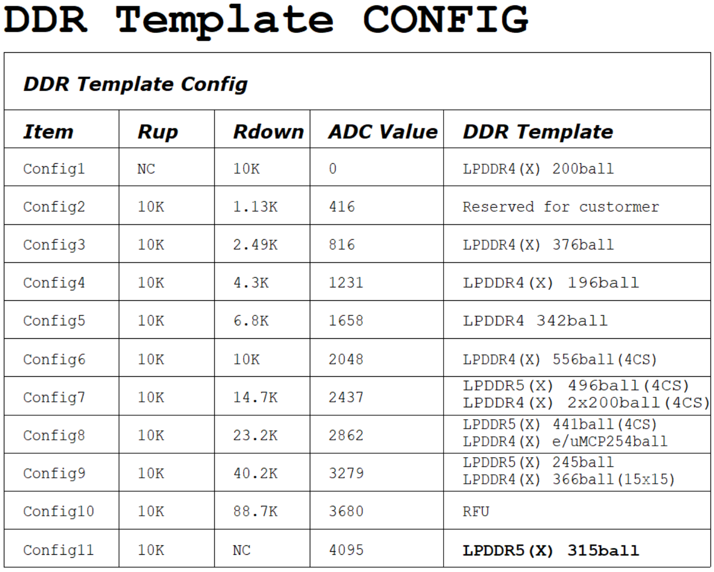
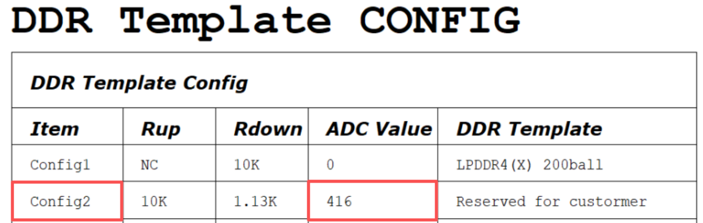

## Applicability

This guide supports RK3572 board design and evaluation for the ArmSoM Zero5 project. It uses the RK3572 Hardware Design Guide V1.1 and the supplied hardware package. SoC interfaces are not necessarily exposed on a board. Final Zero5 configurations, operating systems and kernel versions must be checked against the documentation for the specific hardware revision. No ArmSoM hardware measurements were performed for this article.

DDRBIN configuration is not a single parameter set for all memory. Record the RK3572 DDR template, ADC selection, DRAM type and binary version together. This article follows the 2026-05-18 instructions for Linux and Windows and preserves the meaning of the original command parameters.

## 1. Prepare three matching inputs

Prepare the actual DDR schematic/PCB template, its `_ddrbin_tool_config.txt`, and the `rk3572_ddr_*MHz_v*.*.bin` matching your SDK. If the template has no configuration file, follow the instruction to use the rkbin default and record that choice; do not invent settings from a similar memory capacity. Preserve the original binary, configuration, tool version and output checksum for rollback and reproducibility.

## 2. ADC Config is an index, not the sampled value

| Config | Rup | Rdown | ADC | DDR template selection |
|---|---|---|---|---|
| 1 | NC | 10 kΩ | 0 | LPDDR4(X) 200-ball |
| 2 | 10 kΩ | 1.13 kΩ | 416 | Customer reserved |
| 3 | 10 kΩ | 2.49 kΩ | 816 | LPDDR4(X) 376-ball |
| 4 | 10 kΩ | 4.3 kΩ | 1231 | LPDDR4(X) 196-ball |
| 5 | 10 kΩ | 6.8 kΩ | 1658 | LPDDR4 342-ball |
| 6 | 10 kΩ | 10 kΩ | 2048 | LPDDR4(X) 556-ball (4 CS) |
| 7 | 10 kΩ | 14.7 kΩ | 2437 | LPDDR5(X) 496-ball (4 CS) / LPDDR4(X) 2 × 200-ball (4 CS) |
| 8 | 10 kΩ | 23.2 kΩ | 2862 | LPDDR5(X) 441-ball (4 CS) / LPDDR4(X) e/uMCP 254-ball |
| 9 | 10 kΩ | 40.2 kΩ | 3279 | LPDDR5(X) 245-ball / LPDDR4(X) 366-ball (15 × 15) |
| 10 | 10 kΩ | 88.7 kΩ | 3680 | RFU |
| 11 | 10 kΩ | NC | 4095 | LPDDR5(X) 315-ball |

For example, ADC 416 corresponds to Config 2, so use `adc_value_to_ddr_config=2`, not `=416`. Config 2 is the customer slot used in the source example, not a universal choice for LPDDR4 boards. Boot-medium selection also uses an ADC divider table, but that table describes boot order and cannot replace the DDR mapping here.

## 3. Linux configuration workflow

Read `rkbin/tools/ddrbin_tool_user_guide.txt` from the matching version first, then run `ddrbin_tool.py` from its tool directory. The command below retains the source template. Replace the template name and frequency/version wildcards with exact filenames; do not allow a wildcard to select several DDR binaries. This edits a host file, not board flash.

```text
./ddrbin_tool.py rk3572 模板名称_ddrbin_tool_config.txt rk3572_ddr_*MHz_v*.*.bin LPDDR4 adc_value_to_ddr_config=2
```

Check platform rk3572, the actual PCB-template configuration, the intended DRAM type and the ADC Config selected by the hardware resistors. Output location and naming follow the installed tool’s instructions. Inspect its result and modified file before using the matching SDK packaging flow. The source says to omit DRAM-type and ADC arguments on platforms without an ADC table; do not apply this RK3572 example to every platform.

[](/assets/rk3572-hardware-20261119/ddrbin-config-5.png)

*DDRBIN tool and configuration fields*

## 4. Windows configuration workflow

The source uses `rk_ddrBin_tool_windows`. Select the platform, DramType (LPDDR4 in the example) and ADC Config (2 in the example), import the target DDRBIN, then enter the template parameters field by field. Do not infer Linux-to-GUI field mapping solely from a screenshot; use matching tool documentation, the template and output checks. Screenshot capacities and timings are not defaults for different DRAM parts.

[](/assets/rk3572-hardware-20261119/ddrbin-config-6.png)

*Windows DDR parameter configuration*

## 5. Accumulate multiple profiles in one resulting binary

One operation changes only the selected DRAM type and ADC profile. For several profiles, use the first modified binary as the second input, then continue from that result. Reopening the original binary each time does not accumulate previous changes. Record input, output, DRAM type and Config index for every step, then validate every intended hardware selection.

## 6. Acceptance record before firmware release

| Item | Requirement |
|---|---|
| Hardware | PCB revision, complete DRAM part, capacity, ranks and fitted ADC resistors |
| Files | Template, config, tool version and original/final binary checksums |
| Validation | Boot logs, capacity, memory stress and resume for each profile |

The configuration tools were not executed for this article, and generated files were not tested on Zero5. Before production, the hardware and SDK owners must validate the final binary. One reference EVB booting successfully does not qualify every memory option.

## ArmSoM products and next steps

For a compact RK3572 product, start with ArmSoM’s Zero-form-factor plan and list the display, storage, network and power interfaces your design needs. The planning article is not a released model specification or final schematic. Use the official product catalogue and Docs when selecting an available platform and checking its interfaces.

- [RK3572 / ArmSoM Zero product plan](/articles/rockchip-rk3572-armsom-zero-preview/)
- [ArmSoM](https://www.armsom.org/category/all-products) · [ArmSoM Docs](https://docs.armsom.org/)

## Reading path through this series

- [RK3572 datasheet V1.1: specifications, interfaces and revision changes](/articles/rk3572-datasheet-v10/)
- [RK3572 hardware design: from reference selection to first-board validation](/articles/rk3572-hardware-design-series/)
- [RK3572 minimum system: 24 MHz clock, reset, boot and UART bring-up](/articles/rk3572-minimum-system-bringup/)
- [RK3572 power design: domains, RK806-5 and dual-PMIC options](/articles/rk3572-power-domains-pmic/)
- [RK3572 DDR design: LPDDR4X and LPDDR5 circuits and PCB constraints](/articles/rk3572-ddr-circuit-pcb/)
- [RK3572 DDRBIN configuration: templates, ADC selection and multiple profiles](/articles/rk3572-ddrbin-adc-configuration/)
- [RK3572 storage and boot: eMMC, UFS and FSPI wiring and power](/articles/rk3572-storage-boot-design/)
- [RK3572 USB and Type-C: programming, roles and power detection](/articles/rk3572-usb-typec-power-design/)
- [RK3572 PCIe and SATA: Combo PHY multiplexing, clocks and routing](/articles/rk3572-high-speed-interface-design/)
- [RK3572 displays and cameras: HDMI, eDP, MIPI and voltage matching](/articles/rk3572-display-camera-design/)
