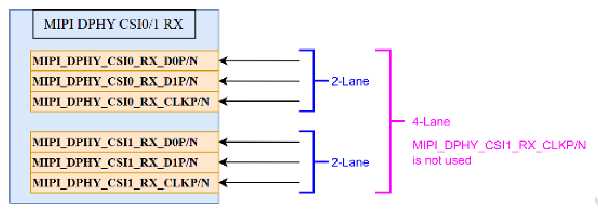
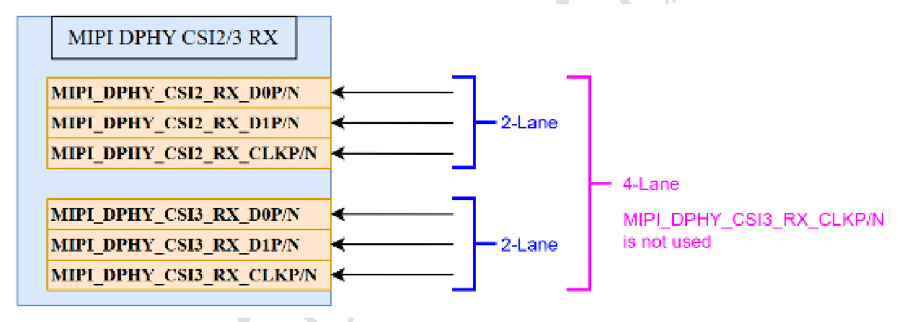
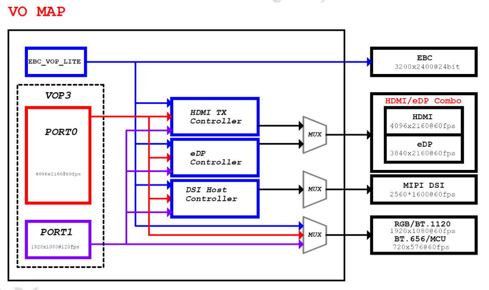
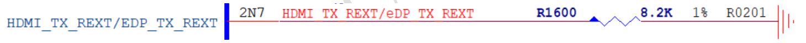
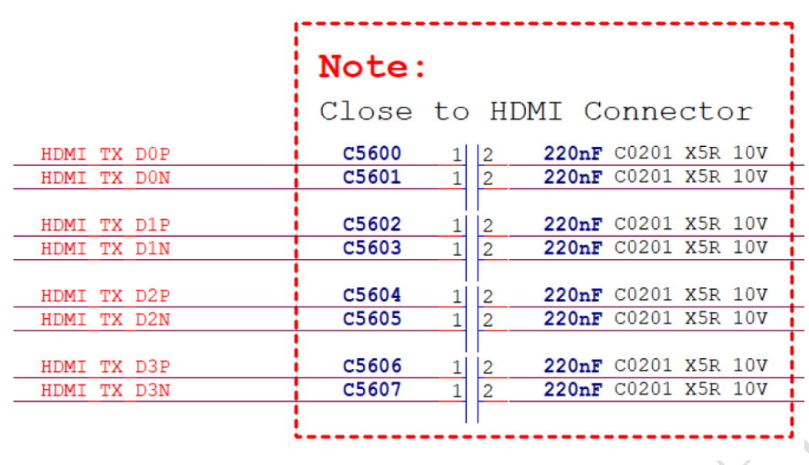
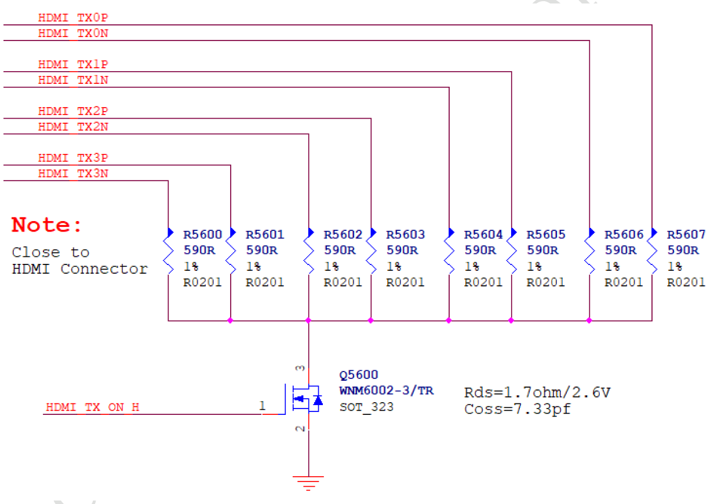
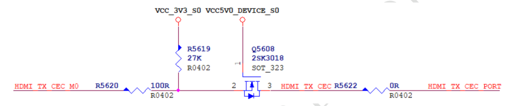
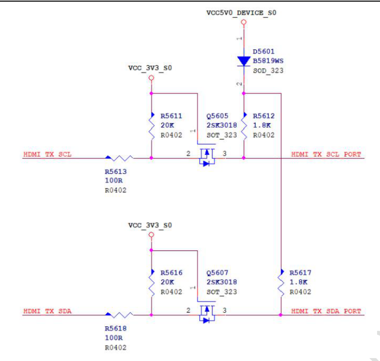
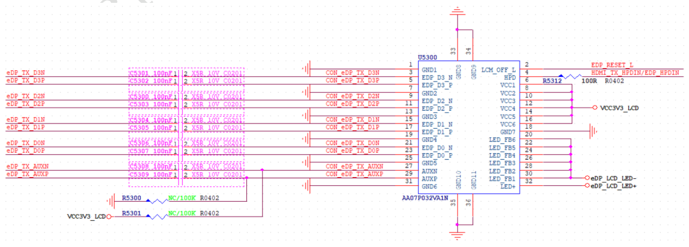
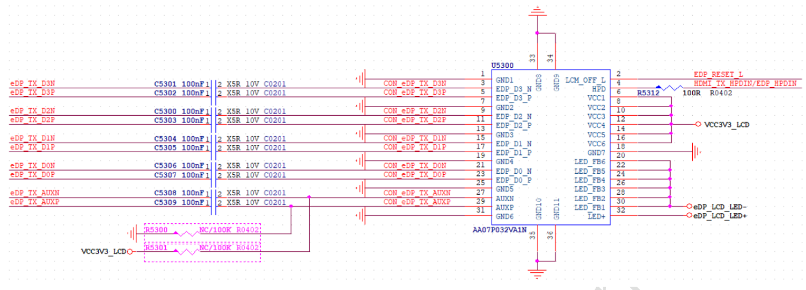

## Applicability

This guide supports RK3572 board design and evaluation for the ArmSoM Zero5 project. It uses the RK3572 Hardware Design Guide V1.1 and the supplied hardware package. SoC interfaces are not necessarily exposed on a board. Final Zero5 configurations, operating systems and kernel versions must be checked against the documentation for the specific hardware revision. No ArmSoM hardware measurements were performed for this article.

RK3572 display and camera design begins with pixel throughput, VOP/ISP paths, PHY multiplexing and voltage levels. A connector that physically fits does not establish resolution, frame rate, lane, power-sequence or driver compatibility. Camera inputs and display outputs are reviewed separately below to support schematic checks.

## 1. Two four-lane CSI groups and split modes

RK3572 provides two MIPI D-PHY CSI RX groups, D-PHY 1.2 at up to 2.5 Gbit/s/lane. Each four-lane group can split into two two-lane interfaces as drawn, each with its corresponding clock pair. This does not permit arbitrary assignment of four data lanes to four sensors.

| Data resource | Split interface |
|---|---|
| CSI0 D0/D1 | CSI0 D0/D1 + CLK0 |
| CSI0 D2/D3 | CSI1 D0/D1 + CLK1 |
| CSI2 D0/D1 | CSI2 D0/D1 + CLK2 |
| CSI2 D2/D3 | CSI3 D0/D1 + CLK3 |

*CSI0/CSI1 lane allocation*

*CSI2/CSI3 lane allocation*

## 2. Sensor power, MCLK and I2C

The camera reference uses 1.8 V, 1.2 V and 2.8 V rails, but a sensor may require 1.5 V or 1.8 V DVDD; its datasheet controls that choice. Evaluate DC/DC for a core rail above 100 mA. Match DOVDD to SoC VCCIO2/VCCIO4 and I2C levels. Two sensors with the same I2C address need separate buses or a validated address-management scheme.

Separate autofocus 2.8 V from analog power or isolate it with a ferrite bead, placing decoupling near the connector. PWDN and RESET defaults must prevent unintended startup; the reference RESET capacitor is 100 nF. Confirm MCLK frequency, level and supply sequence for the selected module. The guide’s sequence is not universal to all cameras.

## 3. Parallel input widths and data ordering

CIF supports BT.601 RAW 8/10/12-bit and 8-bit YCbCr422, BT.656 8-bit and BT.1120 16-bit wiring. Low alignment uses data[0:n−1], high alignment data[16−n:15]. Match BT.1120 Y/C ordering to the source; equal bus width does not guarantee byte ordering. The reference uses 22 Ω near the source for clock input and near the SoC for clock output; validate damping and ESD on board-to-board links.

## 4. VOP outputs and HDMI/eDP multiplexing

*VOP and display-interface map*

HDMI and eDP share a Combo PHY and are not two independent simultaneous outputs. Datasheet V1.1 specifies VideoPort1 as 2048×1080@60, 8-bit, while the hardware guide gives a 2560×1600@60 second-display example. This discrepancy prevents promising that maximum dual-display combination. Check link bandwidth, VOP limits and BSP modes separately. These interfaces also do not establish Type-C DP Alt Mode.

## 5. HDMI: REXT, coupling and TMDS bias

*HDMI REXT reference resistor*

*HDMI differential coupling*

*TMDS bias and switching circuit*

Use 8.2 kΩ, 1% from REXT to ground near the SoC and 220 nF series capacitors, preferably 0201, on differential channels. MOS devices control the 590 Ω TMDS bias network, with different states for FRL and TMDS. A particular RK628F TMDS connection does not replace a general external HDMI connector design, which also needs off-state leakage and compliance checks. FRL protocol modes listed in the guide are not proof that this SoC supports every mode; follow the RK3572 PHY limit and BSP.

## 6. HDMI control-pin voltage matching

*CEC isolation reference*

*DDC level translation*

Match HPD to the selected VCCIO6 or PMUIO1 domain. CEC uses 3.3 V and a 27 kΩ pull-up; isolation-MOS leakage and output capacitance affect standby and waveforms. External DDC is 5 V, which does not make SoC pins 5 V tolerant: retain the reference level translator and check reverse leakage of devices such as D5601. HDMI pin 18 requires 4.8–5.3 V with reference 1 µF decoupling. Check ESD capacitance at ≤0.2 pF for fast signals and ≤1 pF for other lines.

## 7. eDP, DSI and panel control

*eDP main-link AC coupling*

*eDP AUX reference connection*

eDP 1.3 supports 1/2/4 lanes at 1.62/2.7/5.4 Gbit/s, with 1 Mbit/s AUX; do not arbitrarily swap lanes. The circuit section specifies 100 nF for the main link and AUX, with optional 100 kΩ AUXP pull-down and AUXN pull-up to 3.3 V as required by the panel. The PCB section instead lists 220 nF coupling. This 100/220 nF conflict is retained, not silently resolved; confirm the latest vendor guidance and panel requirements before fabrication.

MIPI DSI provides four output lanes; initialization, supplies, RESET and backlight follow the selected panel. Use 1% backlight-feedback resistors and default pull-downs on EN/PWM to avoid startup flashes. Check touch-I2C pull-up voltage and address separately. Parallel RGB, BT.1120 and MCU display modes require their selected IOMUX and cannot share occupied pins with other peripherals. Do not assume readback on the MCU display interface.

## 8. PCB constraints and system acceptance

| Item | MIPI | HDMI | eDP |
|---|---|---|---|
| Differential impedance | 100 Ω ±10% | 100 Ω ±10% | 90 Ω ±10% |
| Intra-pair skew | <1 ps / 6 mil | <1 ps / 6 mil | <1 ps / 6 mil |
| Length | <6 in | <4 in | <6 in |
| Signal vias | ≤4 | Avoid where possible | ≤2 |
| Pair spacing | ≥4W; min 3W | ≥7W | ≥4W |

Check MIPI clock-to-data skew separately at <2 ps/12 mil and HDMI inter-pair skew at <80 ps/480 mil. These are source routing constraints, not universal time-to-length conversion factors. Test target resolution, frame rate, color depth, hot-plug, blank-screen recovery, backlight, touch, camera frame loss and concurrent loads. Record single- and multi-stream results with cables, panel/sensor models and BSP. One working display does not validate every combination.

## ArmSoM products and next steps

For a compact RK3572 product, start with ArmSoM’s Zero-form-factor plan and list the display, storage, network and power interfaces your design needs. The planning article is not a released model specification or final schematic. Use the official product catalogue and Docs when selecting an available platform and checking its interfaces.

- [RK3572 / ArmSoM Zero product plan](/articles/rockchip-rk3572-armsom-zero-preview/)
- [ArmSoM](https://www.armsom.org/category/all-products) · [ArmSoM Docs](https://docs.armsom.org/)

## Reading path through this series

- [RK3572 datasheet V1.1: specifications, interfaces and revision changes](/articles/rk3572-datasheet-v10/)
- [RK3572 hardware design: from reference selection to first-board validation](/articles/rk3572-hardware-design-series/)
- [RK3572 minimum system: 24 MHz clock, reset, boot and UART bring-up](/articles/rk3572-minimum-system-bringup/)
- [RK3572 power design: domains, RK806-5 and dual-PMIC options](/articles/rk3572-power-domains-pmic/)
- [RK3572 DDR design: LPDDR4X and LPDDR5 circuits and PCB constraints](/articles/rk3572-ddr-circuit-pcb/)
- [RK3572 DDRBIN configuration: templates, ADC selection and multiple profiles](/articles/rk3572-ddrbin-adc-configuration/)
- [RK3572 storage and boot: eMMC, UFS and FSPI wiring and power](/articles/rk3572-storage-boot-design/)
- [RK3572 USB and Type-C: programming, roles and power detection](/articles/rk3572-usb-typec-power-design/)
- [RK3572 PCIe and SATA: Combo PHY multiplexing, clocks and routing](/articles/rk3572-high-speed-interface-design/)
- [RK3572 displays and cameras: HDMI, eDP, MIPI and voltage matching](/articles/rk3572-display-camera-design/)
