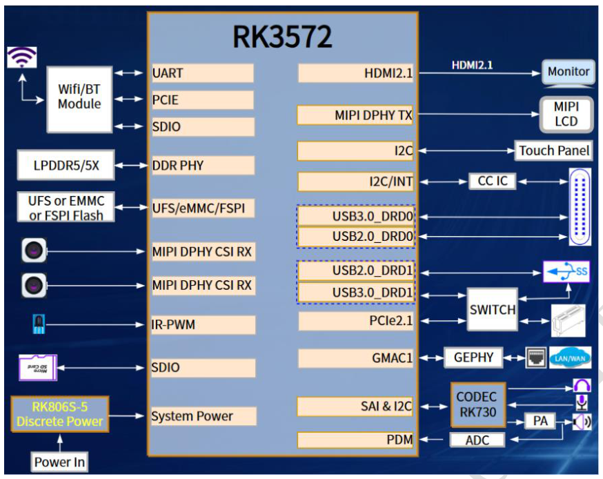
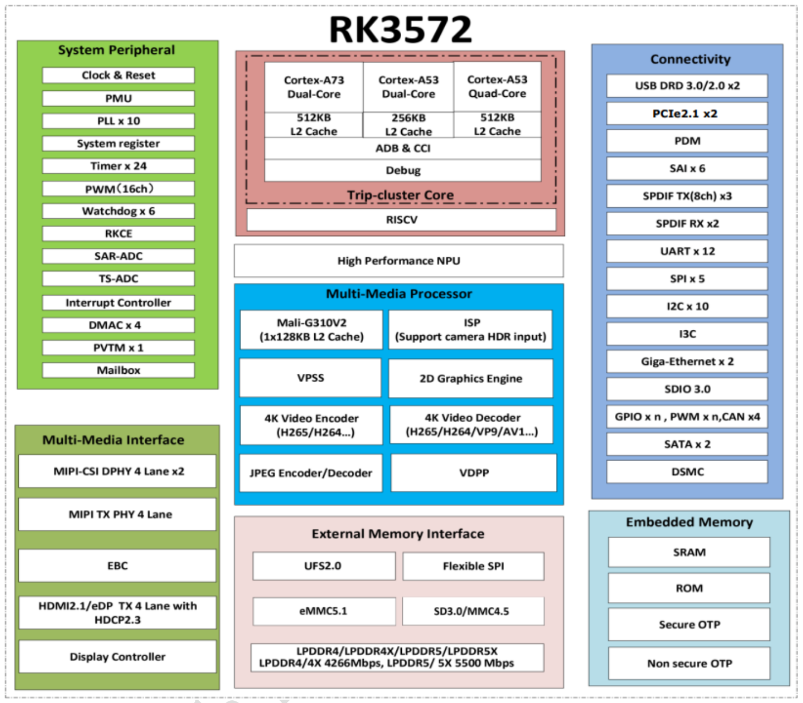

## Applicability

This guide supports RK3572 board design and evaluation for the ArmSoM Zero5 project. It uses the RK3572 Hardware Design Guide V1.1 and the supplied hardware package. SoC interfaces are not necessarily exposed on a board. Final Zero5 configurations, operating systems and kernel versions must be checked against the documentation for the specific hardware revision. No ArmSoM hardware measurements were performed for this article.

The RK3572 package contains datasheets, a hardware guide, EVB manuals, DDR templates, reference schematics and test reports. Rework often comes from combining revisions and reference designs intended for different purposes. This series follows engineering decisions and keeps each interface topic tied to its hardware context.

*RK3572 EVB reference application*

*RK3572 function and interface diagram*

## Choose the correct reference design first

| Document | Purpose | Treatment in this batch |
|---|---|---|
| RK3572 Datasheet V1.1 | SoC features, pins and electrical limits | Update the existing article |
| Hardware Design Guide V1.1 CN/EN | Schematic and PCB guidance | Split by design task; Chinese figures for Chinese, English figures for EN/RU/DE |
| RK3572_AIOT_REF_SCH_V13 | Baseline for a non-battery AIoT board | Check the main reference and TMI3255S footprint correction |
| RK809C-8 + RK805B-8 V14 | Reference for battery-powered designs | Check Adapter/Type-C detection and HUSB311 |
| EVB1 / EVB2 / EVB3 | Interface operation and functional reference | Not the current production schematic by default |
| NVR / E-ink DEMO | Application-specific demonstrations | Retain update and standby limitations from the selection notes |

The selection notes state that EVB1 is no longer updated and should not be used directly as the production PCB/schematic baseline. NVR references have update and standby-design limitations, and the E-ink DEMO is not a complete low-power solution. Select the power architecture first, then the DDR template and matching firmware, and finally allocate multiplexed interfaces.

## Six checkpoints from requirements to first board

1. Build a function matrix recording controller, PHY, mux, supply domain and connector for each display, camera, USB, PCIe, SATA and GPIO function.
2. Freeze the minimum system with test access for the main clock, reset, boot ADC, UART0 and USB DRD0 programming.
3. Manage DRAM part, capacity, ranks, PCB template, ADC Config and DDRBIN as one configuration.
4. Review supply voltages, sequencing, retention rails and wake sources together.
5. Before fabrication, review impedance, delay matching, reference planes, return vias, connectors and ESD.
6. On the first board, establish power and download access, then memory, storage and individual interfaces; test concurrent loads and resume last.

## What the test report establishes

The hardware test report helps define test cases and instrument conditions. Its results belong to the EVB, firmware and environment actually tested. Changing the stack-up, DRAM, PMIC, connectors, cables or enclosure requires the affected tests to be repeated. The workflow here is engineering guidance, not a claim that ArmSoM Zero5 passed the vendor’s tests.

## Scope of this batch

This batch adds nine topics covering orientation, minimum system, power, DDR, DDRBIN, storage, USB, PCIe/SATA, displays and cameras, and updates the datasheet and existing RK730 articles. It does not claim chapter-by-chapter translation of the entire guide’s audio, GMAC, low-speed I/O, EMC, production and soldering material; those remain separate follow-up topics.

## ArmSoM products and next steps

For a compact RK3572 product, start with ArmSoM’s Zero-form-factor plan and list the display, storage, network and power interfaces your design needs. The planning article is not a released model specification or final schematic. Use the official product catalogue and Docs when selecting an available platform and checking its interfaces.

- [RK3572 / ArmSoM Zero product plan](/articles/rockchip-rk3572-armsom-zero-preview/)
- [ArmSoM](https://www.armsom.org/category/all-products) · [ArmSoM Docs](https://docs.armsom.org/)

## Reading path through this series

- [RK3572 datasheet V1.1: specifications, interfaces and revision changes](/articles/rk3572-datasheet-v10/)
- [RK3572 hardware design: from reference selection to first-board validation](/articles/rk3572-hardware-design-series/)
- [RK3572 minimum system: 24 MHz clock, reset, boot and UART bring-up](/articles/rk3572-minimum-system-bringup/)
- [RK3572 power design: domains, RK806-5 and dual-PMIC options](/articles/rk3572-power-domains-pmic/)
- [RK3572 DDR design: LPDDR4X and LPDDR5 circuits and PCB constraints](/articles/rk3572-ddr-circuit-pcb/)
- [RK3572 DDRBIN configuration: templates, ADC selection and multiple profiles](/articles/rk3572-ddrbin-adc-configuration/)
- [RK3572 storage and boot: eMMC, UFS and FSPI wiring and power](/articles/rk3572-storage-boot-design/)
- [RK3572 USB and Type-C: programming, roles and power detection](/articles/rk3572-usb-typec-power-design/)
- [RK3572 PCIe and SATA: Combo PHY multiplexing, clocks and routing](/articles/rk3572-high-speed-interface-design/)
- [RK3572 displays and cameras: HDMI, eDP, MIPI and voltage matching](/articles/rk3572-display-camera-design/)
