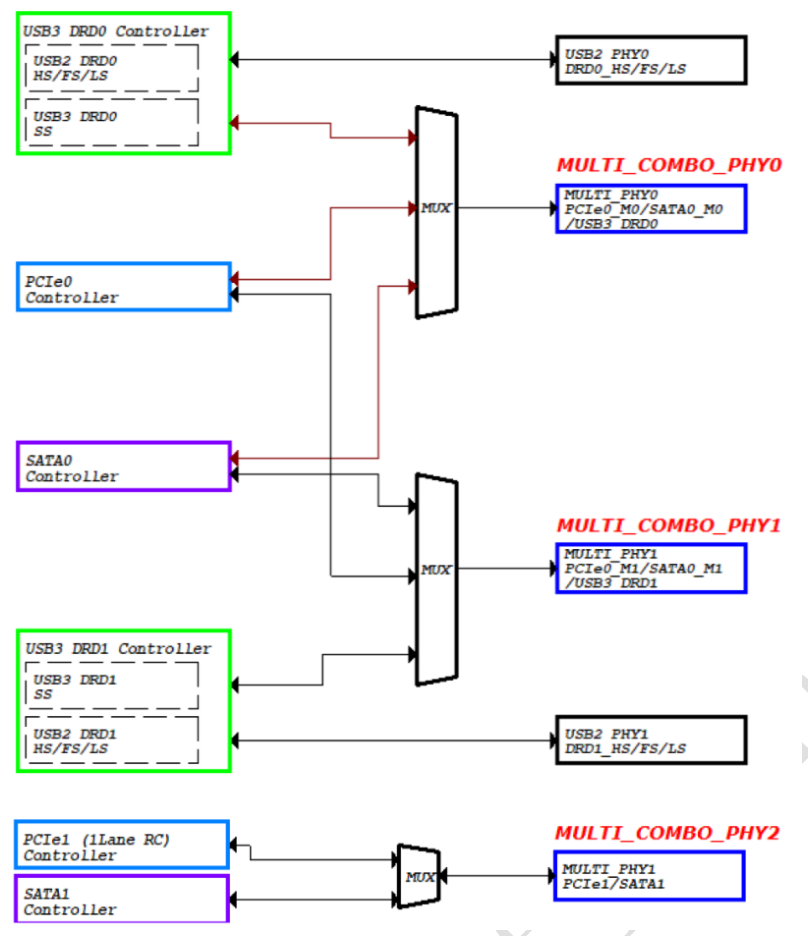
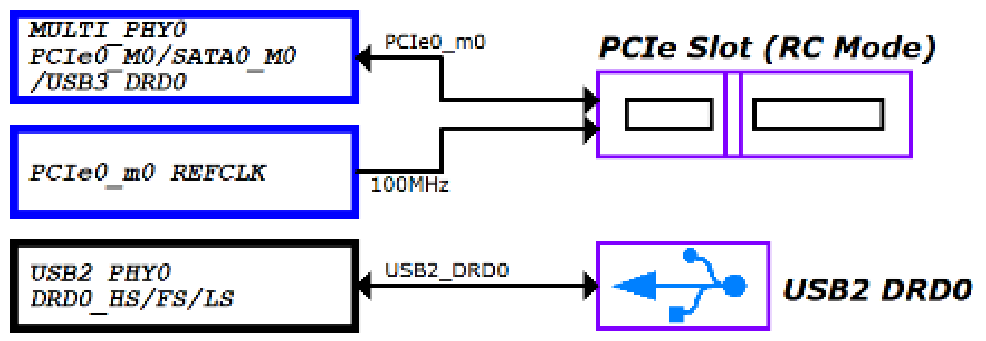
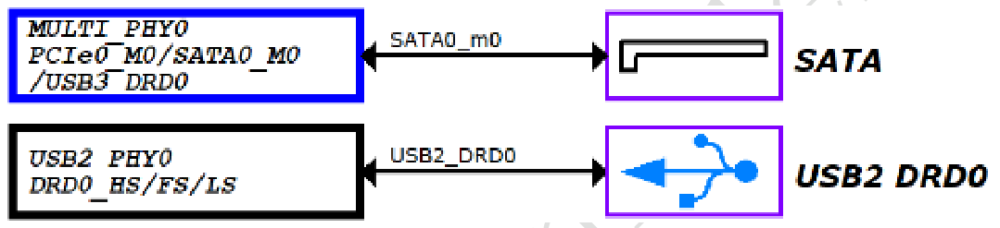
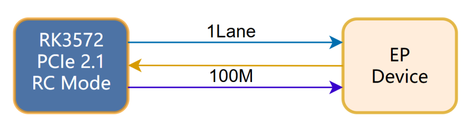
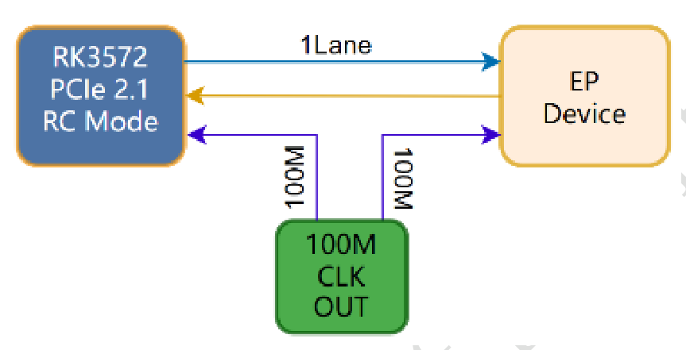
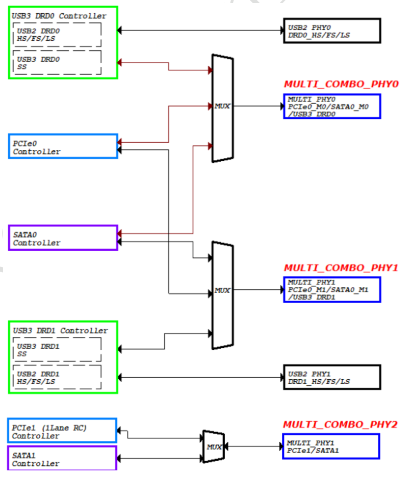

## Applicability

This guide supports RK3572 board design and evaluation for the ArmSoM Zero5 project. It uses the RK3572 Hardware Design Guide V1.1 and the supplied hardware package. SoC interfaces are not necessarily exposed on a board. Final Zero5 configurations, operating systems and kernel versions must be checked against the documentation for the specific hardware revision. No ArmSoM hardware measurements were performed for this article.

For RK3572 SSDs, SATA drives and fast peripherals, start with the controller-to-PHY map rather than the connector count. Three Combo PHYs do not mean three independent PCIe plus three independent SATA controllers. M0/M1 routes of one controller are not two concurrently usable ports.

## 1. Resolve interface counts and multiplexing first

| PHY | Selectable functions |
|---|---|
| Combo PHY0 | PCIe0_M0 / SATA0_M0 / USB3_DRD0 |
| Combo PHY1 | PCIe0_M1 / SATA0_M1 / USB3_DRD1 |
| Combo PHY2 | PCIe1 / SATA1 |

*PCIe controller-to-PHY map*

Hardware Guide V1.1 explicitly describes two PCIe 2.1 x1 controllers, RC only with no EP mode, and two SATA controllers. Datasheet V1.1 lists two PCIe/SATA/USB Combo interfaces plus one PCIe/SATA Combo interface: three multiplexed PHY paths. Controller counts and PHY counts describe different resources. Do not add alternative mux routes and claim three independent PCIe or SATA ports; exposed interfaces still depend on the board design.

*Reference combination of USB2 and PCIe0*

*Reference combination of USB2 and SATA0*

## 2. PCIe reference clocks and sideband signals

PCIE0/1_REFCLKP/N can be input or output, defaulting to output for an external EP. Identify the 100 MHz clock source; do not configure both ends as outputs. TX uses 100 nF series capacitors, preferably 0201; RX and REFCLK connect directly as specified. TXP/TXN polarity inversion is protocol-supported, not permission to swap other clocks, lanes or controls.

*Reference clock as output*

*Reference clock as input*

| Item | Requirement |
|---|---|
| CLKREQN | Use the functional pin, not an ordinary GPIO |
| PERSTN / WAKEN / PRSNT | Voltage-matched GPIOs may be used; check direction and default state |
| CLKREQN M0 / M1 / M2 / M3 | VCCIO4 / VCCIO3 / VCCIO2 / VCCIO6 |
| Standard-slot control level | 3.3 V |

## 3. SATA wiring, hot-plug and port multipliers

*SATA controllers and Combo PHYs*

SATA supports 1.5/3/6 Gbit/s and eSATA. The guide allows up to five devices per port through a port multiplier. They share upstream bandwidth and do not add controllers. Both SATA TX and RX use 10 nF AC-coupling capacitors, preferably 0201; do not copy the PCIe TX value of 100 nF. Place eSATA protection near the connector with parasitic capacitance no greater than 0.4 pF.

SATA0_ACTLED and SATA1_ACTLED indicate activity, with mux positions in VCCIO4/VCCIO6. CPDET, MPSWIT and CPPOD are shared control resources assigned to a controller by registers. Two hot-plug connectors must not independently claim the same resource. Power switches, connector sequencing and operating-system hot-plug support must also align.

## 4. PCB impedance, length and protection

| Item | PCIe | SATA |
|---|---|---|
| Differential impedance | 85 Ω ±10%; REFCLK 100 Ω ±10% | 100 Ω ±10% |
| Intra-pair skew | <1 ps / 6 mil | <1 ps / 6 mil |
| Length | <6 in | <6 in |
| Signal vias | ≤2 | ≤2 |
| AC coupling | TX 100 nF ±20% | TX/RX 10 nF ±20% |
| Pair spacing | ≥4W | ≥4W |

Check PCIe reference-clock intra-pair skew separately against the less-than-12-mil limit. Prefer 5W from data pairs to other signals, with 4W minimum. SATA prefers 100 Ω; any lower target allowed by the guide requires stack-up and simulation review. Tolerance is not a reason to ignore impedance. Provide return paths at transitions and avoid reference-plane splits.

## 5. Unused interfaces and bring-up

The guide’s unused-PCIe procedure covers floating data/clocks, supply treatment and disabling DTS nodes. First check whether USB or SATA still uses the shared PHY; disabling PCIe does not permit grounding a supply needed by another active function. During bring-up, establish power, REFCLK, PERSTN and PHY selection, then inspect link speed, width, errors and sustained I/O. Test resume and peripheral power cycling separately.

## ArmSoM products and next steps

For a compact RK3572 product, start with ArmSoM’s Zero-form-factor plan and list the display, storage, network and power interfaces your design needs. The planning article is not a released model specification or final schematic. Use the official product catalogue and Docs when selecting an available platform and checking its interfaces.

- [RK3572 / ArmSoM Zero product plan](/articles/rockchip-rk3572-armsom-zero-preview/)
- [ArmSoM](https://www.armsom.org/category/all-products) · [ArmSoM Docs](https://docs.armsom.org/)

## Reading path through this series

- [RK3572 datasheet V1.1: specifications, interfaces and revision changes](/articles/rk3572-datasheet-v10/)
- [RK3572 hardware design: from reference selection to first-board validation](/articles/rk3572-hardware-design-series/)
- [RK3572 minimum system: 24 MHz clock, reset, boot and UART bring-up](/articles/rk3572-minimum-system-bringup/)
- [RK3572 power design: domains, RK806-5 and dual-PMIC options](/articles/rk3572-power-domains-pmic/)
- [RK3572 DDR design: LPDDR4X and LPDDR5 circuits and PCB constraints](/articles/rk3572-ddr-circuit-pcb/)
- [RK3572 DDRBIN configuration: templates, ADC selection and multiple profiles](/articles/rk3572-ddrbin-adc-configuration/)
- [RK3572 storage and boot: eMMC, UFS and FSPI wiring and power](/articles/rk3572-storage-boot-design/)
- [RK3572 USB and Type-C: programming, roles and power detection](/articles/rk3572-usb-typec-power-design/)
- [RK3572 PCIe and SATA: Combo PHY multiplexing, clocks and routing](/articles/rk3572-high-speed-interface-design/)
- [RK3572 displays and cameras: HDMI, eDP, MIPI and voltage matching](/articles/rk3572-display-camera-design/)
