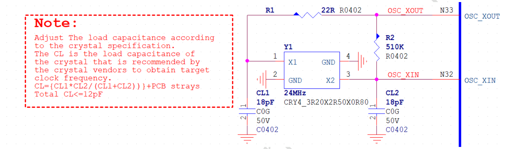
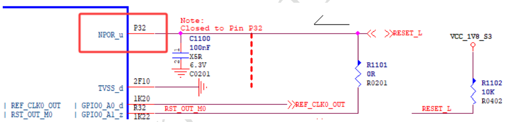
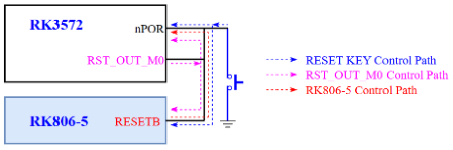
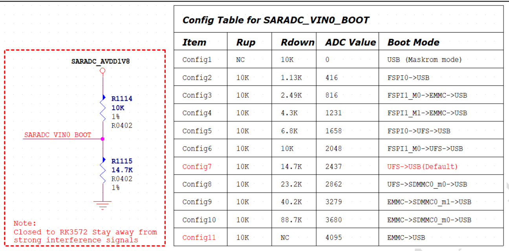

## Applicability

This guide supports RK3572 board design and evaluation for the ArmSoM Zero5 project. It uses the RK3572 Hardware Design Guide V1.1 and the supplied hardware package. SoC interfaces are not necessarily exposed on a board. Final Zero5 configurations, operating systems and kernel versions must be checked against the documentation for the specific hardware revision. No ArmSoM hardware measurements were performed for this article.

When an RK3572 first board produces no UART output, check power, the main clock, reset and boot selection before blaming DDR or the system image. Preserve UART0, USB DRD0 and forced Maskrom access together so debugging remains possible with damaged boot storage.

## 1. The 24 MHz clock and load capacitors

*24 MHz crystal reference circuit*

| Check | Design requirement |
|---|---|
| Crystal | 24 MHz; CL ≤12 pF; ±20 ppm |
| XOUT | 22 Ω |
| Feedback resistor | 510 kΩ |
| Reference load capacitors | 18 pF; adjust for crystal CL and parasitics, preferably C0G/NP0 |

18 pF is a reference value, not a universal choice for every 24 MHz crystal. Ground the ground pads of a four-pad crystal and keep the crystal and capacitors close to the SoC, away from switching supplies and fast signals. Account for probe capacitance when measuring; probe-induced oscillator failure is not evidence of a faulty SoC.

## 2. 32.768 kHz, clock outputs and standby

The external RTC clock specification is 32.768 kHz, ±30 ppm and 45%–55% duty cycle, with a high level from 0.7 times the PMUIO0 supply up to that supply. Configure CLK32K_IN IOMUX and check that the internal pull-down is disabled for an open-drain source. Select internal PMU_PVTM or an external low-frequency standby clock together with the retention-power configuration.

| Output | Frequencies listed in the guide |
|---|---|
| REF_CLK0 / REF_CLK1 / REF_CLK2 | 10, 12, 20, 24, 25, 26, 27, 37.125, 40, 50, 58.5, 74.25, 100 MHz |
| ETH0_CLK25M / ETH1_CLK25M | 25 MHz |
| CAM_CLK0 / CAM_CLK1 / CAM_CLK2 | 24 MHz; 27 / 37.125 / 74.25 MHz |
| CLK0_32K_OUT / CLK1_32K_OUT | Depend on the 24 MHz oscillator; stop when it is disabled |

## 3. Reset pulse width and power-settling delay differ

*RK3572 reset circuit*

NPOR_u is on P32 and is active low. The guide specifies at least 100 cycles of the 24 MHz clock, described approximately as 4 µs. One hundred cycles are about 4.17 µs; design to the cycle requirement with margin. After the final supply settles, hold reset for at least 1 ms; the reference range is 5–200 ms. These are different timing requirements.

Pull RESET_L up to PMUIO0_VCC1V8; the reference debounce capacitor is 100 nF. Prefer an open-drain external watchdog output to avoid contention with the PMIC’s bidirectional RESETB. Thermal protection can act through TSADC, RST_OUT and the reset chain; do not repurpose this path as ordinary debug GPIO.

*Reset and thermal-protection paths*

## 4. Boot ADC selection and recovery access

SARADC_IN0_BOOT selects the boot order; pulling it low enters USB Maskrom. The recovery button on SARADC_IN1 serves Recovery instead. Use 1% divider resistors near the SoC. The following boot-selection table must not be confused with the DDRBIN ADC Config table.

| Config | Rup | Rdown | ADC | Boot order |
|---|---|---|---|---|
| 1 | NC | 10 kΩ | 0 | USB (Maskrom) |
| 2 | 10 kΩ | 1.13 kΩ | 416 | FSPI0 → USB |
| 3 | 10 kΩ | 2.49 kΩ | 816 | FSPI1_M0 → EMMC → USB |
| 4 | 10 kΩ | 4.3 kΩ | 1231 | FSPI1_M1 → EMMC → USB |
| 5 | 10 kΩ | 6.8 kΩ | 1658 | FSPI0 → UFS → USB |
| 6 | 10 kΩ | 10 kΩ | 2048 | FSPI1_M0 → UFS → USB |
| 7 | 10 kΩ | 14.7 kΩ | 2437 | UFS → USB |
| 8 | 10 kΩ | 23.2 kΩ | 2862 | UFS → SDMMC0_m0 → USB |
| 9 | 10 kΩ | 40.2 kΩ | 3279 | EMMC → SDMMC0_m1 → USB |
| 10 | 10 kΩ | 88.7 kΩ | 3680 | EMMC → SDMMC0_m0 → USB |
| 11 | 10 kΩ | NC | 4095 | EMMC → USB |

*Boot ADC resistor configurations*

BootROM does not boot directly from a PCIe SSD. An SSD system disk requires a bootloader from supported storage such as SPI Flash, followed by PCIe initialization. An SSD-hosted OS does not establish PCIe BootROM support.

## 5. UART, JTAG and first-board checks

The default debug port is UART0 M0 at 1500000 baud. JTAG M0 shares SDMMC0 pins. SDMMC0_DETN_M0 (T33) is sampled at boot, has an internal pull-up and a reference 1 nF capacitor: high selects JTAG by default, low selects SD; IOMUX takes over afterward. JTAG M1 shares UART0 M0: U33 is TX/TCK and V32 is RX/TMS. Reserve 100 Ω series resistors and TVS positions, use a 2.54 mm header or test pads at least 0.7 mm in diameter, and match the I/O supply voltage.

Work through short-circuit checks, supply sequencing, 24 MHz, RESET_L release, Maskrom enumeration, DDR initialization, boot storage and kernel logs in that order. Save scope traces, UART logs and firmware versions at each stage. Change one configuration at a time to distinguish power, memory-training and software faults.

## ArmSoM products and next steps

For a compact RK3572 product, start with ArmSoM’s Zero-form-factor plan and list the display, storage, network and power interfaces your design needs. The planning article is not a released model specification or final schematic. Use the official product catalogue and Docs when selecting an available platform and checking its interfaces.

- [RK3572 / ArmSoM Zero product plan](/articles/rockchip-rk3572-armsom-zero-preview/)
- [ArmSoM](https://www.armsom.org/category/all-products) · [ArmSoM Docs](https://docs.armsom.org/)

## Reading path through this series

- [RK3572 datasheet V1.1: specifications, interfaces and revision changes](/articles/rk3572-datasheet-v10/)
- [RK3572 hardware design: from reference selection to first-board validation](/articles/rk3572-hardware-design-series/)
- [RK3572 minimum system: 24 MHz clock, reset, boot and UART bring-up](/articles/rk3572-minimum-system-bringup/)
- [RK3572 power design: domains, RK806-5 and dual-PMIC options](/articles/rk3572-power-domains-pmic/)
- [RK3572 DDR design: LPDDR4X and LPDDR5 circuits and PCB constraints](/articles/rk3572-ddr-circuit-pcb/)
- [RK3572 DDRBIN configuration: templates, ADC selection and multiple profiles](/articles/rk3572-ddrbin-adc-configuration/)
- [RK3572 storage and boot: eMMC, UFS and FSPI wiring and power](/articles/rk3572-storage-boot-design/)
- [RK3572 USB and Type-C: programming, roles and power detection](/articles/rk3572-usb-typec-power-design/)
- [RK3572 PCIe and SATA: Combo PHY multiplexing, clocks and routing](/articles/rk3572-high-speed-interface-design/)
- [RK3572 displays and cameras: HDMI, eDP, MIPI and voltage matching](/articles/rk3572-display-camera-design/)
