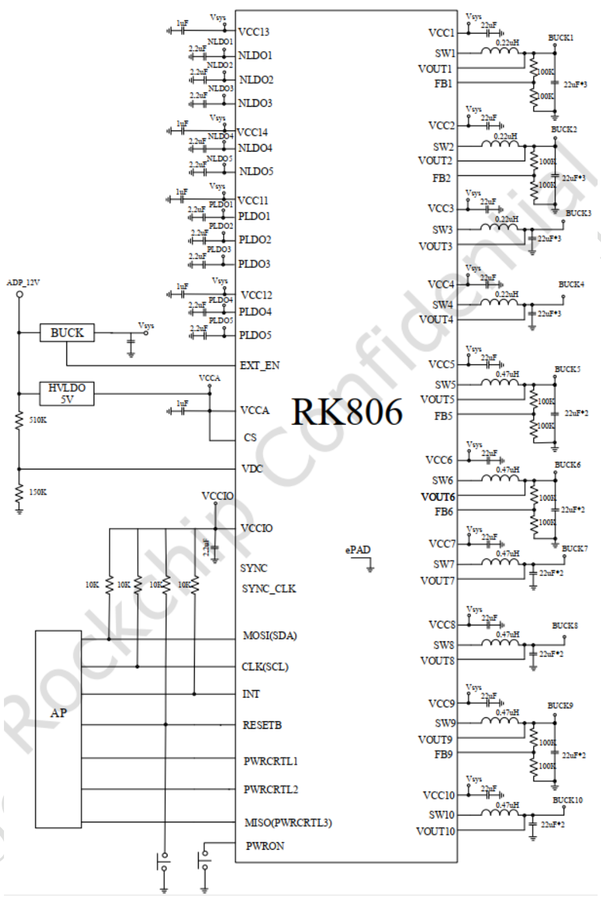
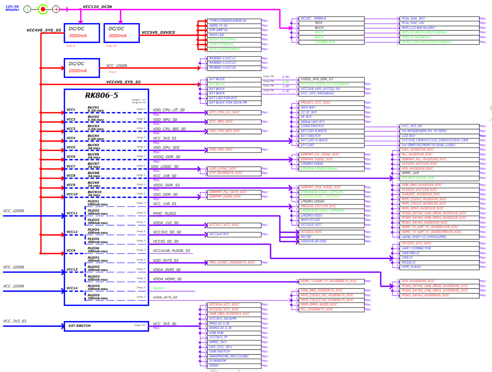

## Applicability

This guide supports RK3572 board design and evaluation for the ArmSoM Zero5 project. It uses the RK3572 Hardware Design Guide V1.1 and the supplied hardware package. SoC interfaces are not necessarily exposed on a board. Final Zero5 configurations, operating systems and kernel versions must be checked against the documentation for the specific hardware revision. No ArmSoM hardware measurements were performed for this article.

RK3572 power design is more than connecting voltage rails. It must account for domain sequencing, dynamic loads, DDR retention, wake paths and back-powering through peripherals. The RK806-5 reference and RK809C-8 plus RK805B-8 option cannot be exchanged merely by counting outputs.

## 1. Select the reference architecture

The package directs ordinary non-battery AIoT designs to RK806-5/RK806S-5 and battery projects to the RK809C-8 plus RK805B-8 branch. The corresponding -5 variants of RK806 and RK806S are presented as compatible options, but manufacturer, input recommendations and OTP configuration still matter. RK806-2 is not a direct substitute for RK806-5. The base name RK806 does not identify the power sequence.

*Typical RK806 connection*

## 2. Power tree and local interface sequences

*RK3572 power tree*

| Block | Local sequence |
|---|---|
| UFS | 0.85 V → 1.8 V |
| USB | 0.75 V → 1.8 V → 3.3 V |
| MIPI / HDMI / eDP | 0.75 V → 1.8 V |
| PCIe / SATA / USB Combo PHY | 0.85 V → 1.8 V |
| DDR PHY | DVDD → VDDQH → VDDQ / CKVDDQ |

Local interface sequences are only part of the complete power tree. The reference places core-related supplies first, followed by 1.8 V, DDR VDD2/1.2 V, selected 3.3 V and SD supplies, DDR 0.9 V and active-state 3.3 V, DDRPHY_VDDQ and finally RESET_L release. S0/S3 suffixes describe the reference design’s power states; they do not by themselves define standby behavior on another board.

## 3. Wake sources determine retention power

| Use case | Retention conditions to check |
|---|---|
| Lowest-power reference state | DDRPHY_VDDQH + PMU_LOGIC + PMUIO0/1 |
| USB HID | OSC + USB2 PHY |
| USB 4G wake | OSC + PLL + LOGIC + USB |
| Voice / GMAC wake | OSC + PLL + LOGIC |
| CEC | OSC + LOGIC |
| IR / PWM | OSC; select a PMU-domain PWM |
| Other GPIO | OSC + LOGIC + corresponding VCCIO |

These are wake-related retention items from the guide, to be combined with DDR, PMIC and peripheral requirements. Configure GPIO retention before switching LOGIC off. If a peripheral remains powered while the SoC I/O is off, check back-powering and unintended pull-ups. Validate suspend/resume using current, domain voltages, the wake source and resume logs together.

## 4. RK806 control, buttons and input supply

| Check | Design requirement |
|---|---|
| VCCA | Apply first or with other inputs; must not lag other inputs |
| I2C | CS → VCCA; SDA/SCL: 2.2 kΩ → PMUIO0 |
| RESETB | 100 nF; total capacitance ≤0.3 µF |
| PWRON | 45 kΩ internal pull-up; low for 20 ms starts power-on |
| VDC | High threshold about 0.8 V; recommend >1 V and no more than VCCA |

Separate the RK806 input specification from the reference-board recommendation: the documented operating range is 2.7–5.5 V, whereas the ordinary RK806 reference recommends 4 V. Verify the input capability of the specific RK806S option too. Long-press shutdown can select 6/8/10/12 s. Keeping VDC permanently high affects hardware shutdown, so coordinate it with buttons and automatic startup.

## 5. Buck inductors, capacitors and dynamic loads

| Buck | Iout max | Cin / Cout | L | Isat | DCR |
|---|---|---|---|---|---|
| 1 | 6.5 A | 22 / 66 µF | 0.24 µH | ≥7.8 A | <15 mΩ |
| 2–4 | 5 A | 22 / 66 µF | 0.24 µH | ≥6.5 A | <20 mΩ |
| 5–10 | 3 A | 10 / 44 µF | 0.47 µH | ≥4 A | <40 mΩ |

These are reference selection conditions, not additive estimates of RK3572 consumption. Check inductor temperature rise, DC bias and transient saturation, and evaluate ceramic capacitance after DC-bias derating. LDO output capacitance is at least 2.2 µF. PLDO input must exceed its output by at least 0.2 V and be at least 2 V. NLDO also needs 0.2 V headroom, with output additionally limited by VCCA − 1.5 V.

## 6. Type-C detection in dual-PMIC V1.4

The dual-PMIC V1.4 reference dated 2026-10-12 adds HUSB311 detection for an adapter and Type-C sharing RK809C VDC (pin 61). HUSB311 is the default in the change note, with the alternative GPIO-detection parts unpopulated. GPIO voltage detection is not a complete USB PD implementation. When reusing an older schematic, review CC detection, VDC, insertion/removal and shutdown together.

## 7. Pre-layout-release and first-board checklist

Record the full PMIC suffix, OTP, input source, rail voltages and current budgets. Check default GPIO states, peripheral back-powering, RESET_L and DDR sequencing. Measure cold boot, warm reset, long-press shutdown and power insertion/removal. Load tests should combine CPU, NPU, DDR and peripherals; inspect voltage minima and ripple on a scope, not just average multimeter readings.

## ArmSoM products and next steps

For a compact RK3572 product, start with ArmSoM’s Zero-form-factor plan and list the display, storage, network and power interfaces your design needs. The planning article is not a released model specification or final schematic. Use the official product catalogue and Docs when selecting an available platform and checking its interfaces.

- [RK3572 / ArmSoM Zero product plan](/articles/rockchip-rk3572-armsom-zero-preview/)
- [ArmSoM](https://www.armsom.org/category/all-products) · [ArmSoM Docs](https://docs.armsom.org/)

## Reading path through this series

- [RK3572 datasheet V1.1: specifications, interfaces and revision changes](/articles/rk3572-datasheet-v10/)
- [RK3572 hardware design: from reference selection to first-board validation](/articles/rk3572-hardware-design-series/)
- [RK3572 minimum system: 24 MHz clock, reset, boot and UART bring-up](/articles/rk3572-minimum-system-bringup/)
- [RK3572 power design: domains, RK806-5 and dual-PMIC options](/articles/rk3572-power-domains-pmic/)
- [RK3572 DDR design: LPDDR4X and LPDDR5 circuits and PCB constraints](/articles/rk3572-ddr-circuit-pcb/)
- [RK3572 DDRBIN configuration: templates, ADC selection and multiple profiles](/articles/rk3572-ddrbin-adc-configuration/)
- [RK3572 storage and boot: eMMC, UFS and FSPI wiring and power](/articles/rk3572-storage-boot-design/)
- [RK3572 USB and Type-C: programming, roles and power detection](/articles/rk3572-usb-typec-power-design/)
- [RK3572 PCIe and SATA: Combo PHY multiplexing, clocks and routing](/articles/rk3572-high-speed-interface-design/)
- [RK3572 displays and cameras: HDMI, eDP, MIPI and voltage matching](/articles/rk3572-display-camera-design/)
