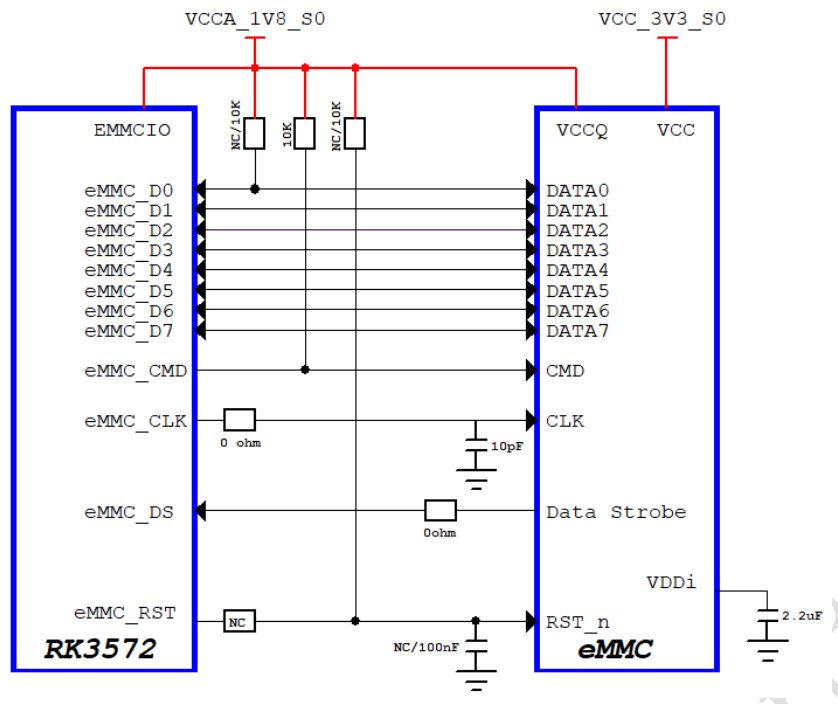
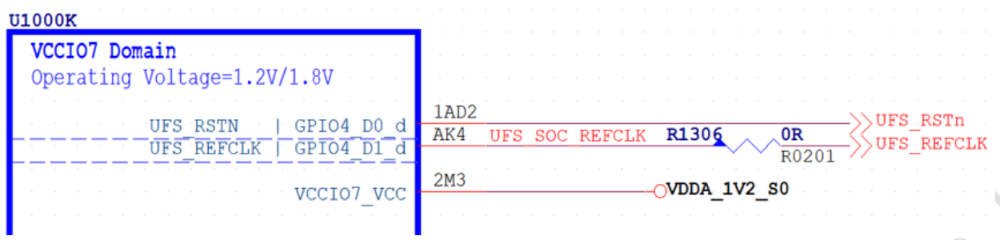
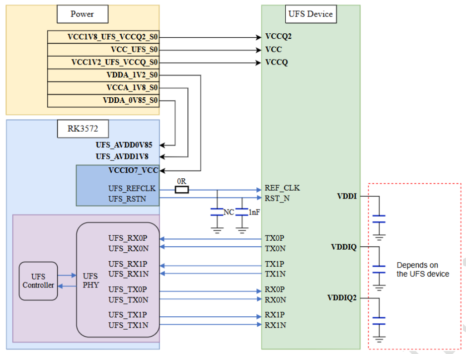
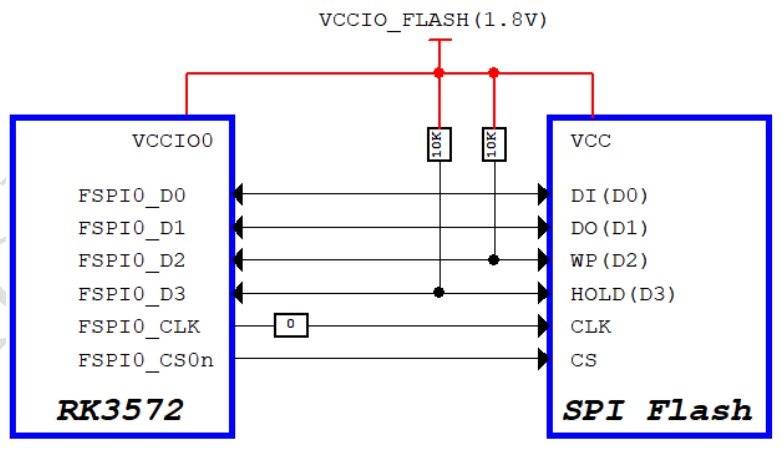
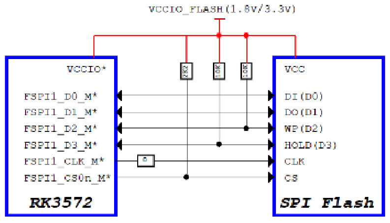

## Applicability

This guide supports RK3572 board design and evaluation for the ArmSoM Zero5 project. It uses the RK3572 Hardware Design Guide V1.1 and the supplied hardware package. SoC interfaces are not necessarily exposed on a board. Final Zero5 configurations, operating systems and kernel versions must be checked against the documentation for the specific hardware revision. No ArmSoM hardware measurements were performed for this article.

Selecting eMMC, UFS or SPI Flash for RK3572 requires checking BootROM access, controller capability, I/O voltage, pin multiplexing and PCB constraints together. In particular, distinguish the UFS device revision from host speed: a newer device does not upgrade the RK3572 UFS 2.0 controller.

## 1. Choosing a storage path

| Item | Design requirement |
|---|---|
| eMMC | eMMC 5.1; HS400 Enhanced Strobe / HS400 / HS200 / DDR50; 1/4/8-bit |
| UFS | UFS 2.0 host, 2 lanes, 5.8 Gbit/s/lane; compatible devices remain host-limited |
| FSPI0 | Shares eMMC pins; VCCIO0 is 1.8 V |
| FSPI1 | M0 uses VCCIO1; M1 uses VCCIO4; configure the whole domain consistently |

SDK filesystem support does not establish direct BootROM support. A PCIe SSD system disk still requires a bootloader from a supported boot medium. Boot ADC selection and the bootloader implementation determine the path. Preserve USB DRD0 programming rather than depending entirely on healthy storage for servicing.

## 2. eMMC: CMD, D0, CLK and STRB

*eMMC reference connection*

| Item | Design requirement |
|---|---|
| CMD | External 10 kΩ pull-up |
| D0 | Reserve a 10 kΩ pull-up; check the reference for internal pull-ups on other data lines |
| CLK | 0 Ω series at SoC; reserve 10 pF to ground near eMMC |
| STRB | 0 Ω near eMMC; reserve a 47 kΩ pull-down |
| RST_n | Reference default is unconnected with CMD reset; hardware reset needs checked pull-up, 0 Ω and 100 nF |

eMMC and FSPI0 share the voltage domain. A 3.3 V-capable Flash does not justify changing VCCIO0 to 3.3 V. Capacity, HS400 and Enhanced Strobe availability also depend on the device and BSP. Successful startup in a slower mode does not validate the target high-speed mode.

## 3. UFS compatibility and supplies

The guide lists connection options for UFS 2.0/2.1/2.2/3.0/3.1 devices, not UFS 4.0. VCCIO7 for RSTN and REFCLK is 1.2 V. PHY supplies at 0.85 V and 1.8 V, SoC VCCIO7, and device VCC/VCCQ/VCCQ2 are distinct nets that need individual checks.

| UFS device | VCC | VCCQ | VCCQ2 |
|---|---|---|---|
| 2.0 | 3.3 V | 1.2 V | 1.8 V |
| 2.1 / 2.2 | 3.3 V | — | 1.8 V |
| 3.0 / 3.1 | 2.5 / 3.3 V | 1.2 V | — |

*UFS I/O and supply domains*

*UFS reference connection*

TX/RX connect directly. REFCLK uses a SoC-side 0 Ω resistor and a reserved device-side shunt capacitor; RSTN connects directly with a reserved 1 nF capacitor. The reference starts UFS 0.85 V, then 1.8 V, then VCCIO7. Apply device VCCQ2/VCCQ as required, with VCC not preceding VCCIO7. Device datasheet and JEDEC timing requirements also apply. For unused UFS, follow the guide for dedicated PHY supplies and software nodes; an unpowered device is not a meaningful link test.

## 4. FSPI: do not omit chip-select pull-ups

*FSPI0 four-bit reference*

*FSPI1 four-bit reference*

FSPI1 M0 and M1 are alternate pin routes for one controller, not two controllers. FSPI0 chip select has an internal pull-up; FSPI1 chip select defaults to high impedance and needs an external 2.2 kΩ pull-up near Flash, including review of CS1/RST multiplexing. When using a four-bit interface in single-bit mode, fit 10 kΩ on D2/D3 as shown. Put the CLK 0 Ω resistor at the SoC; for eight-bit DQS, place its 0 Ω near Flash.

## 5. PCB and validation

| Item | eMMC | UFS |
|---|---|---|
| Impedance | 50 Ω ±10% | 100 Ω differential ±10% |
| Skew | CLK/data <20 ps / 120 mil | Within pair <1 ps / 6 mil; between pairs <16 ps / 100 mil |
| Length | <3.5 in | <4 in |
| Signal vias | ≤2 | ≤2 |
| Return-via distance | ≤30 mil | ≤25 mil |

Keep UFS pairs at least 4W apart and 5W from other signals; ground-guard REFCLK with via spacing no greater than 400 mil. eMMC ordinary spacing is at least 2W, preferably 3W around the clock. Record device identity, negotiated mode, read/write errors, sustained-load and power-loss recovery results. Throughput needs capacity, firmware and test conditions; interface rate is not file-transfer speed.

## ArmSoM products and next steps

For a compact RK3572 product, start with ArmSoM’s Zero-form-factor plan and list the display, storage, network and power interfaces your design needs. The planning article is not a released model specification or final schematic. Use the official product catalogue and Docs when selecting an available platform and checking its interfaces.

- [RK3572 / ArmSoM Zero product plan](/articles/rockchip-rk3572-armsom-zero-preview/)
- [ArmSoM](https://www.armsom.org/category/all-products) · [ArmSoM Docs](https://docs.armsom.org/)

## Reading path through this series

- [RK3572 datasheet V1.1: specifications, interfaces and revision changes](/articles/rk3572-datasheet-v10/)
- [RK3572 hardware design: from reference selection to first-board validation](/articles/rk3572-hardware-design-series/)
- [RK3572 minimum system: 24 MHz clock, reset, boot and UART bring-up](/articles/rk3572-minimum-system-bringup/)
- [RK3572 power design: domains, RK806-5 and dual-PMIC options](/articles/rk3572-power-domains-pmic/)
- [RK3572 DDR design: LPDDR4X and LPDDR5 circuits and PCB constraints](/articles/rk3572-ddr-circuit-pcb/)
- [RK3572 DDRBIN configuration: templates, ADC selection and multiple profiles](/articles/rk3572-ddrbin-adc-configuration/)
- [RK3572 storage and boot: eMMC, UFS and FSPI wiring and power](/articles/rk3572-storage-boot-design/)
- [RK3572 USB and Type-C: programming, roles and power detection](/articles/rk3572-usb-typec-power-design/)
- [RK3572 PCIe and SATA: Combo PHY multiplexing, clocks and routing](/articles/rk3572-high-speed-interface-design/)
- [RK3572 displays and cameras: HDMI, eDP, MIPI and voltage matching](/articles/rk3572-display-camera-design/)
