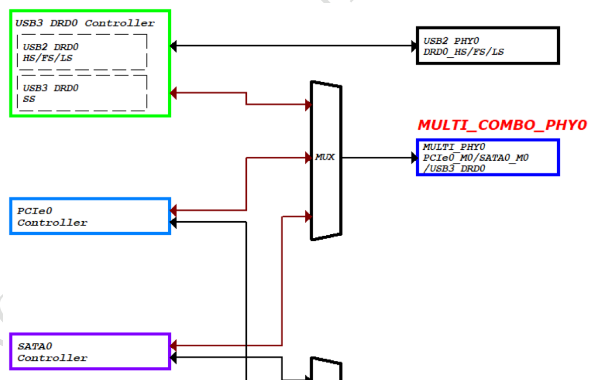
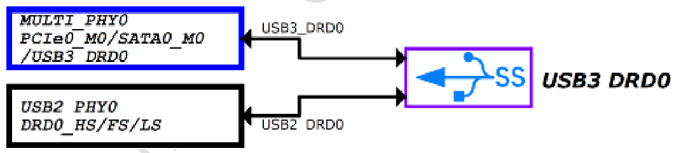
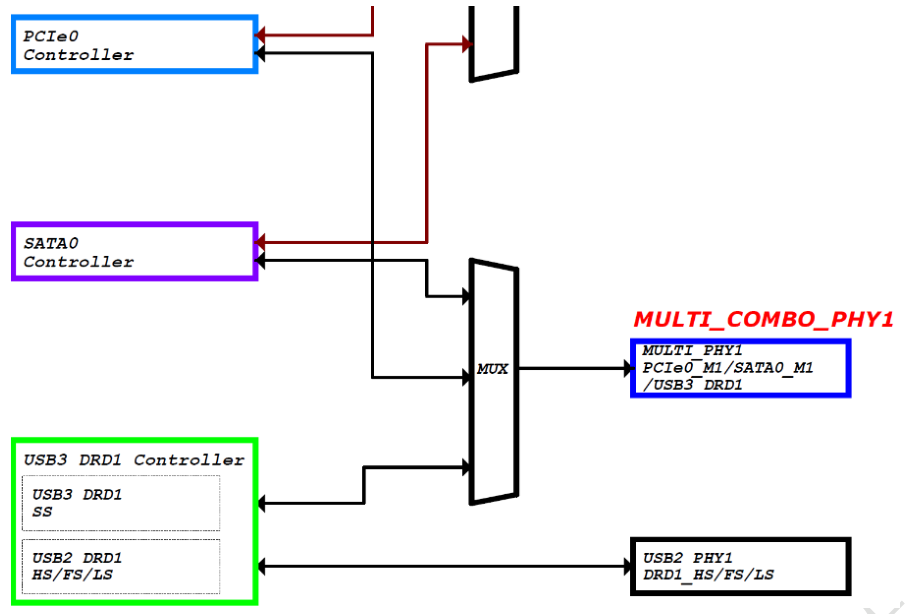
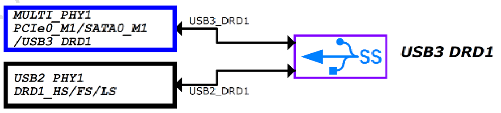
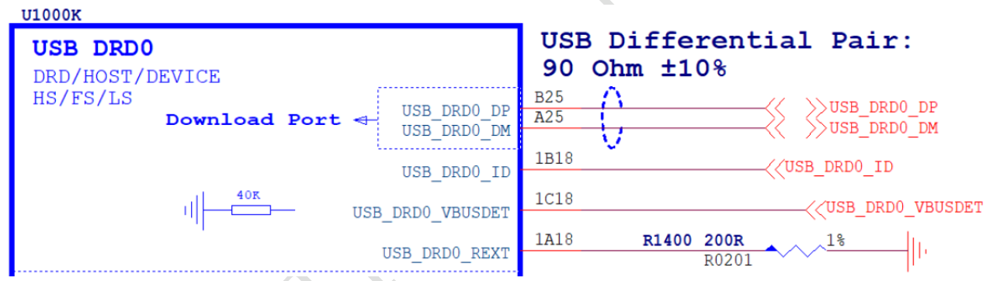
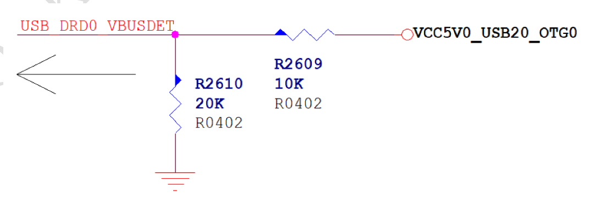
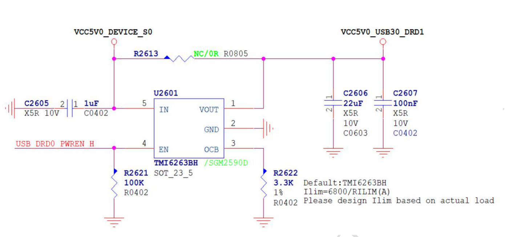
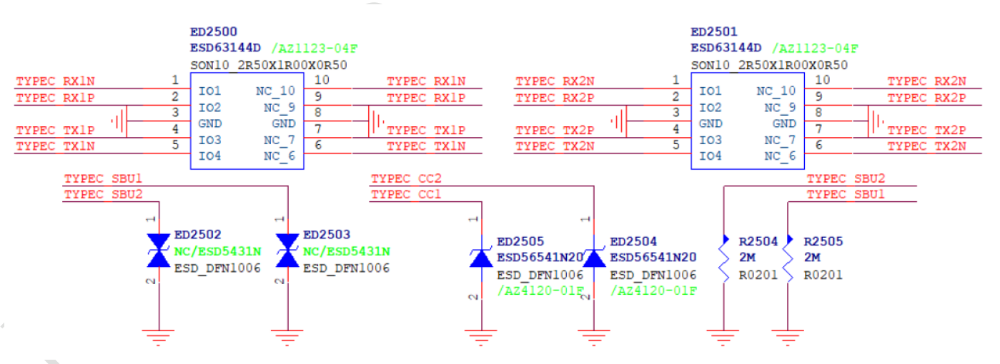

## Applicability

This guide supports RK3572 board design and evaluation for the ArmSoM Zero5 project. It uses the RK3572 Hardware Design Guide V1.1 and the supplied hardware package. SoC interfaces are not necessarily exposed on a board. Final Zero5 configurations, operating systems and kernel versions must be checked against the documentation for the specific hardware revision. No ArmSoM hardware measurements were performed for this article.

RK3572 USB design must coordinate data and power roles. Type-C is a connector format, not proof of DP Alt Mode or USB PD support. Map the DRD controller, Combo PHY, VBUS, CC detection and programming path individually to avoid a schematic that looks complete but cannot enumerate or flash.

## 1. USB3 DRD and Combo PHY relationships

RK3572 has two USB3 DRD paths. USB2 and SuperSpeed within a path must use the same HOST/DEVICE role, not opposite roles. Combo PHY0 can serve USB3 DRD0, PCIe0 M0 or SATA0 M0; PHY1 can serve USB3 DRD1, PCIe0 M1 or SATA0 M1. Different interface names do not permit simultaneous use of one PHY.

*Combo PHY0 multiplexing*

*USB3 DRD0 reference connection*

*Combo PHY1 multiplexing*

*USB3 DRD1 reference connection*

## 2. Preserve the programming path

Even a mainly USB-host product needs service access to DRD0 DP/DM, VBUSDET and forced Maskrom. Reference configurations pair USB2 DRD0 with a high-speed PHY assigned to PCIe/SATA, but the selected mux diagram must be followed rather than retaining an inactive SuperSpeed connection. Keep DRD0/DRD1 numbering consistent between schematic and device tree.

*USB2 DRD0 and service connection*

## 3. VBUSDET, ID and the 5 V input

| Item | Design requirement |
|---|---|
| ID | Internal pull-up about 12 kΩ to 1.8 V; protect and match levels |
| VBUSDET | Internal pull-down about 40 kΩ; typical 3 V, recommend 2.7–3.3 V; detection threshold >2.3 V |
| DP / DM | 2.2 Ω series resistors |
| SuperSpeed TX / RX | TX: 100 nF, 0201; RX: 0 Ω |

*VBUS detection divider reference*

Do not apply 5 V VBUS directly to VBUSDET. Divider analysis must include the internal approximately 40 kΩ pull-down and tolerances, not only two external resistors. Type-C, Micro-USB and fixed-host reference circuits differ; select one defined topology before checking power and role transitions.

## 4. Host current limiting and Type-C CC detection

*USB Host current-limit reference*

Route host 5 V through a current-limit switch and check GPIO control against the reference 3.3 V domain. The guide gives 22 µF plus 100 nF decoupling. Larger capacitance in a portable-drive example still needs inrush, current-limit and supply-headroom analysis; capacitance alone cannot fix an undersized supply. Dual-PMIC V1.4 uses HUSB311 for CC and shared adapter/Type-C VDC handling; alternate GPIO detection is not USB PD.

## 5. Choose ESD and PCB constraints together

*Type-C protection reference*

| Item | USB 2.0 | USB 3.x |
|---|---|---|
| Differential impedance | 90 Ω ±10% | 90 Ω ±10% |
| Intra-pair skew | <3 ps / 20 mil | <1 ps / 6 mil |
| Length | <6 in | <6 in |
| Signal vias | Prefer ≤4, maximum 6 | ≤2 |
| Protection capacitance used here | ≤1 pF | ≤0.2 pF |

The circuit chapter gives ESD limits of ≤3 pF for USB2 and ≤0.25 pF for SuperSpeed, while the PCB chapter uses tighter ≤1 pF and ≤0.2 pF limits. This article uses the tighter values and records the difference. Confirm the actual protection device’s S-parameters and total channel loss. Check at least 4W clearance around SuperSpeed pairs and continuous reference planes.

## 6. Validate beyond one enumeration

Test USB2 and SuperSpeed separately, both connector orientations, host/device transitions, devices attached at cold boot, hot-plug, short-circuit current limiting, resume and Maskrom flashing. Record cables, peripherals, BSP and device-tree versions. For USB2-only operation, check PHY selection, the SuperSpeed path and orientation switching; for no enumeration, start with VBUSDET, CC/ID, DP/DM and power.

## ArmSoM products and next steps

For a compact RK3572 product, start with ArmSoM’s Zero-form-factor plan and list the display, storage, network and power interfaces your design needs. The planning article is not a released model specification or final schematic. Use the official product catalogue and Docs when selecting an available platform and checking its interfaces.

- [RK3572 / ArmSoM Zero product plan](/articles/rockchip-rk3572-armsom-zero-preview/)
- [ArmSoM](https://www.armsom.org/category/all-products) · [ArmSoM Docs](https://docs.armsom.org/)

## Reading path through this series

- [RK3572 datasheet V1.1: specifications, interfaces and revision changes](/articles/rk3572-datasheet-v10/)
- [RK3572 hardware design: from reference selection to first-board validation](/articles/rk3572-hardware-design-series/)
- [RK3572 minimum system: 24 MHz clock, reset, boot and UART bring-up](/articles/rk3572-minimum-system-bringup/)
- [RK3572 power design: domains, RK806-5 and dual-PMIC options](/articles/rk3572-power-domains-pmic/)
- [RK3572 DDR design: LPDDR4X and LPDDR5 circuits and PCB constraints](/articles/rk3572-ddr-circuit-pcb/)
- [RK3572 DDRBIN configuration: templates, ADC selection and multiple profiles](/articles/rk3572-ddrbin-adc-configuration/)
- [RK3572 storage and boot: eMMC, UFS and FSPI wiring and power](/articles/rk3572-storage-boot-design/)
- [RK3572 USB and Type-C: programming, roles and power detection](/articles/rk3572-usb-typec-power-design/)
- [RK3572 PCIe and SATA: Combo PHY multiplexing, clocks and routing](/articles/rk3572-high-speed-interface-design/)
- [RK3572 displays and cameras: HDMI, eDP, MIPI and voltage matching](/articles/rk3572-display-camera-design/)
