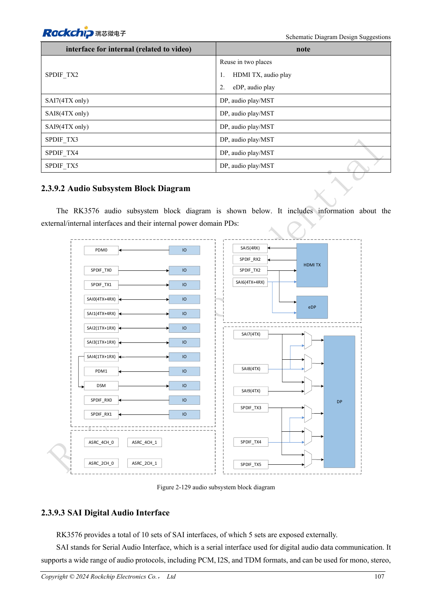
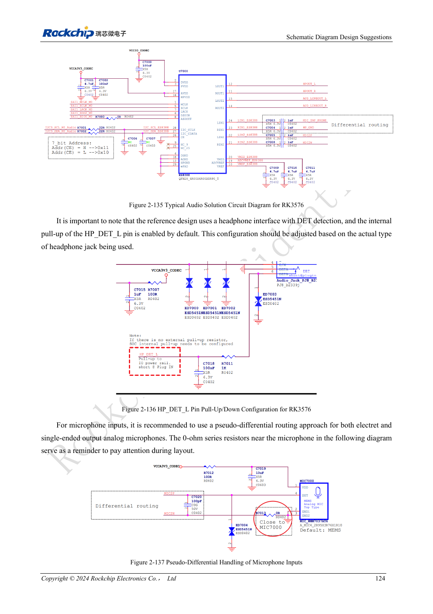

<!-- rk3576-hardware-v11-rest-20261109 -->

# RK3576 audio hardware: SAI, PDM, ASRC and microphone layout

Based on the Chinese and English RK3576 Hardware Design Guide V1.1 (2024-05-28), for SoC-board design. CM5 carriers must follow the module interface; Sige5 can establish a software/peripheral baseline. This guide does not prescribe one SDK/BSP or kernel for every product; verify each board. Values are source references, not ArmSoM measurements.

**RK3576_Hardware_Design_Guide_V1.1_20240528_EN.pdf** · §2.3.9; Audio PCB

## Count internal and external resources separately

The SoC has ten SAI blocks but only five external interfaces, plus two PDM groups, two external SPDIF TX/RX groups and DSM. Other audio resources serve video interfaces. External SAI4 is unavailable when DSM is used. For PCM/I2S/TDM, define master/slave, clock direction, slots and width before choosing the achievable sample rate.

## Budget bandwidth and asynchronous clocks

Per-lane sample rate follows IO rate/(slots×width). TDM16 at 32bit/48kHz needs 24.576MHz SCLK; TDM32 needs 49.152MHz. The limit is 50MHz for master TX/RX and slave RX, but 25MHz for slave TX, subject to signal integrity. Four ASRC blocks handle sample-rate or asynchronous-clock conversion; they are not extra IO ports.

## Routing, amplifiers and validation

Use reference 22Ω clock resistors near the source and daisy chains for multiple devices; two in-phase PDM clocks can reduce long branches. Route analog microphones pseudo-differentially away from DDR, LCD, inductors and RF. Put headphone/microphone protection near connectors. Align codec, amplifier enable and jack detection with software. Test playback, recording, loopback, switching pops and interference. DSM is a low-cost path, not a high-performance DAC.

## Design parameters and review table

| Item | Source reference |
| --- | --- |
| SAI external | 5 |
| PDM | 2 groups |
| TDM16: 32bit ×48kHz | 24.576MHz |
| Slave TX SCLK | ≤25MHz |
| ASRC | 8–384kHz |

## Source figures

The reference pages below contain the relevant circuit or timing figures; click for full resolution. Designators and component values belong to the reference design, not an ArmSoM product schematic.

English original · PDF 126 · 2-129

English original · PDF 143 · 2-137

## ArmSoM development path

CM5 reduces repeated compute-core design on custom carriers; Sige5 provides a starting point for software and peripheral evaluation. Verify exposed interfaces, connector pins, voltages and image support in board documentation rather than inferring them from SoC features.

- [ArmSoM CM5](https://www.armsom.org/cm5) · [CM5 Docs](https://docs.armsom.org/armsom-cm5)
- [ArmSoM Sige5](https://www.armsom.org/sige5) · [Sige5 Docs](https://docs.armsom.org/armsom-sige5)

## Continue reading

- [RK3576 hardware design: 30 topics](/articles/rk3576-hardware-design-series/)
- [RK3576 DP/eDP design: PHY allocation, AUX and coupling discrepancies](/articles/rk3576-dp-edp-hardware-design/)
- [RK3576 Ethernet hardware: RGMII delay, PHY clocks and protection](/articles/rk3576-gmac-hardware-design/)
