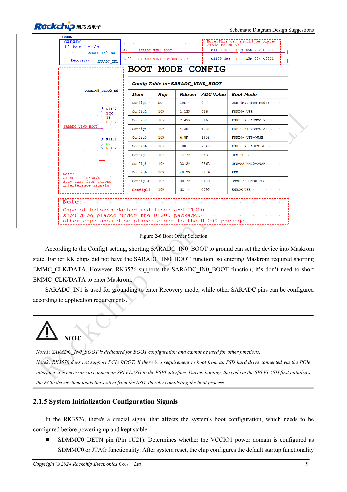

<!-- rk3576-hardware-v11-deep-20261109 -->

# RK3576 boot and debug design: straps, Maskrom, UART and JTAG

A reliable recovery path is part of production design. Define boot resistors, debug UART and USB download access in the schematic rather than adding wires after a boot failure.

Based on the Chinese and English RK3576 Hardware Design Guide V1.1 (2024-05-28), for SoC-board design. CM5 carriers must follow the module interface; Sige5 can establish a software/peripheral baseline. This guide does not prescribe one SDK/BSP or kernel for every product; verify each board. Values are source references, not ArmSoM measurements.

**RK3576_Hardware_Design_Guide_V1.1_20240528_EN.pdf** · §2.1.3–2.1.6

## Boot selection and two recovery modes

SARADC_IN0_BOOT (Pin A25) selects boot order; the source figure lists Config1–11. Default eMMC uses Config10/11 and UFS uses Config7/8. Config1 grounds this input for Maskrom without shorting eMMC clock/data. Grounding SARADC_IN1 invokes Recovery, a different mechanism. Reserve the BOOT function rather than reusing it for unrelated analog sensing. Use the original figure for complete resistor combinations.

## PCIe SSD boot is not native BootROM boot

The guide does not support native PCIe BootROM boot. Code in SPI Flash on FSPI must first initialize PCIe and then load the SSD system. Plan SPI Flash, recovery and image maintenance together; an NVMe socket alone is not a complete boot design.

## Debug pins and production access

Hold SDMMC0_DETN (Pin 1U21) stable before power-up: high defaults to JTAG, low to SDMMC0; the guide includes 1nF. IOMUX controls it after boot. Two-wire SWD uses TCK/TMS; M0 shares SDMMC0 in VCCIO1 and M1 shares UART0_M0 in PMUIO1. UART0 defaults to 1500000bps. Retain 100Ω series resistors, ESD protection and accessible test points. Images may change the baud rate; do not use a 5V UART adapter directly.

## Design parameters and review table

| Item | Value or net | Review note |
| --- | --- | --- |
| Maskrom | SARADC_IN0_BOOT = GND | Config1; distinct from Recovery |
| UART voltage domain | PMUIO1 | Match actual supply |
| Test points | ≥0.7mm / 2.54mm | Test-pad diameter / optional header pitch |

## Reference circuits and figures

The reference pages below contain the relevant circuit or timing figures; click for full resolution. Designators and component values belong to the reference design, not an ArmSoM product schematic.

English original · PDF 28 · 2-6

## ArmSoM products and development path

CM5 brings integrated computing to a custom carrier; Sige5 supports initial Linux and peripheral evaluation. SoC interface capability does not mean both products expose it. Check connectors, board revision and system image before purchasing or layout.

- [ArmSoM CM5](https://www.armsom.org/cm5) · [CM5 Docs](https://docs.armsom.org/armsom-cm5)
- [ArmSoM Sige5](https://www.armsom.org/sige5) · [Sige5 Docs](https://docs.armsom.org/armsom-sige5)

## Series reading order

- [RK3576 hardware design series: from minimum system to DDR and USB](/articles/rk3576-hardware-design-series/)
- [RK3576 minimum system: from schematic review to repeatable first boot](/articles/rk3576-hardware-bringup/)
- [RK3576 clock design: 24MHz crystal, 32kHz standby and peripheral clocks](/articles/rk3576-clock-circuit-design/)
- [RK3576 reset design: NPOR, RK806S-5, watchdog and thermal shutdown](/articles/rk3576-reset-watchdog-design/)
- [RK3576 rails and decoupling: CPU, GPU, NPU and LOGIC supply planning](/articles/rk3576-power-domain-design/)
- [RK3576 and RK806S-5: PMIC selection, control pins and feedback](/articles/rk3576-rk806s5-pmic-design/)
- [RK3576 power sequencing and standby: reset, retained rails and wake paths](/articles/rk3576-power-sequencing-standby/)
- [RK3576 DDR circuits and power: LPDDR4, LPDDR4X and LPDDR5](/articles/rk3576-ddr-circuit-power/)
- [RK3576 DDR PCB routing: impedance, length, return paths and PDN](/articles/rk3576-ddr-pcb-routing/)
- [RK3576 USB and Type-C hardware supplement: multiplexing, recovery and protection](/articles/168-rockchip-rk3576-usb/)
