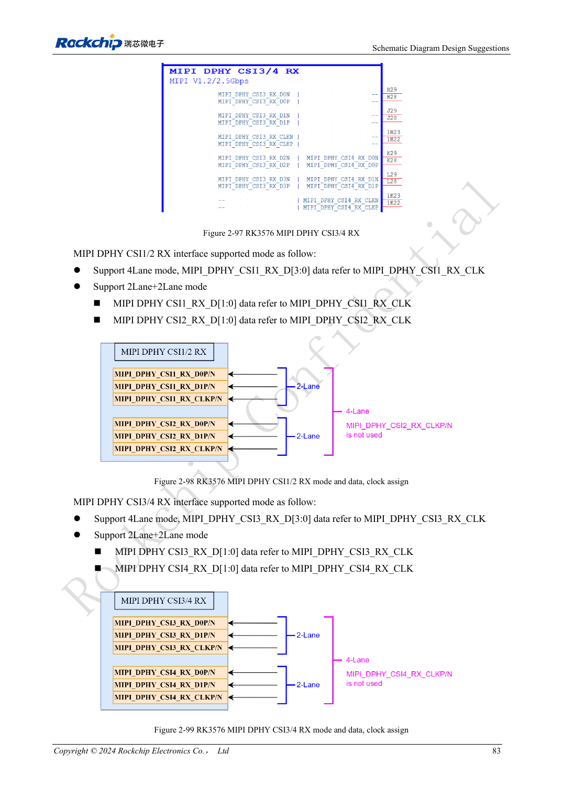
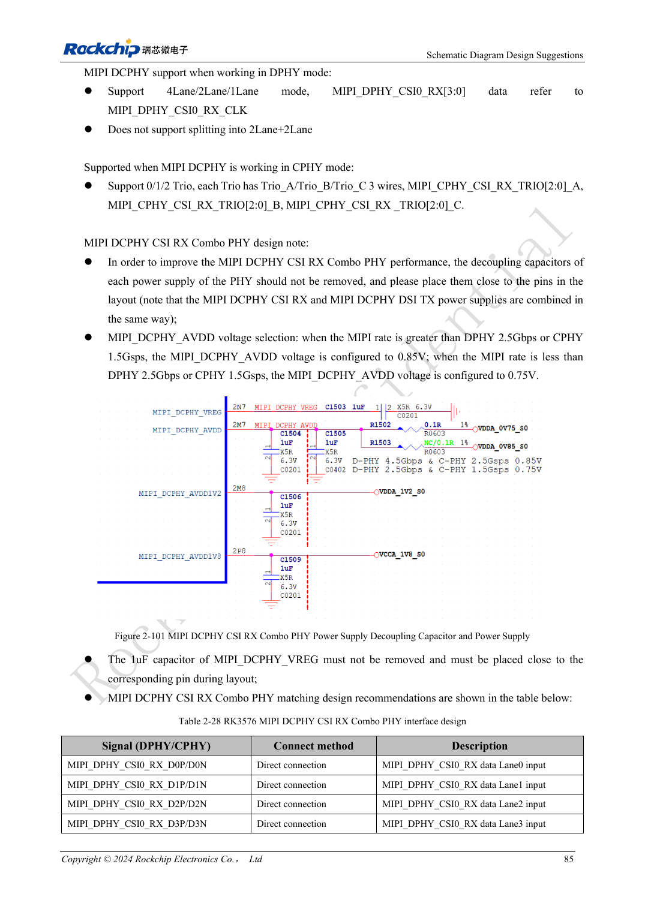

<!-- rk3576-hardware-v11-rest-20261109 -->

# RK3576 camera hardware: CSI grouping, DCPHY modes and power sequencing

Based on the Chinese and English RK3576 Hardware Design Guide V1.1 (2024-05-28), for SoC-board design. CM5 carriers must follow the module interface; Sige5 can establish a software/peripheral baseline. This guide does not prescribe one SDK/BSP or kernel for every product; verify each board. Values are source references, not ArmSoM measurements.

**RK3576_Hardware_Design_Guide_V1.1_20240528_EN.pdf** · §2.3.7; Camera PCB

## Start with physical grouping

Two DPHY CSI groups support four lanes or 2+2 splitting at up to 2.5Gbps/lane. CSI0 uses DCPHY: four DPHY lanes up to 4.5Gbps/lane or three CPHY trios up to 5.7Gbps/trio; CSI0 does not split into 2+2. DCPHY TX/RX must both use DPHY or both CPHY. These are SoC resources; check CM5/Sige5 connector exposure separately.

## Do not blindly copy three supply voltages

Sensor DVDD may be 1.2/1.5/1.8V. The reference sequence 1.8→1.2→2.8V is not universal. Match PWDN, RESET and I2C pull-ups to DOVDD; retain reset 100nF and connector decoupling. Put sensors with the same I2C address on separate buses. Keep the DCPHY MIPI_DCPHY_VREG 1μF capacitor. Verify rate-dependent AVDD against current specifications; equality at the source threshold is not defined.

## Source conflict and validation

CIF is assigned to VCCIO4 in its section but VCCIO6 in camera notes: CN PDF pages 98/100 and EN 105/107 repeat this conflict. Neither is treated here as a confirmed wiring instruction; check PinOut, mux and current schematics. Separate connector pairs with ground pins and isolate MCLK. Low-light work also needs DVDD noise assessment. Test concurrent cameras, frame errors, exposure changes and temperature.

## Design parameters and review table

| Item | Source reference |
| --- | --- |
| CSI DPHY groups | 4 lanes / 2+2 |
| CSI0 DCPHY | No 2+2 |
| VREG | 1μF |
| RESET | 100nF |
| CIF source conflict | VCCIO4 / VCCIO6 |

## Source figures

The reference pages below contain the relevant circuit or timing figures; click for full resolution. Designators and component values belong to the reference design, not an ArmSoM product schematic.

English original · PDF 102 · 2-98

English original · PDF 104 · 2-101

## ArmSoM development path

CM5 reduces repeated compute-core design on custom carriers; Sige5 provides a starting point for software and peripheral evaluation. Verify exposed interfaces, connector pins, voltages and image support in board documentation rather than inferring them from SoC features.

- [ArmSoM CM5](https://www.armsom.org/cm5) · [CM5 Docs](https://docs.armsom.org/armsom-cm5)
- [ArmSoM Sige5](https://www.armsom.org/sige5) · [Sige5 Docs](https://docs.armsom.org/armsom-sige5)

## Continue reading

- [RK3576 hardware design: 30 topics](/articles/rk3576-hardware-design-series/)
- [RK3576 SATA hardware: PHY sharing, coupling and drive power](/articles/rk3576-sata-hardware-design/)
- [RK3576 display hardware: MIPI, RGB, backlight and touch power](/articles/rk3576-display-panel-hardware/)
