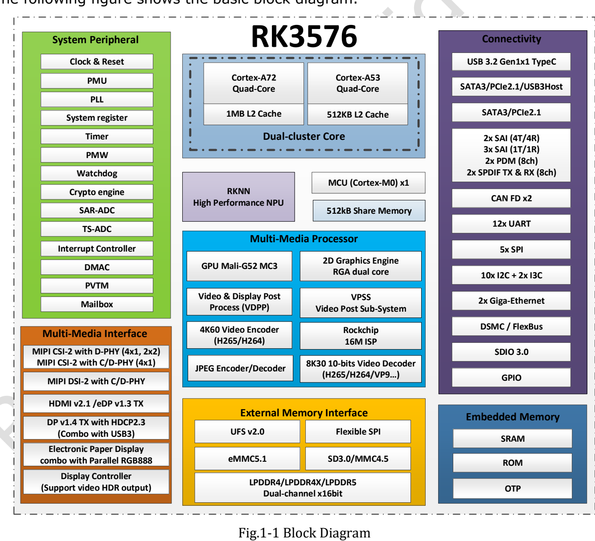

RK3576 brings image processing, inference, display and connectivity into an edge device. Its appeal is not simply the CPU core count: map each stage of your application to the appropriate accelerator, then choose an ArmSoM board or module that exposes the interfaces you need.

## CPU, GPU and NPU roles

| Block | V1.0 specification | Application role |
|---|---|---|
| CPU | 4× Cortex-A72 + 4× Cortex-A53; 1MB / 512KB L2 | OS, protocols, business logic and pre/post-processing |
| GPU | Mali-G52 MC3 | UI rendering and driver-supported graphics workloads |
| NPU | Two cores working together or independently; 6 TOPS INT8 with an asterisk | Converted neural networks with supported operators |
| Memory | Two 16-bit channels; LPDDR4/4X-4266, LPDDR5-4800; up to 16GB address space | Models, frame buffers and application data |
| Imaging/video | 16MP ISP, RGA and video codecs | Capture, resizing and compression |

These are chip capabilities, not a promise that every board exposes every interface. V1.0 page 41 still marks maximum CPU, GPU and NPU frequencies TBD. Check the actual product and image configuration for operating frequencies. Both V1.0 and the newer official Brief V1.2 explain the 6 TOPS asterisk as **sparsity**; this is neither model frame rate nor a like-for-like comparison with differently defined TOPS.

## A practical edge-vision pipeline

For workstation inspection, a camera captures the object, the configured ISP processes the image, RGA can handle resizing and colour operations, the NPU runs a converted model, and the CPU applies decision rules, stores events and reports results. A display provides status and review images.

Keeping this chain local can reduce transmission of raw video. Results depend on camera drivers, lighting, training data, operator coverage and memory transfers. Measure end-to-end latency, false detections and sustained temperature, not just one NPU inference call.

## Read video limits by format

The V1.0 overview lists decoding up to 8K30 or 4K120, while detailed entries set codec-specific limits. H.264 cannot inherit another codec's maximum. The newer official Brief V1.2 mainly lists 4K modes by codec; this guide does not combine revisions into an unconditional maximum specification.

Decoding, display output and concurrent streams are separate questions. Test files matching the intended resolution, frame rate, bitrate, bit depth and codec, and verify that the application really uses hardware acceleration. An HDMI version label does not guarantee every display mode.

## From a Sige5 prototype to a CM5 product

Sige5 is an SBC for connecting peripherals directly and validating algorithms, networking and interaction. CM5 is a compute module for a carrier designed around an enclosure, connectors and specialised peripherals. Sharing RK3576 allows some application experience to carry over, but device trees, pin multiplexing, power and cooling still need review.

For an intelligent terminal, HMI or gateway, list essential peripherals before selecting hardware. PCIe, SATA and USB functions sharing a combo PHY are not independent ports that can necessarily operate together.

## Suggested validation order

1. Freeze board revision, OS image, kernel and NPU runtime.
2. Validate camera, networking, storage and display independently.
3. Convert the model and measure accuracy and end-to-end performance using real data.
4. Add recovery, log rotation, power-loss handling and update strategy.
5. Run sustained load and temperature tests inside the final enclosure.

This is a technical interpretation and a proposed development path, not a report of completed ArmSoM application benchmarks.

## Series and product links

- [ArmSoM CM5 as a Raspberry Pi CM4/CM5 alternative: selection and migration](/articles/cm5-raspberry-pi-cm4-cm5-alternative/)
- [What can Sige5 do? Six RK3576 edge computing applications](/articles/sige5-rk3576-applications/)
- [RK3576 Datasheet V1.0: download, package, electrical and thermal guide](/articles/rk3576-datasheet-v10/)
- [ArmSoM CM5](https://www.armsom.org/cm5) · [ArmSoM Sige5](https://docs.armsom.org/armsom-sige5)

## References

- [Rockchip RK3576](https://www.rock-chips.com/a/en/products/RK35_Series/2024/1212/2033.html)
- [RK3576 Brief V1.2 (2025-08-28)](https://www.rock-chips.com/uploads/pdf/2024.3.18/191/RK3576%20Brief%20Datasheet%20V1.2-20250828.pdf)
- [ArmSoM CM5](https://docs.armsom.org/armsom-cm5)
- [ArmSoM Sige5](https://docs.armsom.org/armsom-sige5)
- [Raspberry Pi CM5](https://www.raspberrypi.com/products/compute-module-5/)
