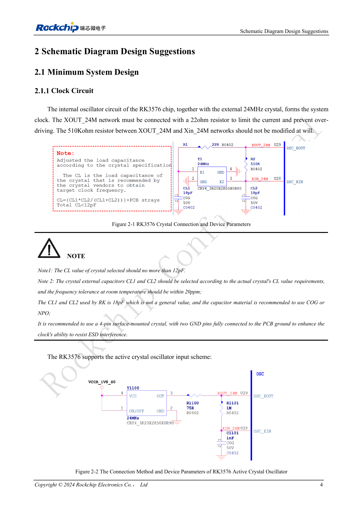

<!-- rk3576-hardware-v11-deep-20261109 -->

# RK3576 clock design: 24MHz crystal, 32kHz standby and peripheral clocks

Clock faults can cause boot, USB or wake-up failures. Review oscillator circuitry, accuracy, output voltage and the sources that remain active in standby; the presence of a 24MHz crystal alone is insufficient.

Based on the Chinese and English RK3576 Hardware Design Guide V1.1 (2024-05-28), for SoC-board design. CM5 carriers must follow the module interface; Sige5 can establish a software/peripheral baseline. This guide does not prescribe one SDK/BSP or kernel for every product; verify each board. Values are source references, not ArmSoM measurements.

**RK3576_Hardware_Design_Guide_V1.1_20240528_EN.pdf** · §2.1.1

## Critical parts around the passive crystal

The 22Ω resistor in series with XOUT_24M limits overdrive; do not arbitrarily change the 510kΩ resistor between XOUT and XIN. Crystal load capacitance CL must not exceed 12pF. Select and verify CL1/CL2 for the actual crystal; 18pF is a reference-design value. Use C0G/NP0 capacitors and a four-pad crystal with both ground pads properly connected. Probe capacitance can disturb oscillation.

## Active input and duty cycle

The reference active-clock voltage is 1.35–1.8V, with 50% duty cycle and 20ppm accuracy. The guide observes bypassed 24MHz at REF_CLK0_OUT (Pin V29) while adjusting R1100; this is not a universal register command. A 0.8V input may not reach 50% duty cycle, so oscillation alone does not demonstrate compliance.

## Review standby and output clocks together

Before stopping 24MHz, switch to PMU_PVTM or external 32.768kHz and verify that wake sources do not require 24MHz. Minimum standby relies on PMUIO0/1 interrupts. Disable the GPIO internal pull-down for an open-drain RTC connected to CLK32K_IN. CLK0/1_32K_OUT is not guaranteed after 24MHz stops. Check pin multiplexing and peripheral voltage for camera and Ethernet clock outputs as well.

## Design parameters and review table

| Item | Value or net | Review note |
| --- | --- | --- |
| Crystal tolerance | ≤20ppm | At room temperature, per source |
| External standby clock | 32.768kHz ±30ppm; 45–55% | Amplitude 0.7×VDD to VDD; VDD=PMUIO0 |
| Reference outputs | REF_CLK0/1/2_OUT | 12/24/25/26/27/37.125/74.25/10/20/40/50/58.5/100MHz |
| Camera clocks | CAM_CLK0/1/2_OUT | Default 24MHz; alternatives 27/37.125/74.25MHz |

## Reference circuits and figures

The reference pages below contain the relevant circuit or timing figures; click for full resolution. Designators and component values belong to the reference design, not an ArmSoM product schematic.

English original · PDF 23 · 2-1 / 2-2

## ArmSoM products and development path

CM5 brings integrated computing to a custom carrier; Sige5 supports initial Linux and peripheral evaluation. SoC interface capability does not mean both products expose it. Check connectors, board revision and system image before purchasing or layout.

- [ArmSoM CM5](https://www.armsom.org/cm5) · [CM5 Docs](https://docs.armsom.org/armsom-cm5)
- [ArmSoM Sige5](https://www.armsom.org/sige5) · [Sige5 Docs](https://docs.armsom.org/armsom-sige5)

## Series reading order

- [RK3576 hardware design series: from minimum system to DDR and USB](/articles/rk3576-hardware-design-series/)
- [RK3576 minimum system: from schematic review to repeatable first boot](/articles/rk3576-hardware-bringup/)
- [RK3576 reset design: NPOR, RK806S-5, watchdog and thermal shutdown](/articles/rk3576-reset-watchdog-design/)
- [RK3576 boot and debug design: straps, Maskrom, UART and JTAG](/articles/rk3576-boot-debug-design/)
- [RK3576 rails and decoupling: CPU, GPU, NPU and LOGIC supply planning](/articles/rk3576-power-domain-design/)
- [RK3576 and RK806S-5: PMIC selection, control pins and feedback](/articles/rk3576-rk806s5-pmic-design/)
- [RK3576 power sequencing and standby: reset, retained rails and wake paths](/articles/rk3576-power-sequencing-standby/)
- [RK3576 DDR circuits and power: LPDDR4, LPDDR4X and LPDDR5](/articles/rk3576-ddr-circuit-power/)
- [RK3576 DDR PCB routing: impedance, length, return paths and PDN](/articles/rk3576-ddr-pcb-routing/)
- [RK3576 USB and Type-C hardware supplement: multiplexing, recovery and protection](/articles/168-rockchip-rk3576-usb/)
