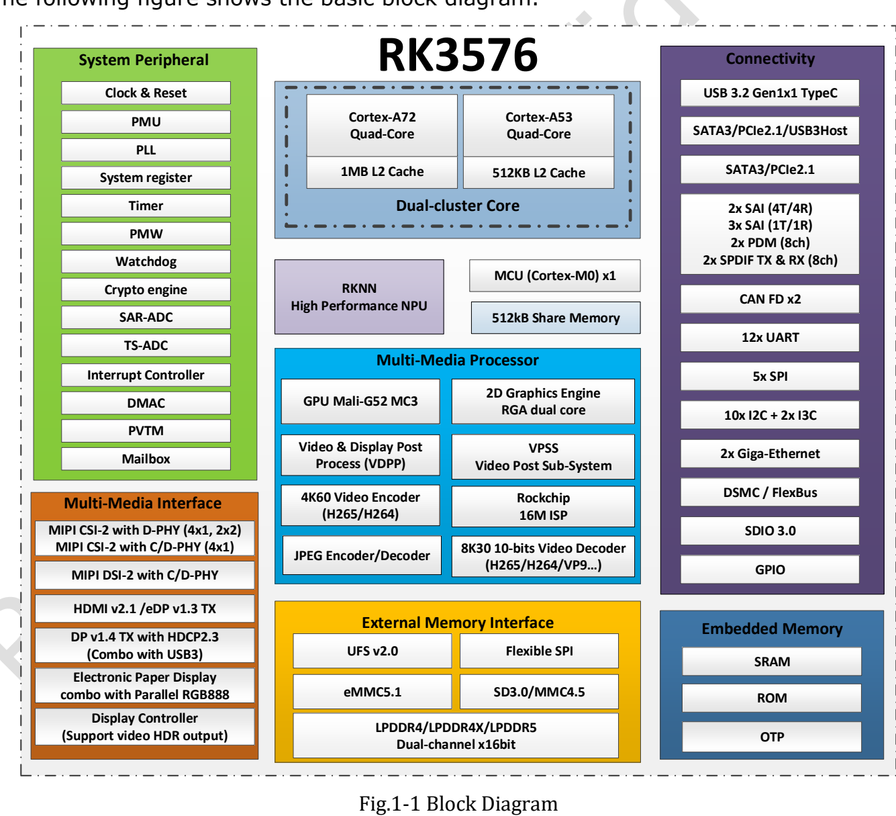
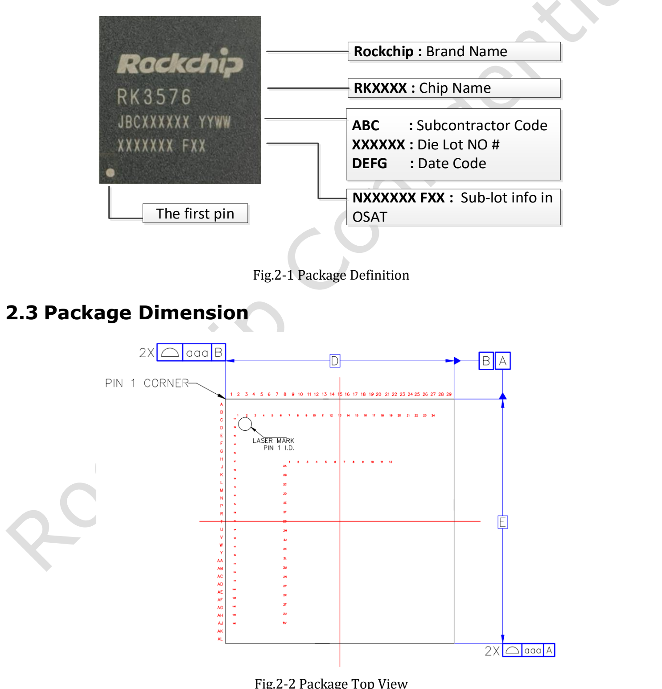
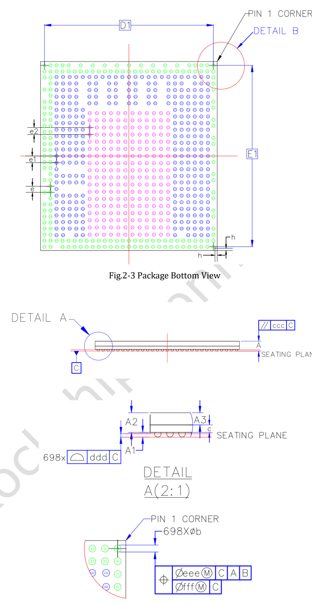
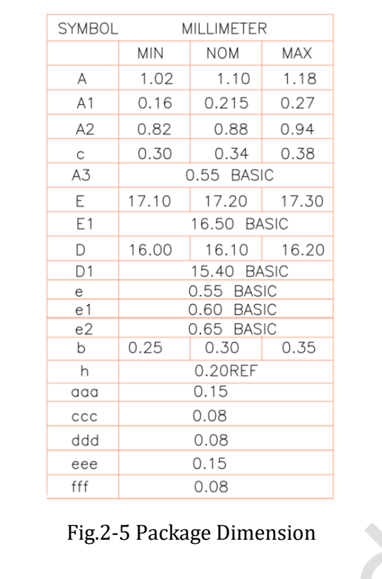

The **RK3576 Datasheet V1.0, dated 2024-03-15, contains 46 pages** covering architecture, package, pins and electrical conditions. This article is a reading guide, not a line-by-line translation or a claim that the initial revision is the latest specification.

[Download the complete original PDF](/assets/rk3576/Rockchip-RK3576-Datasheet-V1.0-20240315.pdf)

## Document map

| Original pages | Contents | Purpose |
|---|---|---|
| 6–22 | CPU, memory, system blocks, multimedia, interfaces and diagram | Architecture and interface planning |
| 23–25 | Marking, drawings, dimensions, MSL and ball material | Package and manufacturing reference |
| 26–37 | Pin-number table | Power-domain and signal review |
| 38 | Absolute ratings | Limits, not recommended operating points |
| 39–45 | Recommended conditions and interface characteristics | Power and signal design |
| 46 | Thermal management and conditions | Cooling reference |

## Architecture and memory

V1.0 describes four Cortex-A72 and four Cortex-A53 cores with 1MB and 512KB shared L2 respectively. Two 16-bit memory channels support LPDDR4/4X-4266 and LPDDR5-4800 with up to 16GB address space. Storage options include eMMC 5.1, UFS 2.0 and serial Flash; board connectivity depends on the design.

## Three revision details to retain

- **Frequency:** page 41 marks maximum A72, A53, GPU and NPU frequencies TBD. Current product frequencies must not be presented as original V1.0 values.
- **NPU:** page 11 lists 6 TOPS* INT8 with a sparsity footnote, retained in the newer official Brief V1.2. Preserve this qualification in promotional material.
- **Graphics and video:** V1.0 lists Vulkan 1.1 and OpenCL 2.0; the newer brief lists Vulkan 1.2 and OpenCL 2.1 and presents video limits differently. Check driver support and the actual codec, bit depth and mode.

## Package and pins

V1.0 specifies FCCSP698L, a 16.1 × 17.2mm body, 0.30mm balls and mixed 0.55/0.60/0.65mm pitches. MSL is 3 and ball material is SnAgCu. Do not generate a footprint from a simplified single-pitch description; use the original dimension table and official design files.

## Electrical and thermal conditions

Absolute ratings and recommended operating conditions are separate tables. Core, memory and general IO domains cannot be treated as one voltage, and a board's 5V input does not imply 5V-tolerant SoC pins. Some page 39 entries remain TBD and need confirmation before design sign-off.

Page 46 requires junction temperature below 125°C, not ambient temperature. The package reference values θJA=15.84, θJB=6.96, θJC=0.67 and ψJT=0.031°C/W have specified conditions; the text describes simulation data subject to physical verification. Do not transfer θJA to an arbitrary enclosure or treat ψJT as an ordinary thermal resistance.

## Implications for CM5 and Sige5

For a ready-made board, start with board-level power, pinout and cooling requirements. For a CM5 carrier, use module connector definitions and reference designs, not the SoC ball table. Electrical characteristics have not been independently retested here. The original PDF is retained intact, including original markings in the figures.

## Series and product links

- [RK3576 explained: from eight CPU cores to ArmSoM edge AI products](/articles/rk3576-chip-guide/)
- [ArmSoM CM5 as a Raspberry Pi CM4/CM5 alternative: selection and migration](/articles/cm5-raspberry-pi-cm4-cm5-alternative/)
- [What can Sige5 do? Six RK3576 edge computing applications](/articles/sige5-rk3576-applications/)
- [ArmSoM CM5](https://www.armsom.org/cm5) · [ArmSoM Sige5](https://docs.armsom.org/armsom-sige5)

## References

- [Rockchip RK3576](https://www.rock-chips.com/a/en/products/RK35_Series/2024/1212/2033.html)
- [RK3576 Brief V1.2 (2025-08-28)](https://www.rock-chips.com/uploads/pdf/2024.3.18/191/RK3576%20Brief%20Datasheet%20V1.2-20250828.pdf)
- [ArmSoM CM5](https://docs.armsom.org/armsom-cm5)
- [ArmSoM Sige5](https://docs.armsom.org/armsom-sige5)
- [Raspberry Pi CM5](https://www.raspberrypi.com/products/compute-module-5/)

<!-- datasheet-related-20261110 -->
## Other chip datasheets

These links support cross-platform reading; electrical conditions and pins are not interchangeable.

- [RK3506B](/articles/rk3506b-datasheet-v10/)
- [RK3588](/articles/rk3588-datasheet-v14/)
- [RK3528](/articles/rk3528-datasheet-v10/)
- [RK3568](/articles/rk3568-datasheet-v12/)
- [RK730](/articles/rk730-audio-codec-design/)
