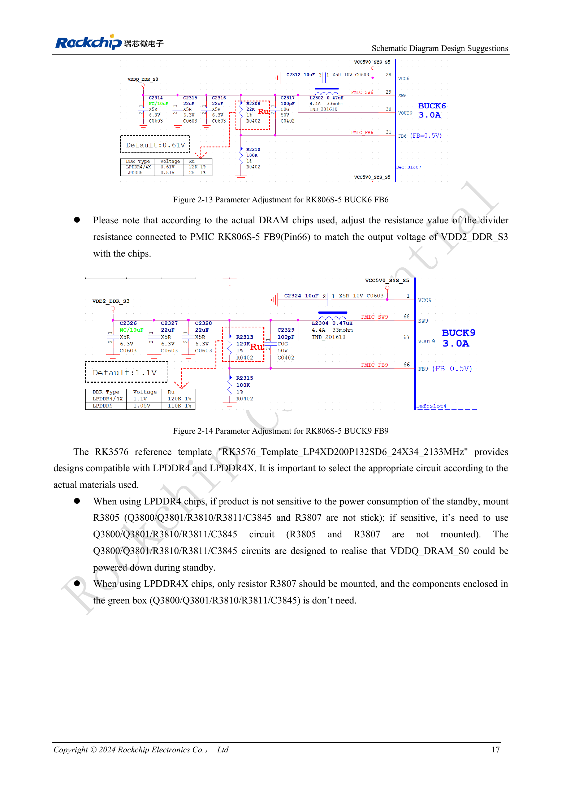
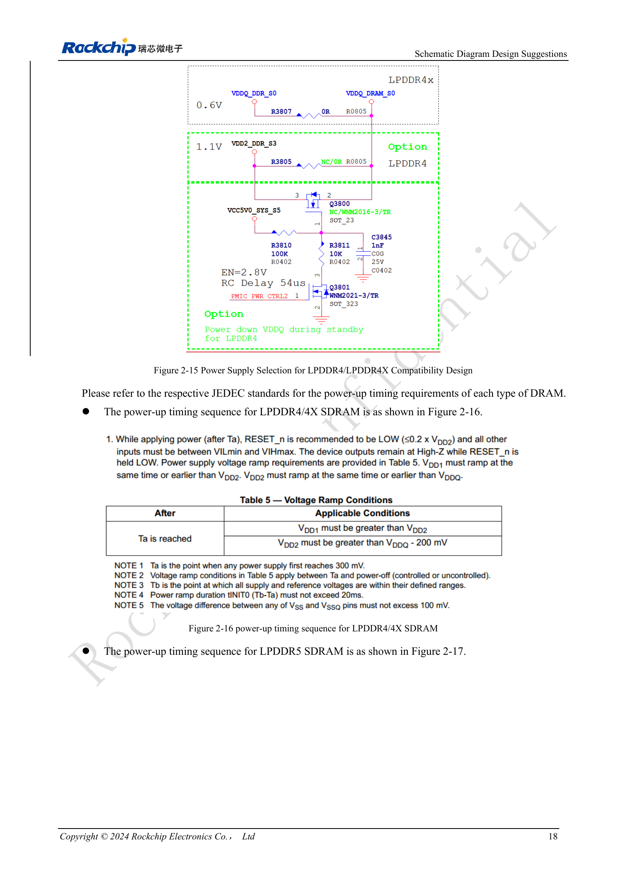

<!-- rk3576-hardware-v11-deep-20261109 -->

# RK3576 DDR circuits and power: LPDDR4, LPDDR4X and LPDDR5

DDR compatibility involves more than the package. Match memory and PHY supplies, ZQ, signal assignments, standby and firmware. The table retains source typical values and separates DRAM from PHY, preventing confusion between LPDDR4’s 1.1V and the PHY’s 0.61V.

Based on the Chinese and English RK3576 Hardware Design Guide V1.1 (2024-05-28), for SoC-board design. CM5 carriers must follow the module interface; Sige5 can establish a software/peripheral baseline. This guide does not prescribe one SDK/BSP or kernel for every product; verify each board. Values are source references, not ArmSoM measurements.

**RK3576_Hardware_Design_Guide_V1.1_20240528_EN.pdf** · §2.1.7

## Interface and capacity boundaries

RK3576 supports LPDDR4/4X/5 with two 16-bit channels, totaling 32 bits. Up to 8GB per channel and 16GB total describe SoC addressing, not every CM5 or Sige5 SKU. Do not arbitrarily swap DQ/CA; review pins against the template and table 2-4. LPDDR5 introduces WCK at 2× or 4× CK; LPDDR4 CKE and other assignments cannot simply be reused.

## ZQ and PMIC dividers

PHY ZQ uses 240Ω, 1% to DDRPHY_VDDQ_S0. LPDDR4X/5 memory ZQ connects to that domain, while LPDDR4 ZQ connects to VDD2_DDR_S3. LPDDR4/4X ODT_CA connects to VDD2_DDR_S3. After selecting memory, check the dividers at RK806S-5 FB6 (Pin31) for VDDQ_DDR_S0 and FB9 (Pin66) for VDD2_DDR_S3. Typical values do not replace memory tolerances or sequencing requirements.

## Population options and standby

In RK3576_Template_LP4XD200P132SD6_24X34_2133MHz, low-standby-power LPDDR4 uses Q3800/Q3801/R3810/R3811/C3845 and omits R3805/R3807; the alternative LPDDR4 option uses R3805. LPDDR4X uses R3807 and omits the corresponding green-box circuit. These references belong only to that template, not arbitrary CM5 carrier modifications. Retain DDRPHY_CKE_VDDQ in standby and check each rail against the memory’s JEDEC sequence.

## Design parameters and review table

| Item | Value or net | Review note |
| --- | --- | --- |
| DRAM VDD1 | 1.8 / 1.8 / 1.8V | Order throughout: LPDDR4 / 4X / 5 |
| DRAM VDD2/VDD2H | 1.1 / 1.1 / 1.05V | LPDDR5 additionally uses VDD2L=0.9V |
| DRAM VDDQ | 1.1 / 0.61 / 0.51V | Do not confuse with PHY rails |
| PHY VDDQ/CK_VDDQ | 0.61 / 0.61 / 0.51V | Typical |
| PHY CKE_VDDQ | 1.1 / 1.1 / 1.05V | Retain in standby |
| PHY DVDD / PLL_DVDD | 0.75–0.85V | PLL_AVDD1V8=1.8V |

## Reference circuits and figures

The reference pages below contain the relevant circuit or timing figures; click for full resolution. Designators and component values belong to the reference design, not an ArmSoM product schematic.

English original · PDF 36 · 2-13

English original · PDF 37 · 2-15

## ArmSoM products and development path

CM5 brings integrated computing to a custom carrier; Sige5 supports initial Linux and peripheral evaluation. SoC interface capability does not mean both products expose it. Check connectors, board revision and system image before purchasing or layout.

- [ArmSoM CM5](https://www.armsom.org/cm5) · [CM5 Docs](https://docs.armsom.org/armsom-cm5)
- [ArmSoM Sige5](https://www.armsom.org/sige5) · [Sige5 Docs](https://docs.armsom.org/armsom-sige5)

## Series reading order

- [RK3576 hardware design series: from minimum system to DDR and USB](/articles/rk3576-hardware-design-series/)
- [RK3576 minimum system: from schematic review to repeatable first boot](/articles/rk3576-hardware-bringup/)
- [RK3576 clock design: 24MHz crystal, 32kHz standby and peripheral clocks](/articles/rk3576-clock-circuit-design/)
- [RK3576 reset design: NPOR, RK806S-5, watchdog and thermal shutdown](/articles/rk3576-reset-watchdog-design/)
- [RK3576 boot and debug design: straps, Maskrom, UART and JTAG](/articles/rk3576-boot-debug-design/)
- [RK3576 rails and decoupling: CPU, GPU, NPU and LOGIC supply planning](/articles/rk3576-power-domain-design/)
- [RK3576 and RK806S-5: PMIC selection, control pins and feedback](/articles/rk3576-rk806s5-pmic-design/)
- [RK3576 power sequencing and standby: reset, retained rails and wake paths](/articles/rk3576-power-sequencing-standby/)
- [RK3576 DDR PCB routing: impedance, length, return paths and PDN](/articles/rk3576-ddr-pcb-routing/)
- [RK3576 USB and Type-C hardware supplement: multiplexing, recovery and protection](/articles/168-rockchip-rk3576-usb/)
