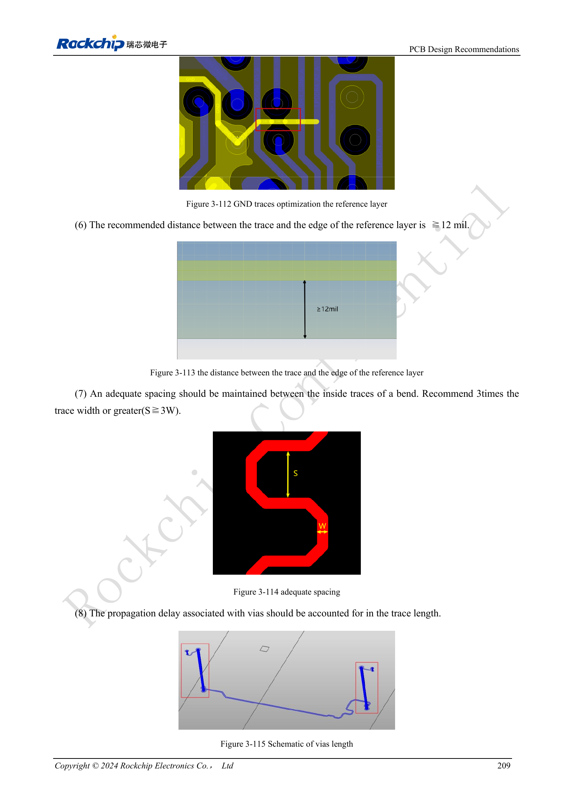

<!-- rk3576-hardware-v11-deep-20261109 -->

# RK3576 DDR PCB routing: impedance, length, return paths and PDN

Start from a validated PCB template and matching DDR firmware. Length matching is only one requirement: reference planes, via return paths, impedance, crosstalk and power impedance jointly determine margin. The following follows §3.5.3.

Based on the Chinese and English RK3576 Hardware Design Guide V1.1 (2024-05-28), for SoC-board design. CM5 carriers must follow the module interface; Sige5 can establish a software/peripheral baseline. This guide does not prescribe one SDK/BSP or kernel for every product; verify each board. Values are source references, not ArmSoM measurements.

**RK3576_Hardware_Design_Guide_V1.1_20240528_EN.pdf** · §3.5.3; Tables 3-18 / 3-19

## Establish continuous return paths first

Do not remove template GND vias under the SoC or DRAM. Within 25mil of a signal-via center, provide at least one GND via connecting both reference planes. Interleave signal and ground vias rather than clustering. Keep at least one continuous GND plane and traces at least 12mil from its edge. Extra serpentine length does not repair a split return path.

## Consider length, spacing and vias together

W means the actual trace width, not a fixed mil value. Serpentine internal spacing should be S≥3W; keep traces at least 8mil from via pads. Include via propagation delay in matching and hold differential intrapair mismatch ≤5mil. Stitch DQS/CLK/WCLK ground guards at intervals ≤400mil. Agree nonfunctional-pad removal with fabrication.

## PDN targets and acceptance

For LPDDR4X VDD2/VDDQ and LPDDR5 VDD2H, impedance limits across 100kHz–1MHz, 1–30MHz and 30–100MHz are 0.03/0.03/0.04Ω. LPDDR5 VDD2L uses 0.07/0.07/0.08Ω. Retain reference decoupling and verify actual capacitor models. The Chinese introduction prints “4266bps” while English says “4266Mbps”; this unit discrepancy is recorded, not converted into a guaranteed product rate. Validate with simulation, actual DDR firmware, cold starts and load stability.

## Design parameters and review table

| Item | Value or net | Review note |
| --- | --- | --- |
| DQ/DM single-ended | LPDDR5:40Ω±10%; LPDDR4/4X:45Ω±10% | Calculate width for actual stackup |
| CA/control | 50Ω±10% | Differential pairs 90Ω±10% |
| Within-byte mismatch | ≤90mil | DQ/DM relative to DQS/WCLK |
| Address/control mismatch | ≤90mil | Relative to CLK |
| Strobe to clock | DQS/WCLK ↔ CLK ≤230mil | Include via delay |
| Trace spacing | ≥2W; DQ↔DQS/WCLK, CLK: ≥3W preferred | Critical groups: minimum 2W, preferred 3W |

## Reference circuits and figures

The reference pages below contain the relevant circuit or timing figures; click for full resolution. Designators and component values belong to the reference design, not an ArmSoM product schematic.

English original · PDF 228 · 3-112 / 3-113

## ArmSoM products and development path

CM5 brings integrated computing to a custom carrier; Sige5 supports initial Linux and peripheral evaluation. SoC interface capability does not mean both products expose it. Check connectors, board revision and system image before purchasing or layout.

- [ArmSoM CM5](https://www.armsom.org/cm5) · [CM5 Docs](https://docs.armsom.org/armsom-cm5)
- [ArmSoM Sige5](https://www.armsom.org/sige5) · [Sige5 Docs](https://docs.armsom.org/armsom-sige5)

## Series reading order

- [RK3576 hardware design series: from minimum system to DDR and USB](/articles/rk3576-hardware-design-series/)
- [RK3576 minimum system: from schematic review to repeatable first boot](/articles/rk3576-hardware-bringup/)
- [RK3576 clock design: 24MHz crystal, 32kHz standby and peripheral clocks](/articles/rk3576-clock-circuit-design/)
- [RK3576 reset design: NPOR, RK806S-5, watchdog and thermal shutdown](/articles/rk3576-reset-watchdog-design/)
- [RK3576 boot and debug design: straps, Maskrom, UART and JTAG](/articles/rk3576-boot-debug-design/)
- [RK3576 rails and decoupling: CPU, GPU, NPU and LOGIC supply planning](/articles/rk3576-power-domain-design/)
- [RK3576 and RK806S-5: PMIC selection, control pins and feedback](/articles/rk3576-rk806s5-pmic-design/)
- [RK3576 power sequencing and standby: reset, retained rails and wake paths](/articles/rk3576-power-sequencing-standby/)
- [RK3576 DDR circuits and power: LPDDR4, LPDDR4X and LPDDR5](/articles/rk3576-ddr-circuit-power/)
- [RK3576 USB and Type-C hardware supplement: multiplexing, recovery and protection](/articles/168-rockchip-rk3576-usb/)
