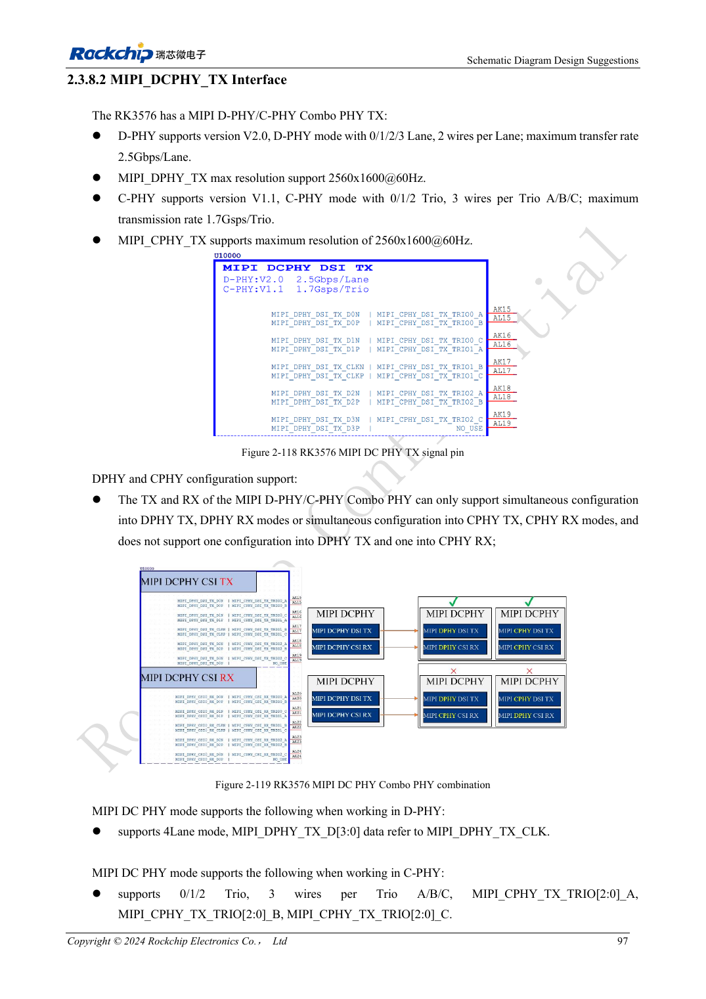
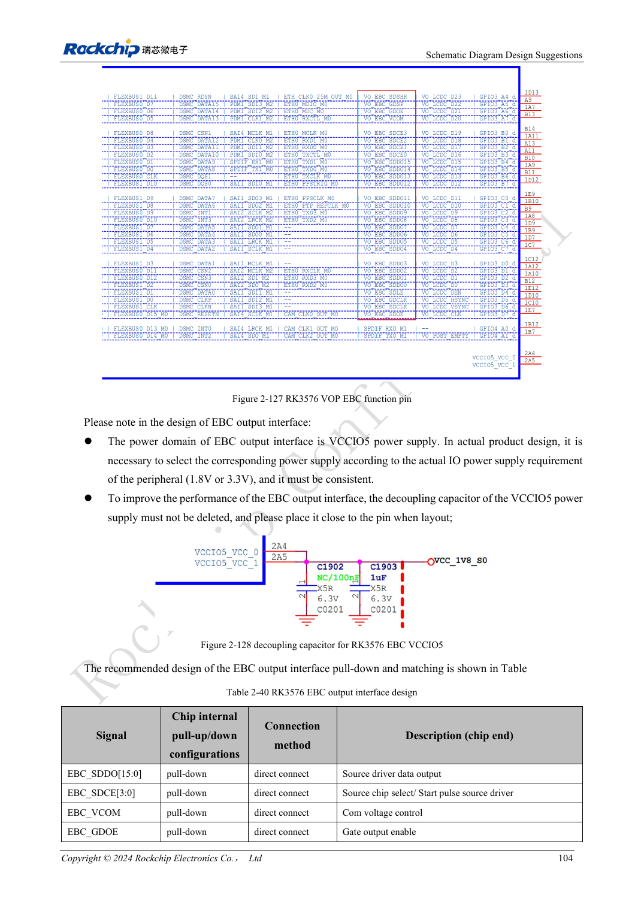

<!-- rk3576-hardware-v11-rest-20261109 -->

# RK3576 display hardware: MIPI, RGB, backlight and touch power

Based on the Chinese and English RK3576 Hardware Design Guide V1.1 (2024-05-28), for SoC-board design. CM5 carriers must follow the module interface; Sige5 can establish a software/peripheral baseline. This guide does not prescribe one SDK/BSP or kernel for every product; verify each board. Values are source references, not ArmSoM measurements.

**RK3576_Hardware_Design_Guide_V1.1_20240528_EN.pdf** · §2.3.8.2, §2.3.8.4–6; MIPI/RGB PCB

## Select a panel by interface, not resolution alone

MIPI TX offers four DPHY lanes up to 2.5Gbps/lane or three CPHY trios up to 1.7Gsps; the guide lists 2560×1600@60 capability. Shared DCPHY TX/RX must use the same mode. RGB/BT1120 uses VCCIO5 at the panel-compatible 1.8/3.3V. RGB666/RGB565 mappings use upper data bits; do not assume wiring starts at D0.

## Start with panel and backlight off

Use controllable panel power, off by default. Backlight EN/PWM should default low with external pull-downs to avoid flashes. Rate boost inductors, diodes and capacitors for operating and open-load conditions; use a 1% current-setting FB resistor. Touch I2C uses 2.2kΩ pull-ups to VCC3V3_TP, preferably on a dedicated bus. Shared buses require address, sequencing and back-power checks.

## Keep DPHY and CPHY constraints distinct

Route DPHY as pairs and CPHY as trios, not ordinary differential pairs. Include FPC, connectors, ESD and test points in the channel; keep test stubs short. Validate cold boot, brightness control, sleep/wake, touch interrupts and prolonged display operation. Panel initialization follows the actual panel, not only the SoC model.

## Design parameters and review table

| Item | Source reference |
| --- | --- |
| DPHY Zdiff | 100Ω ±10% preferred |
| DPHY intra-pair / CLK-data | <6mil / <12mil |
| CPHY Zsingle | 50Ω ±10% |
| CPHY intra-trio / inter-trio | <6mil / <100mil |
| DPHY / CPHY length | <6inch / <5inch |

## Source figures

The reference pages below contain the relevant circuit or timing figures; click for full resolution. Designators and component values belong to the reference design, not an ArmSoM product schematic.

English original · PDF 116 · 2-118

English original · PDF 123 · 2-127

## ArmSoM development path

CM5 reduces repeated compute-core design on custom carriers; Sige5 provides a starting point for software and peripheral evaluation. Verify exposed interfaces, connector pins, voltages and image support in board documentation rather than inferring them from SoC features.

- [ArmSoM CM5](https://www.armsom.org/cm5) · [CM5 Docs](https://docs.armsom.org/armsom-cm5)
- [ArmSoM Sige5](https://www.armsom.org/sige5) · [Sige5 Docs](https://docs.armsom.org/armsom-sige5)

## Continue reading

- [RK3576 hardware design: 30 topics](/articles/rk3576-hardware-design-series/)
- [RK3576 camera hardware: CSI grouping, DCPHY modes and power sequencing](/articles/rk3576-camera-hardware-design/)
- [RK3576 HDMI hardware: FRL/TMDS, DDC levels and protection](/articles/rk3576-hdmi-hardware-design/)
