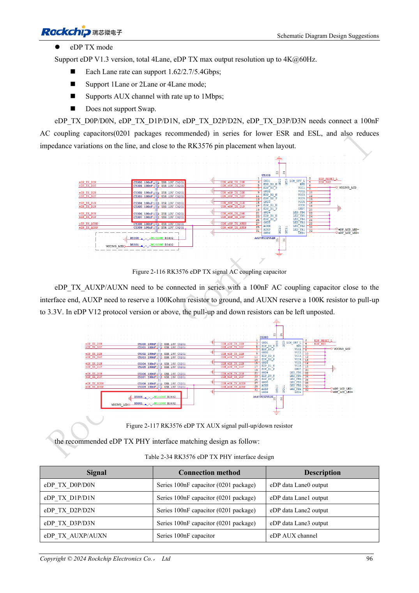
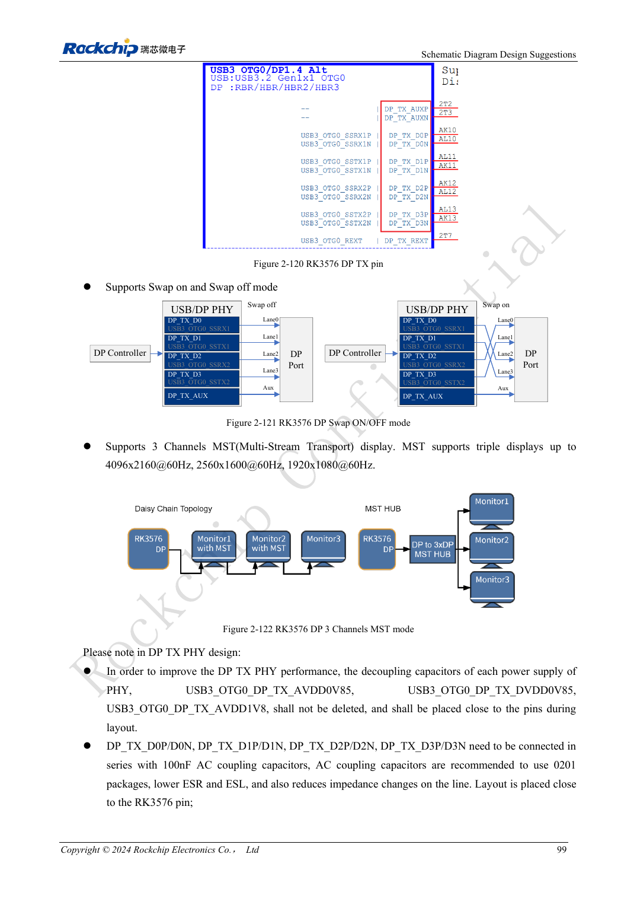

<!-- rk3576-hardware-v11-rest-20261109 -->

# RK3576 DP/eDP design: PHY allocation, AUX and coupling discrepancies

Based on the Chinese and English RK3576 Hardware Design Guide V1.1 (2024-05-28), for SoC-board design. CM5 carriers must follow the module interface; Sige5 can establish a software/peripheral baseline. This guide does not prescribe one SDK/BSP or kernel for every product; verify each board. Values are source references, not ArmSoM measurements.

**RK3576_Hardware_Design_Guide_V1.1_20240528_EN.pdf** · §2.3.8.1, §2.3.8.3; DP/eDP PCB

## DP and eDP use different resources

DP 1.4 shares a Combo PHY with USB3 OTG0 and supports 1/2/4 lanes at 1.62/2.7/5.4/8.1Gbps. eDP 1.3 shares its PHY with HDMI, supports 1/2/4 lanes at 1.62/2.7/5.4Gbps, and the guide disallows lane swap. Check actual mux and board exposure for MST, multiple displays or Type-C rather than counting display outputs alone.

## AUX and a source capacitor conflict

DP data and AUX use 100nF; place AUX capacitors near the connector. The reference resistor is 8.2kΩ, 1%. eDP schematic guidance says 100nF but the PCB table says 220nF±20%: CN PDF 106–107/222; the English schematic and PDF 244 also differ. Both are retained here. Resolve against current reference design, receiver and vendor before choosing the BOM.

## Check power as well as link training

Reference impedance is 100Ω for dedicated DP, 95Ω when shared with USB, and 90Ω for eDP matched to its cable. Verify AUX, HPD, training, panel/backlight sequencing and wake-up. For a black screen distinguish missing AUX, training failure and disabled backlight before repeatedly changing video timings.

## Design parameters and review table

| Item | Source reference |
| --- | --- |
| DP / eDP Zdiff | 100Ω (95Ω shared) / 90Ω |
| Intra-pair mismatch | <6mil |
| Trace length | <6inch |
| eDP AC: unresolved | 100nF / 220nF ±20% |
| Recommended via count | ≤2 |

## Source figures

The reference pages below contain the relevant circuit or timing figures; click for full resolution. Designators and component values belong to the reference design, not an ArmSoM product schematic.

English original · PDF 115 · 2-116

English original · PDF 118 · 2-121

## ArmSoM development path

CM5 reduces repeated compute-core design on custom carriers; Sige5 provides a starting point for software and peripheral evaluation. Verify exposed interfaces, connector pins, voltages and image support in board documentation rather than inferring them from SoC features.

- [ArmSoM CM5](https://www.armsom.org/cm5) · [CM5 Docs](https://docs.armsom.org/armsom-cm5)
- [ArmSoM Sige5](https://www.armsom.org/sige5) · [Sige5 Docs](https://docs.armsom.org/armsom-sige5)

## Continue reading

- [RK3576 hardware design: 30 topics](/articles/rk3576-hardware-design-series/)
- [RK3576 HDMI hardware: FRL/TMDS, DDC levels and protection](/articles/rk3576-hdmi-hardware-design/)
- [RK3576 audio hardware: SAI, PDM, ASRC and microphone layout](/articles/rk3576-audio-hardware-design/)
