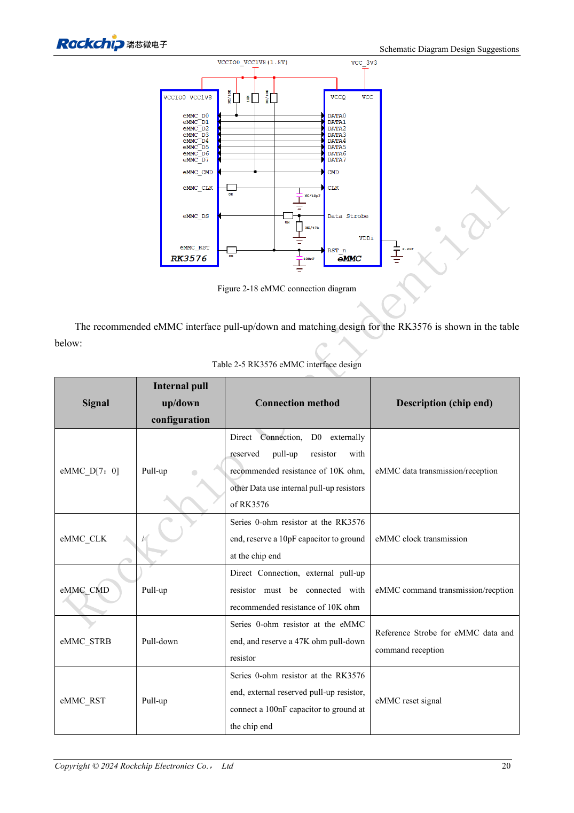
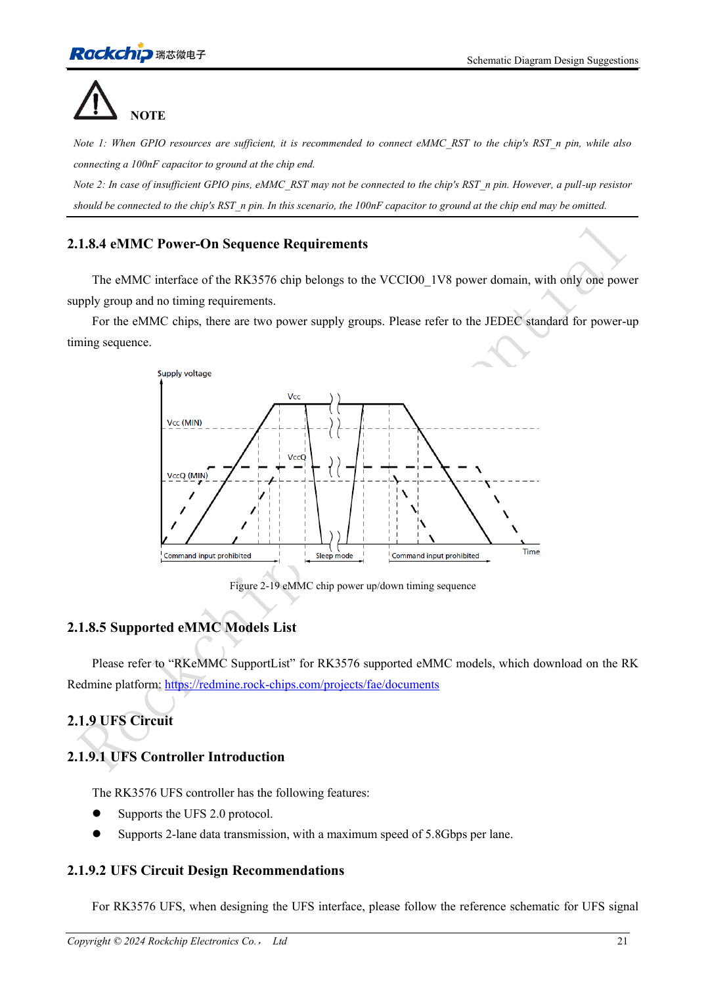

<!-- rk3576-hardware-v11-rest-20261109 -->

# RK3576 eMMC hardware: supplies, pull-ups and HS400 routing

Based on the Chinese and English RK3576 Hardware Design Guide V1.1 (2024-05-28), for SoC-board design. CM5 carriers must follow the module interface; Sige5 can establish a software/peripheral baseline. This guide does not prescribe one SDK/BSP or kernel for every product; verify each board. Values are source references, not ArmSoM measurements.

**RK3576_Hardware_Design_Guide_V1.1_20240528_EN.pdf** · §2.1.8; eMMC PCB

## Plan the complete boot-storage link

RK3576 supports eMMC 5.1, 5.0, 4.51 and 4.41, including HS400ES, HS400, HS200 and DDR50. Controller support alone does not validate every memory part and PCB at that mode. Select the part, Loader, IO supply and routing, then verify negotiated operation. eMMC shares pins with FSPI0; these are not independent boot interfaces that can occupy the same pins simultaneously.

## Treat CMD, D0 and reset separately

VCCIO0 is fixed at 1.8V; connect the memory core and IO supplies according to its own specification and sequence. CMD requires an external 10kΩ pull-up. Reserve a 10kΩ pull-up on D0; other data lines use internal pull-ups in the reference. Place the CLK 0Ω resistor near the SoC and reserve 10pF at the device. Place STRB 0Ω near the device and reserve 47kΩ pull-down. GPIO-controlled reset retains 100nF at the device. Without a GPIO, RST_n still requires a pull-up.

## From routing review to validation

Apply the constraints below and preserve ground return paths at layer changes. Check cold boot, sustained reads/writes, restart and recovery after interrupted power. Record the part, actual bus mode, image version and errors. Operation at a lower frequency is a diagnostic clue, not a substitute for supply and signal-integrity checks.

## Design parameters and review table

| Item | Source reference |
| --- | --- |
| Z | 50Ω ±10% |
| CLK ↔ DATA | <120mil |
| Trace length | <3.5inch |
| Airgap | ≥2W |
| Recommended via count | ≤2 |
| GND via | ≤30mil |

## Source figures

The reference pages below contain the relevant circuit or timing figures; click for full resolution. Designators and component values belong to the reference design, not an ArmSoM product schematic.

English original · PDF 39 · 2-18

English original · PDF 40 · 2-19

## ArmSoM development path

CM5 reduces repeated compute-core design on custom carriers; Sige5 provides a starting point for software and peripheral evaluation. Verify exposed interfaces, connector pins, voltages and image support in board documentation rather than inferring them from SoC features.

- [ArmSoM CM5](https://www.armsom.org/cm5) · [CM5 Docs](https://docs.armsom.org/armsom-cm5)
- [ArmSoM Sige5](https://www.armsom.org/sige5) · [Sige5 Docs](https://docs.armsom.org/armsom-sige5)

## Continue reading

- [RK3576 hardware design: 30 topics](/articles/rk3576-hardware-design-series/)
- [RK3576 UFS hardware: device compatibility, sequencing and differential routing](/articles/rk3576-ufs-hardware-design/)
