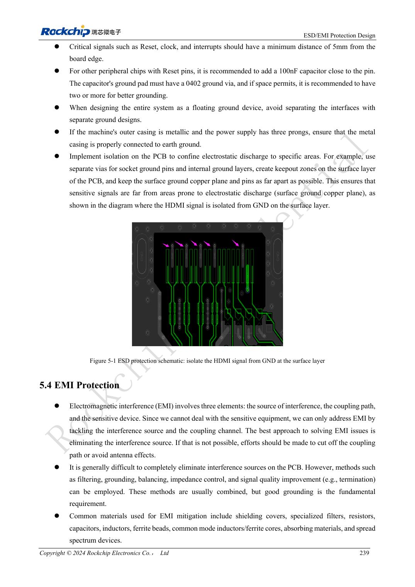

<!-- rk3576-hardware-v11-rest-20261109 -->

# RK3576 ESD and EMI: connector discharge, reset immunity and production review

Based on the Chinese and English RK3576 Hardware Design Guide V1.1 (2024-05-28), for SoC-board design. CM5 carriers must follow the module interface; Sige5 can establish a software/peripheral baseline. This guide does not prescribe one SDK/BSP or kernel for every product; verify each board. Values are source references, not ArmSoM measurements.

**RK3576_Hardware_Design_Guide_V1.1_20240528_EN.pdf** · Chapters 5–6

## Protection needs a real discharge path

Place ESD devices at connector entry so signals pass protection before reaching the chip. Keep ground discharge short and away from sensitive circuitry. High-speed protection must satisfy capacitance as well as voltage requirements. Generic ESD resistor ranges do not replace interface-specific HDMI, USB or SDIO values.

## Review reset, clocks and enclosure together

The guide recommends at least 5mm from board edges for reset, clock and interrupt nets. Place NPOR 100nF near the chip with a nearby ground via. Keep clock damping near the source and prefer inner routing with continuous return. Heatsinks and enclosures can radiate too; validate grounding at system level rather than repeatedly adding common-mode chokes.

## Turn guidance into traceable tests

Record port, polarity, test point, mode and failure symptoms. After ESD check reset, communication, storage and recovery; lack of a crash does not prove data integrity. Before production review soldering, moisture and packaging. Source MSL3 floor life is 168 hours at ≤30°C/60%RH, not a storage promise for arbitrary packaging. Choose test levels from the target product standard; no certification is claimed.

## Design parameters and review table

| Item | Source reference |
| --- | --- |
| Sensitive-net edge distance | ≥5mm |
| NPOR filter | 100nF |
| Clock damping distance | ≤400mil |
| MSL3 reference floor life | 168h; ≤30°C / 60%RH |

## Source figures

The reference pages below contain the relevant circuit or timing figures; click for full resolution. Designators and component values belong to the reference design, not an ArmSoM product schematic.

English original · PDF 258 · 5-1

## ArmSoM development path

CM5 reduces repeated compute-core design on custom carriers; Sige5 provides a starting point for software and peripheral evaluation. Verify exposed interfaces, connector pins, voltages and image support in board documentation rather than inferring them from SoC features.

- [ArmSoM CM5](https://www.armsom.org/cm5) · [CM5 Docs](https://docs.armsom.org/armsom-cm5)
- [ArmSoM Sige5](https://www.armsom.org/sige5) · [Sige5 Docs](https://docs.armsom.org/armsom-sige5)

## Continue reading

- [RK3576 hardware design: 30 topics](/articles/rk3576-hardware-design-series/)
- [RK3576 thermal design: thermal resistance, PCB conduction and sustained loads](/articles/rk3576-thermal-hardware-design/)
