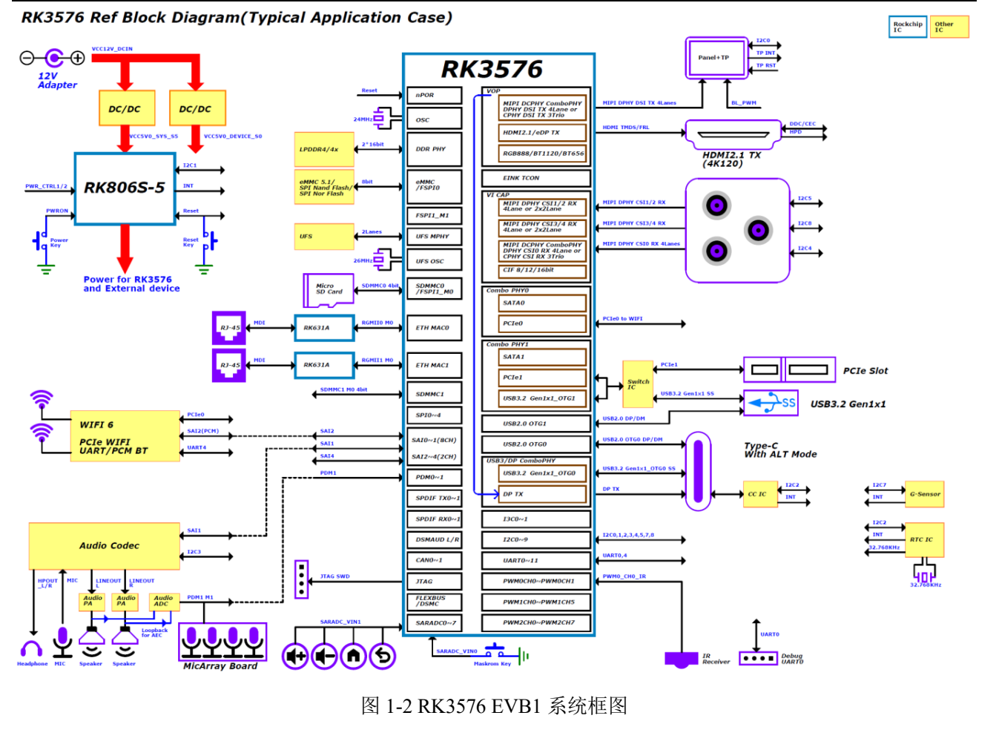
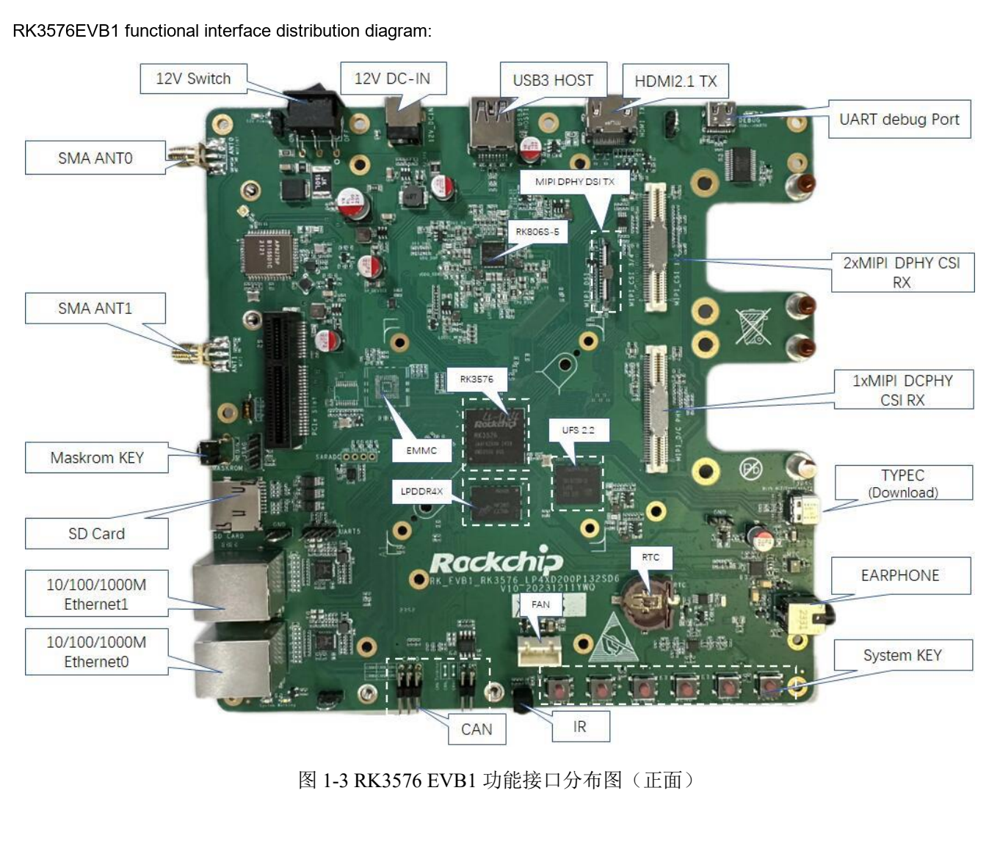
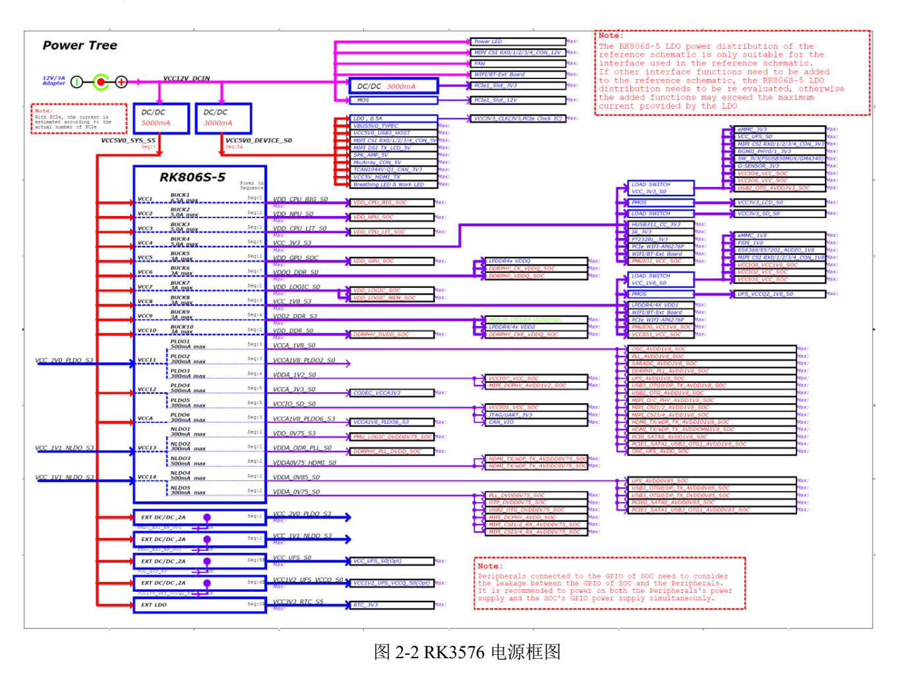

This task-focused guide explains the source with key specifications, limitations and original figures. It is not a page-by-page translation or a complete pin/register manual. Vendor examples are not ArmSoM measurements. Check the actual board revision, schematic, SDK/BSP, kernel and drivers before applying them; no new hardware validation was performed for this article.

**Primary source：** `Rockchip_RK3576_EVB1_User_Guide_V1.0_CN.pdf` · PDF 53 pages.

## Identify the reference revision

The manual targets `RK_EVB1_RK3576_LP4XD200P132SD6_V10_20231211YWQ_final`. Its table lists 8GB LPDDR4x, 128GB UFS and eMMC N/A, with a 12V/3A kit supply. This is EVB1 configuration, not CM5 or Sige5 configuration. Both ArmSoM products use RK3576, but migration requires their own schematics and BSP.


[](/assets/hardware-reference-20261110/rk3576-evb-p12.png)

*RK3576 EVB1 system diagram — Original Chinese figure; no corresponding English figure was found in this batch. `Rockchip_RK3576_EVB1_User_Guide_V1.0_CN.pdf`, PDF p. 12.*


## Identify ports before applying power

The main Type-C handles downloading and DP Alt Mode; another Type-C is USB-UART Debug. Connect debug to the PC, identify its COM port and use the source's `1500000` (1.5M) baud rate. Ensure the serial path supports it and capture logs from reset onward.


[](/assets/localized/figures/en/1002bd9a0aab9fc17048.png)

*RK3576 EVB1 interface layout — Original Chinese figure; no corresponding English figure was found in this batch. `Rockchip_RK3576_EVB1_User_Guide_V1.0_CN.pdf`, PDF p. 14.*


## Loader, MASKROM and USB3 download

1. Match image, Loader, Parameter and Uboot to storage and board revision; back up data.
2. For reference-board MASKROM, connect download Type-C, hold MASKROM, apply power and enable the switch; release after detection.
3. For Loader, hold Volume+(RECOVERY) during power-on/reset and release after detection. The source associates this with low `SARADC_IN1`.
4. The source requires tool v3.28 or later. Its USB3 configuration in `config.ini` is below; device support still determines whether USB3 is selected.

```ini
USB3_TRANSFER=TRUE
```

This is a source example, not a setting for every software release. Consult CM5/Sige5 documentation for buttons, supplies and download ports rather than copying the EVB's 12V procedure.

## Three common interface mistakes

**Slot shape is not link width.** The source describes a PCIex4 connector but lists 1 active lane and an alternative relationship with USB3.0 Host. Check supply, lanes, PHY and BSP before choosing an expansion card; do not infer x4 throughput from the connector.

**A camera connector is not universal plug-and-play.** The guide provides DCPHY/DPHY paths, an 80pin connector and an IMX415 example. The overview gives DCPHY as 1×3 trios CPHY, with differing wording later. Confirm mode using the actual schematic and formal chip information rather than adding interface counts. Power, reset, clock, I2C and driver must agree.

**USB wake depends on hardware power.** Page 30 lists resistor changes keeping Host 5V, USB PHY and oscillator supplied. A software property alone does not guarantee wake. Every resistor reference belongs only to the named EVB revision.


[](/assets/hardware-reference-20261110/rk3576-evb-p23.png)

*RK3576 EVB1 power tree — Original Chinese figure; no corresponding English figure was found in this batch. `Rockchip_RK3576_EVB1_User_Guide_V1.0_CN.pdf`, PDF p. 23.*


## Selected I2C addresses and voltages

| EVB bus | Device | Source address | Voltage |
| --- | --- | --- | --- |
| I2C1_M0 | RK806S-5 | `0x23` | 1.8V |
| I2C2_M0 | HYM8563TS / HUSB311 | `0x51` / `0x4E` | 3.3V |
| I2C3_M0 | ES8388 / ES7202 | `0x11` / `0x30` | 1.8V |
| I2C4_M3 | CAM0 | `0x1A` | 1.8V |

These are selected known entries from p. 23. Other camera, touch and MicArray entries include `TBD`; do not invent addresses. Check conflicts, pull-up supplies and reverse powering during sleep before adding devices.

## Debugging and migration checklist

The manual disables JTAG use with an inserted SD card, and also marks CAN as sharing with SD Card. The fan section lists 12V/5V support, default 12V, but says EVB1 does not yet support Sensor speed control. A connector does not prove closed-loop fan control.

For an image that enables ADB, the source's connection checks are:

```sh
adb devices
adb shell
```

Validate supply, downloading, serial output, storage, display, networking and camera in sequence, then concurrency and suspend/resume. CM5 carriers and Sige5 use their own pins, storage, firmware and power requirements. The EVB provides a troubleshooting method.


## Products and development resources

- **CM5** — [Product](https://www.armsom.org/cm5) · [Documentation](https://docs.armsom.org/armsom-cm5)
- **Sige5** — [Product](https://www.armsom.org/sige5) · [Documentation](https://docs.armsom.org/armsom-sige5)
