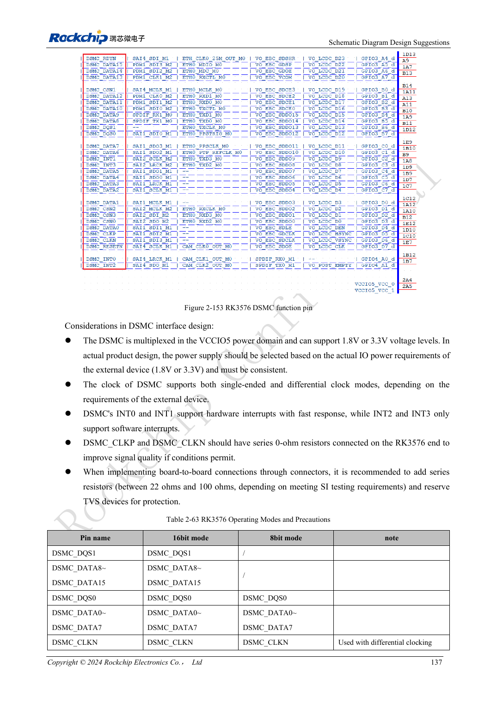

<!-- rk3576-hardware-v11-rest-20261109 -->

# RK3576 FlexBus and DSMC: FPGA, PSRAM and parallel routing

Based on the Chinese and English RK3576 Hardware Design Guide V1.1 (2024-05-28), for SoC-board design. CM5 carriers must follow the module interface; Sige5 can establish a software/peripheral baseline. This guide does not prescribe one SDK/BSP or kernel for every product; verify each board. Values are source references, not ArmSoM measurements.

**RK3576_Hardware_Design_Guide_V1.1_20240528_EN.pdf** · §2.3.11–12; DSMC/FlexBus PCB

## Distinguish the buses first

FlexBus0 transmits or receives; FlexBus1 is receive-only, with 2/4/8/16bit modes and a reference maximum clock of 100MHz. DSMC targets DDR PSRAM or FPGA with 8/16bit, four chip selects and clocks up to 100MHz. Equal width does not make controllers interchangeable; match peer protocol, sampling edges and software.

## IO domains and data packing

FlexBus primarily uses VCCIO5, with extra pins on VCCIO2; match voltages when both are used. Nonstandard widths may be packed wider in memory: 3bit into 4bit and 5/6/7bit into 8bit. Pin width alone does not define buffer layout. DSMC uses VCCIO5; INT0/1 have hardware paths while INT2/3 use software handling, affecting latency budgets.

## Review branches by topology

DSMC limits more than total length: L2/L3 below 500mil, L4 below 1inch, L5 below 100mil; L1 plus the applicable main branch below 5inch, T-branch mismatch below 100mil. Keep the source L1–L5 definitions; numbers cannot be transferred to a different topology. Validate fixed patterns, boundary lengths and continuous transfers for bit order, clock edges and packing errors.

## Design parameters and review table

| Item | Source reference |
| --- | --- |
| Clock | ≤100MHz |
| DSMC Z | 50Ω single / 100Ω differential ±10% |
| DSMC CLK-data | <120mil |
| FlexBus CLK-data | <180mil |
| Main path length | <5inch |

## Source figures

The reference pages below contain the relevant circuit or timing figures; click for full resolution. Designators and component values belong to the reference design, not an ArmSoM product schematic.

English original · PDF 156 · 2-153

## ArmSoM development path

CM5 reduces repeated compute-core design on custom carriers; Sige5 provides a starting point for software and peripheral evaluation. Verify exposed interfaces, connector pins, voltages and image support in board documentation rather than inferring them from SoC features.

- [ArmSoM CM5](https://www.armsom.org/cm5) · [CM5 Docs](https://docs.armsom.org/armsom-cm5)
- [ArmSoM Sige5](https://www.armsom.org/sige5) · [Sige5 Docs](https://docs.armsom.org/armsom-sige5)

## Continue reading

- [RK3576 hardware design: 30 topics](/articles/rk3576-hardware-design-series/)
- [RK3576 control interfaces: UART, I2C/I3C, SPI, CAN and PWM](/articles/rk3576-industrial-control-interfaces/)
- [RK3576 PCB stackup and fanout: six/eight layers and mixed-pitch BGA](/articles/rk3576-pcb-stackup-fanout/)
