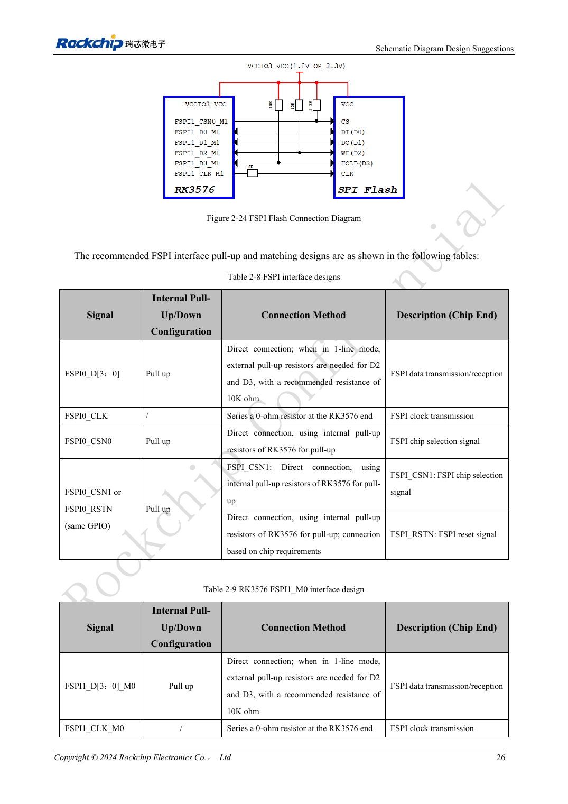
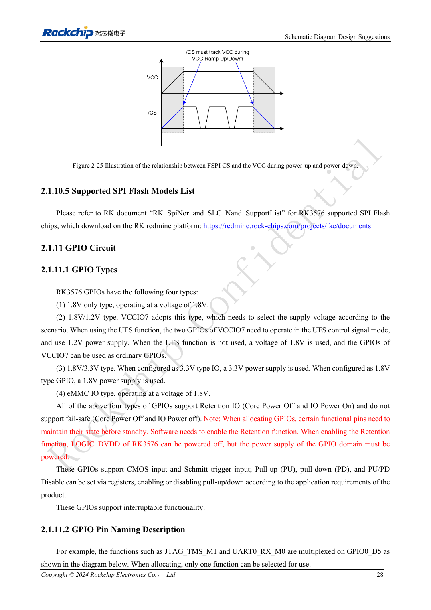

<!-- rk3576-hardware-v11-rest-20261109 -->

# RK3576 FSPI boot hardware: NOR/NAND, voltage and chip-select defaults

Based on the Chinese and English RK3576 Hardware Design Guide V1.1 (2024-05-28), for SoC-board design. CM5 carriers must follow the module interface; Sige5 can establish a software/peripheral baseline. This guide does not prescribe one SDK/BSP or kernel for every product; verify each board. Values are source references, not ArmSoM measurements.

**RK3576_Hardware_Design_Guide_V1.1_20240528_EN.pdf** · §2.1.10; FSPI PCB

## Choose a controller and a complete mux group

Two FSPI controllers support NOR/NAND with SDR 1/2/4-wire operation. FSPI0 shares pins with eMMC and VCCIO0 is 1.8V only. FSPI1_M0 uses VCCIO1 and M1 uses VCCIO3, with 1.8V or 3.3V selected for the entire IO domain. Do not assemble CLK, CS and data from different mux groups.

## Make chip select reliable during power-up

D2/D3 require external 10kΩ pull-ups in single-wire operation. FSPI1_M0 CSN defaults low and needs an external pull-up: the table specifies 2.2kΩ, while prose lists 2.2kΩ/4.7kΩ. Confirm the current reference BOM and timing. Match flash supply to its IO domain and pull CS high with the supply. Boot probing changes pulls on GPIO1_B0 and GPIO1_C2; avoid using these for sensitive enables.

## Validate routing and recoverability together

Reserve 0Ω on CLK at the SoC. Check 50Ω single-ended routing, clock/data mismatch below 200mil and length below 4inch. Keep independent USB recovery access. Test blank flash, a damaged image, power interruption around programming and normal cold boot; one successful download is insufficient.

## Design parameters and review table

| Item | Source reference |
| --- | --- |
| FSPI0 | VCCIO0 = 1.8V |
| FSPI1_M0 / M1 | VCCIO1 / VCCIO3 |
| Z | 50Ω ±10% |
| CLK ↔ DATA | <200mil |
| Trace length | <4inch |

## Source figures

The reference pages below contain the relevant circuit or timing figures; click for full resolution. Designators and component values belong to the reference design, not an ArmSoM product schematic.

English original · PDF 45 · 2-24

English original · PDF 47 · 2-25

## ArmSoM development path

CM5 reduces repeated compute-core design on custom carriers; Sige5 provides a starting point for software and peripheral evaluation. Verify exposed interfaces, connector pins, voltages and image support in board documentation rather than inferring them from SoC features.

- [ArmSoM CM5](https://www.armsom.org/cm5) · [CM5 Docs](https://docs.armsom.org/armsom-cm5)
- [ArmSoM Sige5](https://www.armsom.org/sige5) · [Sige5 Docs](https://docs.armsom.org/armsom-sige5)

## Continue reading

- [RK3576 hardware design: 30 topics](/articles/rk3576-hardware-design-series/)
- [RK3576 UFS hardware: device compatibility, sequencing and differential routing](/articles/rk3576-ufs-hardware-design/)
- [RK3576 SD cards and SDIO Wi-Fi: voltage switching, power and RF layout](/articles/rk3576-sdio-wifi-hardware/)
