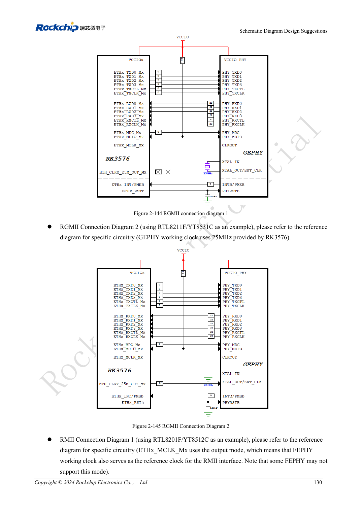
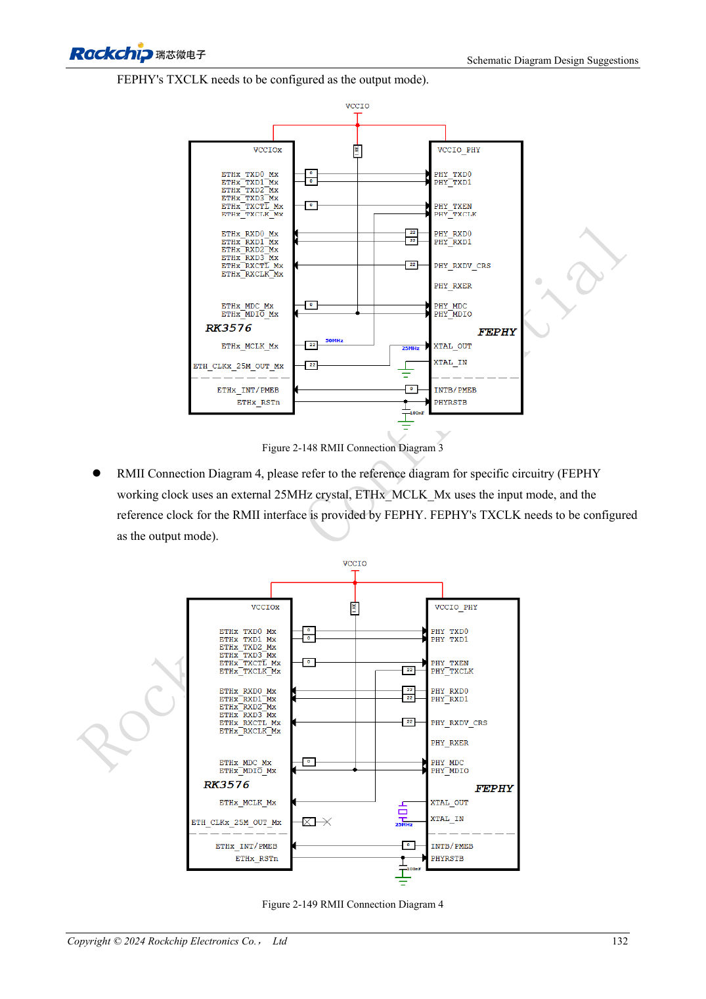

<!-- rk3576-hardware-v11-rest-20261109 -->

# RK3576 Ethernet hardware: RGMII delay, PHY clocks and protection

Based on the Chinese and English RK3576 Hardware Design Guide V1.1 (2024-05-28), for SoC-board design. CM5 carriers must follow the module interface; Sige5 can establish a software/peripheral baseline. This guide does not prescribe one SDK/BSP or kernel for every product; verify each board. Values are source references, not ArmSoM measurements.

**RK3576_Hardware_Design_Guide_V1.1_20240528_EN.pdf** · §2.3.10

## The MAC requires an external PHY

Two GMACs connect to RGMII 10/100/1000Mbps or RMII 10/100Mbps PHYs. GMAC0 M0/M1 uses VCCIO5/VCCIO4; GMAC1 M0/M1 uses VCCIO4/VCCIO3. Select one complete mux group per interface. The guide prefers 1.8V for signal quality, provided the actual PHY supports it.

## Set clock direction and delay once

RMII 50MHz may come from MAC or PHY, matching the schematic; both must not drive it. The RGMII reference assigns TX timing to MAC and RX timing to PHY; RTL8211F/FI enables a 2ns RXCLK delay. Recheck internal delays and device tree after changing PHY to avoid double delay. Reserve TX 0Ω at SoC, use RX 22Ω at PHY and MDIO pull-up 1.5–1.8kΩ.

## Connector-side design also matters

The guide specifies 3.3V for RTL8211F/FI reset with nearby 100nF; do not infer reset voltage from 1.8V RGMII. Follow the PHY vendor for transformer centre taps and verify RJ45 pin mapping for latch orientation. Test speeds, concurrent ports, long cables, reboot and wake, counting packet errors rather than only watching link LEDs.

## Design parameters and review table

| Item | Source reference |
| --- | --- |
| RMII reference | 50MHz |
| PHY crystal example | 25MHz, ±20ppm |
| MDIO pull-up | 1.5–1.8kΩ |
| RX series | 22Ω at PHY |
| RTL8211F/FI RX delay example | 2ns |

## Source figures

The reference pages below contain the relevant circuit or timing figures; click for full resolution. Designators and component values belong to the reference design, not an ArmSoM product schematic.

English original · PDF 149 · 2-144

English original · PDF 151 · 2-149

## ArmSoM development path

CM5 reduces repeated compute-core design on custom carriers; Sige5 provides a starting point for software and peripheral evaluation. Verify exposed interfaces, connector pins, voltages and image support in board documentation rather than inferring them from SoC features.

- [ArmSoM CM5](https://www.armsom.org/cm5) · [CM5 Docs](https://docs.armsom.org/armsom-cm5)
- [ArmSoM Sige5](https://www.armsom.org/sige5) · [Sige5 Docs](https://docs.armsom.org/armsom-sige5)

## Continue reading

- [RK3576 hardware design: 30 topics](/articles/rk3576-hardware-design-series/)
- [RK3576 audio hardware: SAI, PDM, ASRC and microphone layout](/articles/rk3576-audio-hardware-design/)
- [RK3576 GPIO and SARADC: voltage domains, back-power and key sensing](/articles/rk3576-gpio-saradc-hardware/)
