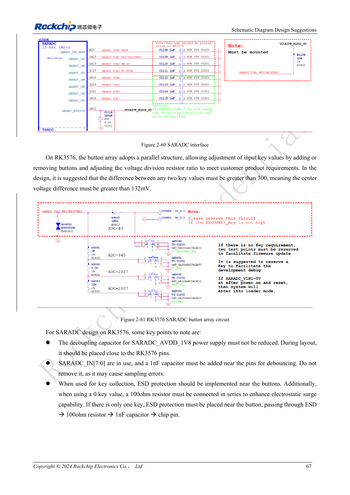

<!-- rk3576-hardware-v11-rest-20261109 -->

# RK3576 GPIO and SARADC: voltage domains, back-power and key sensing

Based on the Chinese and English RK3576 Hardware Design Guide V1.1 (2024-05-28), for SoC-board design. CM5 carriers must follow the module interface; Sige5 can establish a software/peripheral baseline. This guide does not prescribe one SDK/BSP or kernel for every product; verify each board. Values are source references, not ArmSoM measurements.

**RK3576_Hardware_Design_Guide_V1.1_20240528_EN.pdf** · §2.1.11; §2.3.2

## GPIO voltage belongs to the entire domain

PMUIO0 and VCCIO0 are fixed at 1.8V. VCCIO7 uses 1.2V for UFS and otherwise 1.8V per the guide. PMUIO1 and VCCIO1–6 support 1.8/3.3V. Changing one pin’s function does not give other pins in the same domain a different voltage. Suffixes _u/_d/_z denote pull-up, pull-down and high impedance; check boot probing and sleep states too.

## Prevent back-power in off and standby states

The guide supports retention with core power off and IO still powered, but not fail-safe inputs when both core and IO are off. A powered peripheral must not drive a high level into an unpowered domain. Review pull-up ownership, enable order and isolation together. Check per-pin drive strength rather than assuming one current capability for every GPIO.

## SARADC keys and boot roles

SARADC provides 12bit, up to 1MS/s and eight 0–1.8V inputs. IN0 serves boot configuration; IN1 recovery requires a 10kΩ, 1% pull-up even without a button. Recommended key spacing exceeds 300 counts or 132mV, with nearby 1nF filtering. Reference protection is connector→ESD→100Ω→1nF→chip. Never connect a 3.3V signal directly to the ADC.

## Design parameters and review table

| Item | Source reference |
| --- | --- |
| SARADC | 12bit; 0–1.8V |
| IN1 pull-up | 10kΩ ±1% |
| Key-level separation | >300 counts / >132mV |
| Filter capacitor | 1nF |

## Source figures

The reference pages below contain the relevant circuit or timing figures; click for full resolution. Designators and component values belong to the reference design, not an ArmSoM product schematic.

English original · PDF 86 · 2-61

## ArmSoM development path

CM5 reduces repeated compute-core design on custom carriers; Sige5 provides a starting point for software and peripheral evaluation. Verify exposed interfaces, connector pins, voltages and image support in board documentation rather than inferring them from SoC features.

- [ArmSoM CM5](https://www.armsom.org/cm5) · [CM5 Docs](https://docs.armsom.org/armsom-cm5)
- [ArmSoM Sige5](https://www.armsom.org/sige5) · [Sige5 Docs](https://docs.armsom.org/armsom-sige5)

## Continue reading

- [RK3576 hardware design: 30 topics](/articles/rk3576-hardware-design-series/)
- [RK3576 Ethernet hardware: RGMII delay, PHY clocks and protection](/articles/rk3576-gmac-hardware-design/)
- [RK3576 control interfaces: UART, I2C/I3C, SPI, CAN and PWM](/articles/rk3576-industrial-control-interfaces/)
