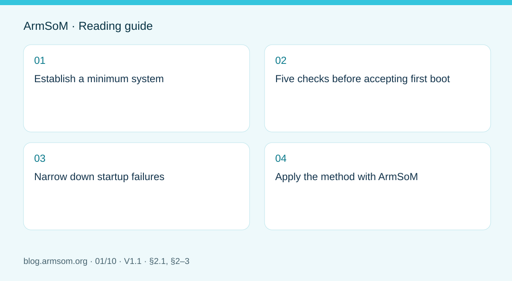

# RK3576 hardware bring-up: minimum system and first-power checks

## Scope and sources

This is a task-focused engineering guide, not a page-by-page translation of the complete PDF. Source examples are not ArmSoM measurements. Check voltages, pins, SDK/BSP and kernel against the actual board revision.

**Rockchip:** `RK3576_Hardware_Design_Guide_V1.1_20240528_CN.pdf` · V1.1 · §2.1, §2–3

## Establish a minimum system

Section 2.1 of the RK3576 Hardware Design Guide V1.1 covers clocks, reset, boot, JTAG, UART and memory. Start with a configuration that boots repeatedly, provides a serial log and permits recovery. Add cameras, displays and high-speed peripherals one at a time so that failures can be associated with a specific change.

DDR, clocks and regulators are part of a custom SoC board's minimum system. With CM5, begin with the module interface and carrier documentation instead: internal chip rails are not module supply inputs. Sige5 can establish an application baseline, but does not validate the electrical design of another board.

## Five checks before accepting first boot

| Area | Before power | Evidence to retain |
| --- | --- | --- |
| Power | BOM, voltage, polarity, shorts and current limit | Input current, rails and startup transients |
| Clock | Crystal, load network and routing | Frequency and waveform measured with a suitable probing method |
| Reset | Supply domain, pulls and reset sources | Timing of rail stabilization and reset release |
| Boot | Media, configuration resistors, Loader and board revision | Complete boot log through the kernel |
| Debug | UART, recovery path and test points | Repeatable cold boots, resets and recovery |

Section 2.1.1 describes a main-clock circuit using an external 24MHz crystal. It does not instruct CM5 carrier designers to duplicate that circuit. Reset and UART voltage levels must also match the actual signal domains.

## Narrow down startup failures

For a silent serial port, check adapter voltage, ground, TX/RX, baud rate, power and reset before replacing the image. If Loader runs but the kernel does not, check DDR initialization, storage, image and device-tree compatibility. Once Linux boots, investigate peripheral power, pin multiplexing, clocks and drivers separately.

Change one variable at a time. Record schematic and module revisions, the image checksum and logs. A successful boot is followed by repeated cold starts, power-loss recovery and load testing; one boot is not a production acceptance test.

## Apply the method with ArmSoM

Establish a software baseline on the CM5 companion IO board before moving to a custom carrier. On Sige5, record peripheral models, cables and power conditions. This workflow is an engineering checklist, not a universal voltage table or a substitute for a board-specific review.

## Source illustration

Original from the English document, shared by EN/RU/DE. Reference design, not an ArmSoM board schematic.

`RK3576_Hardware_Design_Guide_V1.1_20240528_EN.pdf` · PDF p. 22.

## Products and development resources

- **CM5** — [Product page](https://www.armsom.org/cm5) · [Documentation](https://docs.armsom.org/armsom-cm5)
- **Sige5** — [Product page](https://www.armsom.org/sige5) · [Documentation](https://docs.armsom.org/armsom-sige5)

## Continue this series

- [ArmSoM CM5 carrier-board checklist: power, boot and interface planning](/articles/019-cm5-carrier-production/)
- [RK3576 high-speed interfaces: review schematics and PCB together](/articles/rk3576-high-speed-interface-design/)
- [RK3588S hardware design: from a reference circuit to a CM7s carrier](/articles/rk3588s-cm7s-carrier-design/)
- [RK3588 edge-AI hardware: plan power, cooling and expansion together](/articles/rk3588-edge-ai-hardware-design/)
- [RK3588 high-speed PCB review: stackup, impedance and routing](/articles/rk3588-high-speed-pcb-review/)
- [RK3506 industrial HMI hardware: choosing a CM1 or Forge1 development path](/articles/rk3506-industrial-hmi-hardware/)
- [RK3308 hardware variants: compatibility checks for P2 Pro audio projects](/articles/rk3308-hardware-variant-compatibility/)
- [RK3588S versus RK3588S2: what to check before a hardware revision](/articles/rk3588s-rk3588s2-hardware-differences/)
- [Rockchip prototype to production: process requirements and test records](/articles/rockchip-hardware-production-checklist/)
