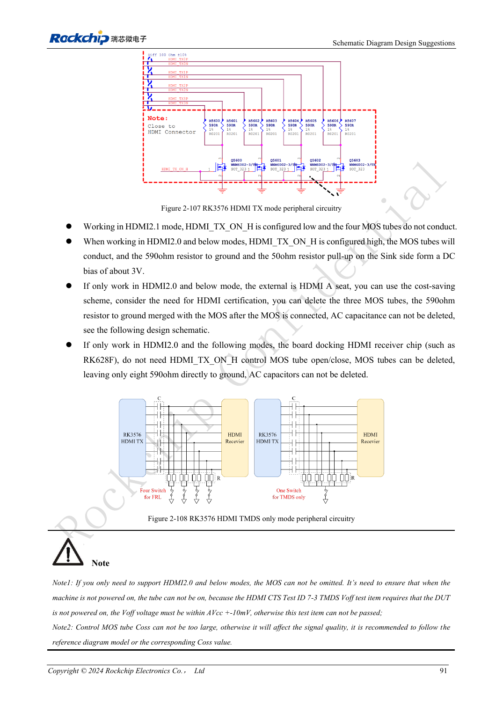
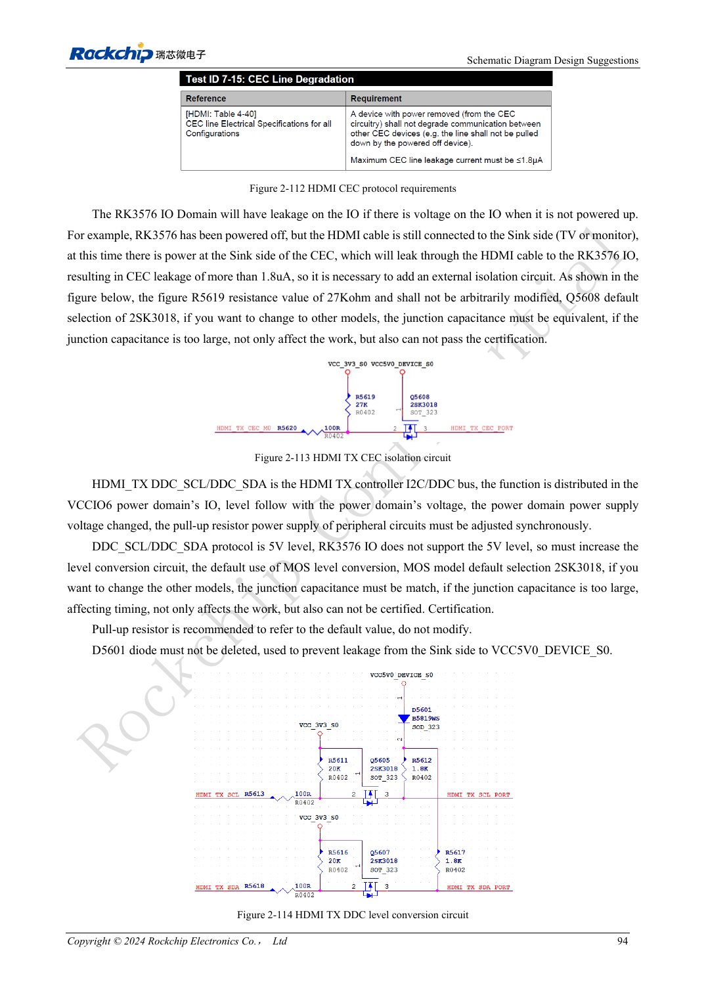

<!-- rk3576-hardware-v11-rest-20261109 -->

# RK3576 HDMI hardware: FRL/TMDS, DDC levels and protection

Based on the Chinese and English RK3576 Hardware Design Guide V1.1 (2024-05-28), for SoC-board design. CM5 carriers must follow the module interface; Sige5 can establish a software/peripheral baseline. This guide does not prescribe one SDK/BSP or kernel for every product; verify each board. Values are source references, not ArmSoM measurements.

**RK3576_Hardware_Design_Guide_V1.1_20240528_EN.pdf** · §2.3.8.1; HDMI PCB

## Shared PHY and output modes

HDMI and eDP share a PHY, so the same PHY cannot provide both modes simultaneously. HDMI 2.1 uses FRL; lower-version compatibility uses TMDS. Place the 8.2kΩ, 1% HDMI/EDP_TX_REXT resistor to ground near the SoC without arbitrary value changes. Use 220nF channel coupling, preferably 0201, rather than copying another HDMI chip’s direct connection.

## TMDS bias and DDC protection

HDMI_TX_ON_H is low for FRL and high for TMDS, controlling the reference MOS/590Ω bias network. External Type-A and onboard receivers differ: the RK628F onboard simplification is not an external-connector template. DDC involves 5V while SoC IO is not 5V tolerant. Keep level shifting and reverse-current protection; check CEC/HPD domains and leakage.

## Validate the complete channel

The connector supply reference is 4.8–5.3V with 1μF at the connector. High-speed ESD capacitance is at most 0.2pF; other signals use at most 1pF in the guide. Preserve ground and short stubs; follow reference treatment beneath 590Ω pads. Test hot-plug, multiple cables/displays, mode changes and wake-up rather than accepting one lit display.

## Design parameters and review table

| Item | Source reference |
| --- | --- |
| Zdiff | 100Ω ±10% |
| Intra-pair mismatch | <6mil |
| Inter-pair mismatch | <480mil |
| Trace length | <4inch |
| AC | 220nF ±20% |
| Airgap | ≥7W |

## Source figures

The reference pages below contain the relevant circuit or timing figures; click for full resolution. Designators and component values belong to the reference design, not an ArmSoM product schematic.

English original · PDF 110 · 2-107

English original · PDF 113 · 2-113

## ArmSoM development path

CM5 reduces repeated compute-core design on custom carriers; Sige5 provides a starting point for software and peripheral evaluation. Verify exposed interfaces, connector pins, voltages and image support in board documentation rather than inferring them from SoC features.

- [ArmSoM CM5](https://www.armsom.org/cm5) · [CM5 Docs](https://docs.armsom.org/armsom-cm5)
- [ArmSoM Sige5](https://www.armsom.org/sige5) · [Sige5 Docs](https://docs.armsom.org/armsom-sige5)

## Continue reading

- [RK3576 hardware design: 30 topics](/articles/rk3576-hardware-design-series/)
- [RK3576 display hardware: MIPI, RGB, backlight and touch power](/articles/rk3576-display-panel-hardware/)
- [RK3576 DP/eDP design: PHY allocation, AUX and coupling discrepancies](/articles/rk3576-dp-edp-hardware-design/)
