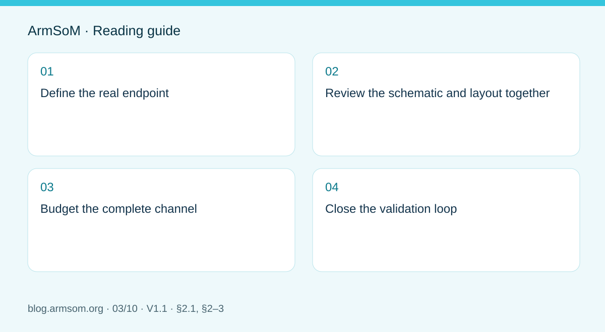

# RK3576 high-speed interfaces: review schematics and PCB together

## Scope and sources

This is a task-focused engineering guide, not a page-by-page translation of the complete PDF. Source examples are not ArmSoM measurements. Check voltages, pins, SDK/BSP and kernel against the actual board revision.

**Rockchip:** `RK3576_Hardware_Design_Guide_V1.1_20240528_CN.pdf` · V1.1 · §2.1, §2–3

## Define the real endpoint

The source covers interface circuits in §2.3, signals at 8GT/s and above in §3.4, and module-specific PCB guidance in §3.5. Begin with the peripheral, operating mode, connector and cable. Resources shown in a chip diagram are not necessarily all exposed or simultaneously available on a module.

List PHY sharing, control buses, supplies and software dependencies for cameras, displays, storage and networking. Check CM5 module pins or the actual Sige5 board revision before allocating resources.

## Review the schematic and layout together

| Area | Schematic review | Layout review |
| --- | --- | --- |
| Differential channel | Direction, coupling and protection | Impedance, reference planes, vias and pad discontinuities |
| Peripheral control | Reset, enable, buses and voltage domains | Separation and accessible test points |
| Connector | Exact part, pins and shield connection | Footprint, return path and orientation |
| Power | Peak current and sequencing | Decoupling, current loops and heat path |

The guide discusses BGA pads, glass-weave effects, differential vias, coupling capacitors, ESD parts and connector pads. Local reference-plane voiding addresses specific parasitics; it is not permission to split ground under arbitrary high-speed routes.

## Budget the complete channel

Include module traces, connectors, carrier, cable and peripheral PCB. Length matching is only one constraint: stubs, reference changes and protection capacitance can also reduce margin. Obtain numerical limits from the relevant interface mode and the fabricator's stackup calculation, not from an unrelated bus.

## Close the validation loop

Test each interface at the intended rate, then test adjacent interfaces and application concurrency. Failures under combined load also require investigation of power transients, heat, bandwidth and drivers. Record cables, peripherals, BSP and board revisions. Reducing speed may help diagnosis, but does not pass the original speed requirement. Revalidate the actual channel when moving a CM5 or Sige5 prototype into a custom product.

## Source illustration

Original from the English document, shared by EN/RU/DE. Reference design, not an ArmSoM board schematic.

`RK3576_Hardware_Design_Guide_V1.1_20240528_EN.pdf` · PDF p. 22.

## Products and development resources

- **CM5** — [Product page](https://www.armsom.org/cm5) · [Documentation](https://docs.armsom.org/armsom-cm5)
- **Sige5** — [Product page](https://www.armsom.org/sige5) · [Documentation](https://docs.armsom.org/armsom-sige5)

## Continue this series

- [RK3576 hardware bring-up: minimum system and first-power checks](/articles/rk3576-hardware-bringup/)
- [ArmSoM CM5 carrier-board checklist: power, boot and interface planning](/articles/019-cm5-carrier-production/)
- [RK3588S hardware design: from a reference circuit to a CM7s carrier](/articles/rk3588s-cm7s-carrier-design/)
- [RK3588 edge-AI hardware: plan power, cooling and expansion together](/articles/rk3588-edge-ai-hardware-design/)
- [RK3588 high-speed PCB review: stackup, impedance and routing](/articles/rk3588-high-speed-pcb-review/)
- [RK3506 industrial HMI hardware: choosing a CM1 or Forge1 development path](/articles/rk3506-industrial-hmi-hardware/)
- [RK3308 hardware variants: compatibility checks for P2 Pro audio projects](/articles/rk3308-hardware-variant-compatibility/)
- [RK3588S versus RK3588S2: what to check before a hardware revision](/articles/rk3588s-rk3588s2-hardware-differences/)
- [Rockchip prototype to production: process requirements and test records](/articles/rockchip-hardware-production-checklist/)
